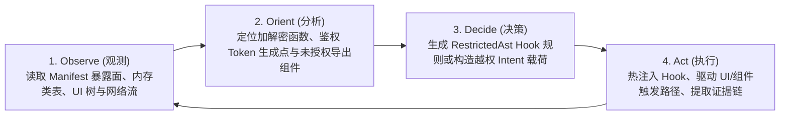

# AI Agent 控制面与 MCP 安全测试规范 (Agent & MCP Design)

本文档定义 Tripoder 面向外部 AI Agent（如 Claude Code、Cursor、自研安全智能体）暴露的 **Model Context Protocol (MCP)** 控制面架构、P-256 加密会话租约模型、24 个标准工具原语以及自动化安全测试闭环（OODA Loop）。

---

## 1. 架构定位：为什么将沙箱改造为 AI 原生基础设施

传统移动安全测试依赖人工编写 Frida 脚本、手动配置抓包证书与零散的 `adb` 命令，存在三大痛点：
1. **环境易碎**：Frida Server 注入特征明显，极易触发应用自杀或反调试。
2. **上下文割裂**：静态 Manifest/Dex 信息、动态 Hook 命中日志、UI 树状态与网络流量分散在不同工具中，AI Agent 难以形成统一推理闭环。
3. **脚本失控风险**：任意自由代码注入容易导致目标进程崩溃且缺乏确定性的回滚围栏。

Tripoder 将**免 Root 虚拟沙箱**与**内建 MCP Server (`EngineAgentHttpServer` / `EngineAgentGatewayProvider`)** 深度融合，使 AI Agent 能够通过标准工具调用直接驱动沙箱内的目标应用。

---

## 2. 安全控制通道与会话租约 (`AgentSession` & P-256 签名)

为了防止未授权应用或恶意脚本滥用沙箱控制能力，所有外部 Agent 控制请求均受会话租约与加密签名保护：

1. **会话握手 (`openSession` / `renewSession` / `closeSession`)**：
   - Agent 客户端生成或持有 **ECDSA P-256** 密钥对，向 `EngineAgentGatewayProvider` 申请控制会话。
   - 宿主签发具有明确 TTL 的 `agentSessionId` 与单调递增的请求序号窗口（`sequenceNumber`）。
2. **请求认证与防重放**：
   - 敏感写操作（如注入 Hook 规则、启动/停止应用、执行 UI 点击、读取沙箱私有文件）必须携带针对 `(agentSessionId, sequenceNumber, toolName, payloadSha256)` 的 P-256 签名。
   - 宿主校验签名与序号单调性，拒绝过期或重放的指令。
3. **本地 HTTP MCP 桥接 (`EngineAgentHttpServer`)**：
   - 在开发调试模式下，宿主提供绑定于 `127.0.0.1`（通过 `adb forward` 映射至宿主机）的标准 JSON-RPC 2.0 / MCP 端点，供桌面端 AI Agent 零配置接入。

---

## 3. MCP 核心工具矩阵 (24 Tools)

Tripoder MCP Server 按职责划分为五大能力域：

### 3.1 沙箱生命周期与环境管理 (Lifecycle & Space)
| 工具名称 | 功能说明 |
| --- | --- |
| `list_spaces` / `create_space` | 查询或创建具有独立设备指纹（`android_id`/机型/定位）的虚拟空间 |
| `install_app` / `uninstall_app` | 将宿主机或设备路径上的 APK 导入指定 Space 并生成组件索引 |
| `list_installed_apps` | 查询指定 Space 下的已安装应用、生成号（`installGeneration`）与数据目录标识 |
| `launch_app` / `stop_app` | 免网关直接拉起目标应用首屏 Activity，或强行驱逐并停止其占用的所有 `:slotN` 进程 |
| `get_runtime_status` | 获取 8 个进程槽位（`slot0..7`）的实时绑定状态、PID 与活跃组件租约快照 |

### 3.2 应用静态与运行时内省 (Introspection)
| 工具名称 | 功能说明 |
| --- | --- |
| `get_app_manifest` | 获取目标应用的完整组件清单（Exported Activities/Services/Providers/Receivers、权限与 `meta-data`） |
| `search_classes` / `get_class_methods` | 在运行中的 `:slotN` 进程内通过 `ClassLoader` 枚举匹配的类名、方法签名与字段结构（无视常规静态混淆与动态 Dex 加载） |
| `list_native_libraries` / `list_exports` | 枚举目标进程已加载的 `.so` 模块基址及导出符号表 |

### 3.3 动态 Hook 与主动调用 (Dynamic Hook & Active RPC)
| 工具名称 | 功能说明 |
| --- | --- |
| `upsert_hook_rule` / `remove_hook_rule` | 下发受限 TypeScript（编译为 `RestrictedAst`）或声明式 Java/Native Hook 规则，支持热更新与代数原子切换 |
| `list_hook_rules` | 查看当前 Project 激活的 Hook 规则及命中计数 |
| `query_hook_events` | 按时间窗口、方法名或关键字检索捕获到的入参、返回值（支持 `byte[]` Hex/Base64）、线程信息与调用栈 |
| `invoke_java_method` | 在目标 Guest 进程上下文中主动反射调用指定静态方法或已捕获实例的方法（如直接调用签名/加解密函数验证算法） |

### 3.4 存储与网络流量审计 (Storage & Network Audit)
| 工具名称 | 功能说明 |
| --- | --- |
| `list_sandbox_files` / `read_sandbox_file` | 浏览并读取目标应用在沙箱隔离目录下的文件、SharedPreferences XML 内容 |
| `query_sandbox_sqlite` | 对目标应用沙箱内的 SQLite 数据库执行只读 SQL 查询，审计明文敏感数据落盘问题 |
| `query_network_flows` | 获取沙箱内捕获的 HTTP/HTTPS 明文请求与响应流（URL、Headers、Body、TLS 证书信息） |

### 3.5 UI 观测与交互自动化 (UI & Component Driving)
| 工具名称 | 功能说明 |
| --- | --- |
| `dump_ui_hierarchy` / `capture_screenshot` | 获取当前前台 Guest Activity 的语义化 View 树（坐标、文本、Resource ID、可点击性）与屏幕截图 |
| `perform_ui_action` | 在 Guest Activity 内执行点击、输入文本、滑动或返回操作 |
| `start_exported_component` | 构造自定义 Intent（含 Extras、Flags、Data URI）直接触发目标应用的任意 Activity / Service / Receiver / Provider，用于组件越权与 Fuzz 测试 |

---

## 4. AI 自动化安全测试闭环 (OODA Loop)

基于上述 MCP 原语，AI Agent 可以在无需人工介入的情况下执行完整的移动应用安全评估闭环：

### 典型自动化分析场景

1. **接口签名与加密算法逆向**：
   - Agent 通过 `query_network_flows` 发现请求头包含 `X-Sign` ──► 使用 `search_classes` 搜索关键字定位签名类 ──► 调用 `upsert_hook_rule` 对候选方法与 `MessageDigest`/`Mac` 下发 Hook ──► 调用 `perform_ui_action` 触发刷新 ──► 从 `query_hook_events` 获取明文入参、`byte[]` 密钥与调用栈，并通过 `invoke_java_method` 直接做 RPC 验算。
2. **隐私合规与敏感数据明文落盘检测**：
   - 在应用冷启动阶段预置对 `DeviceId`/`IMEI`/定位/剪贴板读取的 Hook 规则，记录未同意隐私协议前的敏感调用栈；同时通过 `list_sandbox_files` 与 `query_sandbox_sqlite` 自动扫描 SharedPreferences 与数据库中的明文 Token、密码或身份证号。
3. **导出组件越权与 Intent Fuzzing**：
   - 解析 `get_app_manifest` 中所有未设权限保护的组件与 DeepLink ──► 自动合成包含边界值或恶意 URI 的 Intent 调用 `start_exported_component` ──► 结合崩溃监控与文件访问日志判定是否存在任意文件读写、WebView 任意 URL 加载或崩溃拒绝服务漏洞。
