# Tripoder AI Agent 自动化安全测试架构与演进路线图

更新时间：2026-10-18。本文基于第一性原理拆解“AI Agent 通过 MCP 驱动 Tripoder 完成移动应用端侧（Client-Side）与 API 接口（Server-Side）自动化安全测试”的核心架构差距、技术设计及分阶段实施方案。

---

## 一、 第一性原理剖析：自动化应用与 API 安全测试的本质

当用户向 AI Agent 下达高层指令（如：“对应用 `XXX` 进行全面安全测试，挖掘所有端侧安全问题与所有 API 接口安全问题”）时，Agent 要独立闭环完成任务，本质上必须打通以下 **四个确定性阶段（OODA Loop）**：

```mermaid
flowchart LR
  subgraph S1["1. 攻击面测绘 (Observe)"]
    M1["Manifest 与导出组件审计"]
    M2["DEX 类/方法与 Native 符号枚举"]
    M3["沙盒文件/SQLite/SharedPreferences 审计"]
    M4["运行期 API 流量与加签点捕获"]
  end

  subgraph S2["2. 假设与载荷构造 (Orient)"]
    O1["端侧配置与组件权限缺陷分析"]
    O2["加解密/签名函数 (Cipher/Sign) 定位"]
    O3["API 鉴权/越权/参数变异策略生成"]
  end

  subgraph S3["3. 模拟触发与注入发包 (Act)"]
    A1["UI 自动化遍历 (点击/输入/滑动) 触发业务流"]
    A2["挂载 Java/Native Hook 拦截与修改字节流"]
    A3["端侧主动调用 (guest_invoke) 计算合法签名"]
    A4["容器网络上下文内主动发包与重放 (http_send)"]
  end

  subgraph S4["4. 证据核验与归档 (Verify)"]
    V1["比对 HTTP 响应状态与敏感数据差异"]
    V2["采集调用栈、明文落盘与异常崩溃证据"]
    V3["停用 Hook 恢复现场并输出结构化报告"]
  end

  S1 --> S2 --> S3 --> S4
  S4 -->|迭代深挖深层业务| S1
```

---

## 二、 现状基线与五大核心差距（Gap Analysis）

### 2.1 当前已具备的底座能力
1. **免 Root 单包虚拟容器（[`android/runtime`](file:///Users/like/code/tripoder/android/runtime/README.md)）**：`dev.tripoder.engine` 提供 `:authority` 控制中枢与 `:slot0..7` 隔离工作进程，具备组件路由、文件沙盒重定向与系统服务门面。
2. **自研双栈 Hook 内核（[`android/self-hook`](file:///Users/like/code/tripoder/android/self-hook/README.md)）**：支持 ART Java 方法与 ARM64 Native 导出函数拦截，无 Frida 特征依赖。
3. **受限 TypeScript AST 解释器（[`src/draft.ts`](file:///Users/like/code/tripoder/src/draft.ts) / [`src/plan.ts`](file:///Users/like/code/tripoder/src/plan.ts)）**：编译期阻断非法语法与死循环，支持 `ctx.debug.emitEvent` 有界遥测事件队列。
4. **基础 MCP 协议桥（[`agent/tools.mjs`](file:///Users/like/code/tripoder/agent/tools.mjs)）**：已跑通 P-256 双向签名校验、持久化操作账本（`operationId`）及类搜索、方法观察、脚本激活、基础 UI 视图树提取。

### 2.2 距离目标构想的五大核心差距

| 维度 | 核心差距描述 | 根本原因（代码定位） | 解决方案 |
| :--- | :--- | :--- | :--- |
| **Gap 1：API 流量捕获、端侧加签与主动发包缺失** | Agent 无法看到 App 发出的 HTTP 请求，无法调用端侧加签函数，也无法主动发包测试 API 越权与参数篡改 | [`agent/tools.mjs`](file:///Users/like/code/tripoder/agent/tools.mjs) 缺少网络流量读取、主动发包和客体方法主动调用（RPC）工具 | 新增 `network_traffic_get`（容器内结构化流量池）、`http_send_request`（客体网络上下文内主动发包）与 `guest_invoke`（主动调用客体加签/加密方法） |
| **Gap 2：Hook 类型系统不支持 `byte[]` 字节流** | 无法 Hook 加解密（`Cipher.doFinal(byte[])`）、摘要计算（`MessageDigest`）及二进制协议封装方法 | [`src/evidence.ts`](file:///Users/like/code/tripoder/src/evidence.ts) 与 [`JavaHookValues.java`](file:///Users/like/code/tripoder/android/runtime/src/dev/tripoder/runtime/script/JavaHookValues.java) 仅放行基本标量与 `String` | 在 TypeScript SDK 与 Java 脚本引擎中打通 `byte[]`（`[B`）类型，采用有界 Hex 编码实现零堆逃逸的字节流读取与篡改 |
| **Gap 3：端侧安全攻击面与沙盒落盘审计缺失** | Agent 无法直接获取导出组件清单、权限配置，也无法检查 SharedPreferences/SQLite 是否明文落盘敏感凭据 | 容器虽持有 `PackageInfo` 与 `RuntimeStorage`，但未在 [`SelfHookControl.java`](file:///Users/like/code/tripoder/android/runtime/src/dev/tripoder/runtime/script/SelfHookControl.java) 暴露审计入口 | 新增 `manifest_inspect`（导出四大组件暴露面、权限、备份/明文流量标志及 Intent Filter）与 `storage_inspect`（审计沙盒 `shared_prefs`、`databases`、`files`） |
| **Gap 4：UI 业务流驱动能力不足** | Agent 只能点击坐标/文本或发按键，无法向输入框填入测试账号/Payload，也无法滑动长列表触发深层 API | [`RuntimeStartupDiagnostics.java`](file:///Users/like/code/tripoder/android/runtime/src/dev/tripoder/runtime/RuntimeStartupDiagnostics.java) 的 `dispatchUiAction` 仅实现了 `tap`、`clickText`、`key` | 扩展 `dispatchUiAction` 支持 `setText`（按资源 ID/提示词/文本定位 `EditText` 注入文本）与 `swipe`（平滑触控滑动） |
| **Gap 5：容器生命周期与会话配额受限** | 会话强绑定单个存活 `processGeneration`，无法跨进程崩溃/重启，且单会话限制 256 次请求 | [`RuntimeAgentSessions.java`](file:///Users/like/code/tripoder/android/engine/src/dev/tripoder/runtime/RuntimeAgentSessions.java) 与 [`AgentContactLease.java`](file:///Users/like/code/tripoder/android/engine/src/dev/tripoder/runtime/AgentContactLease.java) 预算静态受限 | 分阶段扩展应用启动/重启控制与会话操作容量，支持长周期安全评估任务 |

---

## 三、 本轮落地的核心能力规范

遵循 **100% 净室自研** 与 **零隐式 Fallback** 原则，本轮率先在代码库中落地以下核心能力闭环：

### 3.1 扩展 `byte[]`（`[B`）一等公民 Hook 支持
- **契约定义**：
  - 在 [`src/evidence.ts`](file:///Users/like/code/tripoder/src/evidence.ts)、[`HookEvidence.java`](file:///Users/like/code/tripoder/android/runtime/src/dev/tripoder/runtime/script/HookEvidence.java)、[`JavaHookValues.java`](file:///Users/like/code/tripoder/android/runtime/src/dev/tripoder/runtime/script/JavaHookValues.java) 与 [`ScriptValues.java`](file:///Users/like/code/tripoder/android/runtime/src/dev/tripoder/runtime/script/ScriptValues.java) 中新增对 Java `byte[]`（反射类型名 `[B` 及源码别名 `byte[]`）的支持。
  - **编码边界**：`byte[]` 在脚本层表示为偶数长度的十六进制字符串（`[0-9a-fA-F]*`，最大 4096 字节 / 8192 字符）或 `null`。不满足偶数长度或非十六进制字符的输入在 ABI 边界直接抛出 `HOOK_TYPE:[B`，绝不静默截断或兜底。

### 3.2 端侧攻击面与沙盒存储安全审计（`RuntimeSecurityAudit.java`）
1. **`manifest_inspect`（`hook.manifestInspect`）**：
   - 从客体 `RuntimeEngine` 已验证的 `PackageInfo` 与 `manifestDeclarations` 提取：
     - 基础安全标志：`debuggable`、`allowBackup`、`usesCleartextTraffic`、`targetSdkVersion`、`minSdkVersion`、`requestedPermissions`。
     - 四大组件攻击面：`activities`、`services`、`receivers`、`providers` 的名称、`exported` 状态、权限要求（`permission` / `readPermission` / `writePermission`）、Provider `authority` 以及声明的 `intentFilters`（Actions / Categories / Data Schemes）。
2. **`storage_inspect`（`hook.storageInspect`）**：
   - 在客体专属沙盒根目录（`RuntimeEngine.current.data`）内执行严格防穿越只读审计：
     - `shared_prefs`：枚举 XML 配置文件，解析键值名、类型与有界摘要，自动标记疑似敏感键名（`token`、`secret`、`password`、`key`、`session`、`auth`、`phone`、`cert`）。
     - `databases`：枚举 SQLite 数据库文件，只读读取表结构（`sqlite_master`）、列名与行数统计。
     - `files`：枚举沙盒内普通文件、大小与最近修改时间。

### 3.3 端侧主动调用（RPC）、网络流量池与主动发包（`RuntimeSecurityAudit.java`）
1. **`guest_invoke`（`hook.guestInvoke`）**：
   - 允许 Agent 主动调用客体 ClassLoader 所属类（强制校验 `engine.ownsLoader`）的声明方法（支持静态方法与无参构造实例方法）。
   - 入参/返回值统一复用 `JavaHookValues` 类型系统（支持基本类型、`String`、`byte[]` Hex），赋能 Agent 直接在客体进程内调用加签/加密/编码算法。
2. **`network_traffic_get`（`hook.networkTraffic`）**：
   - 维护客体进程内有界环形流量缓冲（最多保留最近 256 条 HTTP/HTTPS 交换记录，单调递增 `seq`），记录请求方法、URL、请求头、请求体摘要、状态码、响应头、响应体摘要与耗时。
3. **`http_send_request`（`hook.httpRequest`）**：
   - 在客体进程网络上下文内发起有界 HTTP/HTTPS 请求（支持自定义 `method`、`url`、`headers`、`body`、`timeoutMs`），自动将请求与响应记入流量池并返回结构化响应（`statusCode`、`headers`、`body`、`durationMs`），直接赋能 Agent 进行 API 鉴权、越权与参数变异测试。

### 3.4 容器内 UI 自动化增强（`RuntimeStartupDiagnostics.java`）
- 扩展 `ui_dispatch_action`（`hook.uiAction`）支持：
  - `setText`：按 `id`（资源 entry 名）或现有 `text`/`hint` 查找可见 `EditText` / `TextView` 并填入指定文本。
  - `swipe`：在当前前台客体窗口注入从 `(startX, startY)` 到 `(endX, endY)` 的多步平滑触控滑动事件序列。

---

## 四、 验证标准

1. **TypeScript SDK 测试**：`npm test` 覆盖 `byte[]`（`[B`）类型校验、Hex 边界拒绝与计划准备。
2. **跨语言编译器与控制协议测试**：`node android/runtime/script-tests/run.mjs` 覆盖 `JavaHookValues` 的 `byte[].class` 编解码往返，以及 `SelfHookControl` 新增的 `manifestInspect`、`storageInspect`、`networkTraffic`、`httpRequest`、`guestInvoke` 协议命令与参数校验。
3. **MCP 工具层测试**：`node --test agent/agent.test.mjs` 验证全部 24 个 MCP 工具的 JSON Schema、持久化 `operationId` 绑定与非法参数拒绝。
