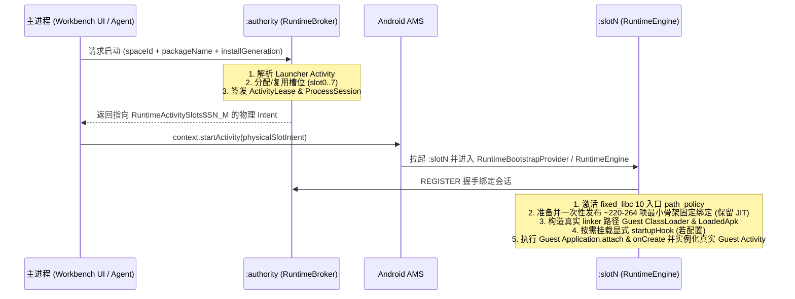

# Tripoder 当前架构 (Current Architecture)

## 1. 第一性原理与双层解耦架构

Tripoder 是一个面向 Android 的**无需 Root 的免重打包应用虚拟化沙箱与 AI 原生动态安全测试平台**。

其核心边界由以下第一性原理约束决定：

1. **宿主即唯一操作系统身份**：在无 Root 的 stock Android 下，宿主进程（`dev.tripoder.engine`）是向系统 AMS/PMS 发起请求时的唯一真实 UID 身份。Guest 应用无法真正拥有独立的系统级 Linux UID，所有进程与组件隔离必须在宿主自身的进程池与虚拟化边界内完成。
2. **「统一最小承载底座 + 按需策略扩展」双层解耦模型**：
   - **第一层：统一最小承载底座（Level 1 Skeleton Baseline，默认开启）**
     - **目标**：以最小侵入、零冗余开销保证原版商业应用稳定启动与流畅交互。
     - **Java / Framework 最小骨架**：通过 [`RuntimeSelfHookProduct`](../android/runtime/src/dev/tripoder/runtime/RuntimeSelfHookProduct.java)、[`RuntimeFixedPreparation`](../android/runtime/src/dev/tripoder/runtime/RuntimeFixedPreparation.java) 与显式 [`GuestContext`](../android/runtime/src/dev/tripoder/runtime/GuestContext.java) 边界，仅保留组件生命周期、`Application`/`LoadedApk` 身份、Package/Storage/Notification/Job/PendingIntent 必需的最小固定绑定（约 220–264 项，启动期一次发布，100% 保留 ART JIT 编译，运行期 UI 主线程 0 次 `toggleBatchNative`）。12 类普通设备系统服务（网络、电话、音频、电池、电源、定位等）默认直接透传平台实现。
     - **Native / Libc 最小路径边界**：通过 [`self_hook_storage.c`](../android/runtime/native/self_hook_storage.c) 与 [`fixed_libc.c`](../android/self-hook/native/fixed_libc.c) 双页包装器接管 `libc.so` 10 个核心路径入口（共用 [`path_policy.c`](../android/runtime/native/path_policy.c)）。默认**不安装全进程 `seccomp` 过滤器（`addedSeccompFilters = 0`）**，不抑制 `debuggerd`，保持客体信号掩码与原生异常处理器语义。
   - **第二层：按需/分级策略扩展层（Opt-in Capabilities & Profiles，显式启用）**
     - **动态代码探针与业务 Hook**：仅在用户或外部 AI Agent 通过 MCP 显式配置 `startupHook`、`probes_control` 或 `hook_activate` 时，才对目标方法执行按需调用者反优化与受限 TS 脚本（`RestrictedAst`）挂载。
     - **被动网络明文观测**：仅在调用 `network_control(action=start)` 时对目标 TLS 模块挂载 `SSL_read/SSL_write` 有界缓冲区捕获与 HTTP/1.1 分帧。
     - **环境模拟与强对抗沙箱策略**：仅在显式配置 `persona_control`、`env_mock`、`malware_probe_control` 或强对抗壳兼容策略时，才按需装配设备服务伪装门面或 `seccomp`（`syscall_namespace.c`）直接系统调用拦截。
3. **控制面与执行面严格分离**：
   - 控制面（`:authority`）持有唯一的 SQLite 权威状态（安装目录、进程槽位、组件租约、操作日志与安全策略）。
   - 执行面（`:slot0` .. `:slot7`）按 `(spaceId, packageName, targetProcessName, installGeneration)` 唯一绑定，同一时间绝不混跑两个不同的 Guest 进程身份。

当前单运行时收敛规则见 [单运行时与最小底座收敛](single-runtime.md)，分阶段演进路线见 [架构梳理与实施计划](implementation-plan.md)。

---

## 2. 单 APK 四类进程模型

Tripoder 编译并分发为单一 APK：**`dev.tripoder.engine`**。所有进程共享同一应用 UID，消除跨 APK IPC 权限开销与中间跳板 Activity：

| 进程名 | 核心职责 | 关键入口与核心类 |
| --- | --- | --- |
| `dev.tripoder.engine` (主进程) | 原生工作台 UI、应用/空间管理、Hook 脚本编辑、本地 HTTP MCP Server 桥接 | `WorkbenchActivity`, `WorkbenchProjectActivity`, `AgentControlService`, `WorkbenchAgentControl` |
| `dev.tripoder.engine:authority` | 权威控制面（Authority Broker）：负责 APK 导入与解析、槽位分配、四大组件与 Job/PendingIntent 调度、权威状态持久化 | `RuntimeAuthorityService`, `RuntimeBroker`, `ProcessSupervisor`, `ApkStore` |
| `dev.tripoder.engine:recovery` | 独立恢复管理门禁：管理引擎崩溃后的有界指数退避恢复、孤儿进程观察与 `UNKNOWN` 范围门禁 | `RuntimeRecoveryGate`, `tripoder-recovery.db`（见 [引擎崩溃恢复](runtime-crash-recovery.md)） |
| `dev.tripoder.engine:slot0` .. `:slot7` | Guest 执行容器进程（共 8 个预声明槽位）：承载被测/多开 Guest 应用的 `Application`、四大组件、ART/Native Hook 与内嵌脚本引擎 | `RuntimeEngine`, `RuntimeSlot`, `RuntimeActivitySlots`, `RuntimeServiceSlots`, `RuntimeJobSlots`, `RuntimeReceiverSlots` |

---

## 3. 应用模型：每个应用唯一项目，空间保存运行环境

- 应用按包名识别，`application_projects` 强制包名唯一并持久保存项目 ID。
- 项目保存该应用的唯一源码和目标声明；重复导入、升级、增加空间均复用项目。源码归属独立于安装生命周期。
- 每个 `(space, package)` 保存独立安装、应用数据（`dataId`）和进程。`project_refs` 按 `(project, space)` 保存安装绑定，同一项目可以关联多个空间。
- 安装更新使旧绑定/观察证据失效；`:authority` 为新安装代次签发新绑定回执。保存脚本不会向任何空间自动部署。
- MCP 是全局控制入口。安装与进程操作分别显式携带空间、包名、安装代次（`installGeneration`）及进程代次（`processGeneration`），不依赖 UI 当前页或连接选中状态。详细契约见 [Agent 控制面](agent-mcp-design.md)。

### 执行代码与 Application 生命周期

1. **只读执行副本与真实 Native 库搜索路径**：
   - 安装制品目录封存原始 APK、签名与摘要描述符。[`RuntimeExecutionCode`](../android/runtime/src/dev/tripoder/runtime/RuntimeExecutionCode.java) 在安装的数据代次内生成运行副本，统一 APK/Split、ClassLoader、资源与 `.so` 的物理 ABI 目录（`info.nativeLibraryDir`）。
   - [`RuntimeSharedLibraries`](../android/runtime/src/dev/tripoder/runtime/RuntimeSharedLibraries.java) 与 [`RuntimeDexLoader`](../android/runtime/src/dev/tripoder/runtime/RuntimeDexLoader.java) 使用真实解压的 `info.nativeLibraryDir` 配置客体 ClassLoader 的 linker namespace 搜索路径，同时在 `applicationInfo.nativeLibraryDir` 保留供客体自检的逻辑路径视图。可执行副本保持只读，其父目录允许 Android 和客体生成 `profile/oat/odex/vdex` 等派生编译缓存。
2. **Application 与壳委托（Shell Delegate）生命周期**：
   - `LoadedApk` 在 `Application.attach` 前绑定到启动记录；`Application` 实例在 `attach` 完成后发布。
   - 兼容加壳应用（如网易易盾、梆梆、360 加固）：若壳 `Application` 在 `attachBaseContext` 阶段已向 `ActivityThread.mInitialApplication` 发布了真实业务委托 `Application`，[`RuntimeEngine`](../android/runtime/src/dev/tripoder/runtime/RuntimeEngine.java) 保留该客体委托实例，仅在字段仍为物理宿主时才替换为壳实例，防止壳在 `onCreate` 中自调用陷入无限递归。
   - `Application.onCreate` 完成后，运行时读取客体明确安装的 `ApplicationContext`，统一发布为组件的 `Application`、`LoadedApk.mApplication` 和逻辑进程视图。
3. **显式 Context、组件代理与延迟解包契约**：
   - **裸 `ContextImpl` 收口**：保留客体 `LoadedApk` 身份与资源契约，将底层 `ContextImpl` 的 7 个外部目录 getter 接回同一 [`GuestStorageContext`](../android/runtime/src/dev/tripoder/runtime/GuestStorageContext.java)，服务绑定收敛至 `bindServiceCommon` 并使用物理宿主 Context 向 AMS 发起调用，杜绝因外层 `GuestContext` 被剥离而触发 `SecurityException`。
   - **显式广播代理（`RuntimeReceiverProxy`）**：动态、Manifest 与有序最终 Receiver 统一经过 [`RuntimeReceiverProxy`](../android/runtime/src/dev/tripoder/runtime/RuntimeReceiverProxy.java) 转发，不在运行期对客体 `BroadcastReceiver.onReceive` 子类动态打 ART Hook，彻底消除 UI 主线程 `toggleBatchNative`。
   - **跨组件 Parcel 延迟解包（`RuntimeGuestPayload`）**：在 Activity Intent、Activity Result、SavedInstanceState、Service/Broadcast 交付边界由 [`RuntimeGuestPayload`](../android/runtime/src/dev/tripoder/runtime/RuntimeGuestPayload.java) 绑定客体 `ClassLoader`，确保 Android 13+ `Parcel.LazyValue` 与嵌套 `Bundle` 解包时不丢失客体类加载器。

---

## 4. 无网关单跳启动链路 (Gateless Launch)

从工作台点击应用图标或由外部 Agent 发起 `process_start` 时，不经过任何透明跳板 Activity，直接单跳拉起目标槽位：

---

## 5. 代码仓库结构

| 模块路径 | 说明 |
| --- | --- |
| [`android/engine`](../android/engine) | 主引擎与恢复进程模块：包含 `:authority` 控制面入口、`:recovery` 崩溃恢复状态机与持久库 |
| [`android/workbench`](../android/workbench) | 原生工作台 UI、应用/空间目录、内置脚本编辑器与手机端 HTTP MCP Server |
| [`android/runtime`](../android/runtime) | 虚拟化沙箱核心库：包含 `RuntimeEngine`、`RuntimeSelfHookProduct`、四大组件/Package/Storage/Notification/Job/PendingIntent 承载边界及按需探测模块 |
| [`android/self-hook`](../android/self-hook) | 自研底层 Hook 与脚本引擎：包含 ART Java Hook（`ManagedHook` + Nterp 汇编解释器策略）、ARM64 Native Inline/PLT Hook、固定 `libc` 双页重映射（`fixed_libc`）及受限 TS AST 编译器与解释器 |
| [`agent/`](../agent) | 桌面端 stdio MCP 适配器、统一工具 Schema 定义（`tools.mjs` / `tool-schema.mjs` / `tool-groups.mjs`）与自动化验收脚本 |
| [`src/`](../src) | TypeScript Hook SDK 与受限 AST 静态校验/编译器（主机构建与前端共享） |
| [`android/scripts`](../android/scripts) | 确定性构建与真机验证脚本（如 `build-workbench.py`、`diagnose-six-app-startup.py`、`validate-runtime-ingress.py`） |
