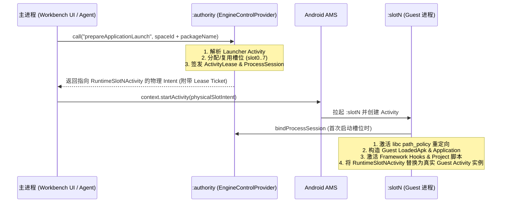

# Tripoder 当前架构 (Current Architecture)

## 1. 第一性原理与定位

Tripoder 是一个面向 Android 的**无需 Root 的免重打包应用虚拟化沙箱与 AI 原生动态安全测试平台**。

其核心边界由以下第一性原理约束决定：

1. **宿主即唯一操作系统身份**：在无 Root 的 stock Android 下，宿主进程（`dev.tripoder.engine`）是向系统 AMS/PMS 发起请求时的唯一真实 UID 身份。Guest 应用无法真正拥有独立的系统级 Linux UID，所有进程与组件隔离必须在宿主自身的进程池与虚拟化边界内完成。
2. **双层拦截闭环（Framework + Native/Syscall）**：
   - **Java / Framework 层**：通过 `SelfHook` 的 ART Hook 与 `RuntimeHookEngine` 拦截 Guest 对 `ActivityTaskManager`、`ActivityManager`、`PackageManager`、`ContentResolver`、`LoadedApk` 等系统服务的调用，将宿主身份重写为 Guest 逻辑身份，并将组件调度路由回 `:authority` 进程。
   - **Native / Libc 层**：固定 `libc` 双页包装器（10 个路径入口）与进程内直接系统调用边界共用 `path_policy`。linker、受保护库的直接 SVC 也会获得同一套客体文件路径；策略内部使用独立的 kernel gateway，避免重入。该兼容边界不赋予客体独立 Linux UID。
3. **控制面与执行面严格分离**：
   - 控制面（`:authority`）持有唯一的 SQLite 权威状态（安装目录、进程槽位、组件租约、安全策略）。
   - 执行面（`:slot0` .. `:slot7`）按 `(spaceId, packageName, targetProcessName)` 唯一绑定，同一时间绝不混跑两个不同的 Guest 进程身份。

---

当前单运行时策略、schema 41 迁移与验收入口见 [单运行时收敛](single-runtime.md)。

## 2. 单 APK 三类进程模型

Tripoder 编译并分发为单一 APK：**`dev.tripoder.engine`**（Debug 包名为 `dev.tripoder.engine.debug`）。所有进程共享同一应用 UID，消除跨 APK IPC 权限开销与中间跳板 Activity：

| 进程名 | 核心职责 | 关键入口与组件 |
| --- | --- | --- |
| `dev.tripoder.engine` (主进程) | 原生 Android 工作台 UI、项目管理、Hook 脚本编辑、网络抓包/日志查看、本地 MCP Server 桥接 | `EngineControlActivity`, `EngineStatusProvider`, `EngineAgentGatewayProvider`, `EngineAgentHttpServer` |
| `dev.tripoder.engine:authority` | 权威控制面（Authority Broker）：负责 APK 导入与解析、槽位分配、四大组件与 Job/PendingIntent 调度、权威状态持久化 | `EngineControlProvider` (`*.authority`), `RuntimeControllerDatabase`, `RuntimeSystemBroadcastReceiver` |
| `dev.tripoder.engine:slot0` .. `:slot7` | Guest 执行容器进程（共 8 个预声明槽位）：承载被测/多开 Guest 应用的 `Application`、四大组件、ART/Native Hook 与内嵌脚本引擎 | `RuntimeSlot0..7Activity` (含 Portrait / Landscape / Translucent 变体), `RuntimeSlot0..7Service`, `RuntimeSlot0..7JobService`, `RuntimeSlot0..7Provider` |

---

## 3. 应用模型：每个应用唯一项目，空间保存运行环境

用户以应用为入口，点击图标启动，长按图标后选择“分析”进入脚本与运行页面，图标下方不显示分析按钮。底部仅保留应用和设置，不要求创建、选择或重命名项目。

添加页支持手机应用多选、搜索后保留选择、当前结果全选和清空；APK 文件入口允许一次选择多个独立文件。批次按选择顺序逐项添加，每项保留独立操作 ID 与成功/失败结果，单项失败后继续处理后续项。批次进度持久保存，进程重启后由用户点击继续，先查询原操作；未知结果不会自动重放。

- 应用按包名识别，`application_projects` 强制包名唯一并持久保存项目 ID。
- 项目保存该应用的唯一源码和目标声明；重复导入、升级、增加空间均复用项目。源码归属独立于安装生命周期。
- 每个 `(space, package)` 保存独立安装、应用数据和进程。`project_refs` 按 `(project, space)` 保存安装绑定，同一项目可以关联多个空间。
- 安装更新使旧绑定/观察证据失效；authority 为新安装代次签发新绑定回执。保存脚本不会向任何空间自动部署。
- 移除一个安装或删除空间保留源码；从全部空间移除后，应用仍显示为未安装，可打开分析。彻底删除应用才删除其项目及源码。

schema 35 升级保留 v34 绑定表为历史元数据，建立唯一应用归属及旧项目别名。重复源码和无法归属的源码移入历史归档；存在差异时标记迁移待审阅，用户选择保留当前版本或恢复旧版本，恢复前保存备份。源码迁移可重复执行，不直接丢弃旧内容。

MCP 是全局控制入口。安装与进程操作分别显式携带空间、包名、安装代次及进程代次，不依赖 UI 当前页或连接选中状态。详细契约见 [Agent 控制面](agent-mcp-design.md)。

### 执行代码与 Application 生命周期

安装制品目录继续封存原始 APK、签名与摘要描述符。`RuntimeExecutionCode` 在明确安装的数据代次内生成运行副本，统一 APK/Split、ClassLoader、资源、so 的 ABI 目录与 Native 模块观察路径；构造前逐文件核对原始摘要，并拒绝并发修改、符号链接与异常文件归属。可执行副本保持只读，其父目录允许 Android 和客体生成 profile/oat 等派生缓存。执行副本不会借用手机上另一个系统安装的代码路径，也不会修改、重签被测 APK。

`LoadedApk` 在 Application attach 前绑定到启动记录；Application 实例在 attach 完成后发布。Application.onCreate 完成后，运行时读取客体明确返回的 ApplicationContext，核对其已附着同一逻辑 LoadedApk，再统一发布为组件的 Application、LoadedApk.mApplication 和逻辑进程 Application 视图；宿主及未附着对象会被拒绝。attach 期间 `getApplicationContext()` 保持平台的空值语义；完成后从逻辑 `LoadedApk.mApplication` 读取，及时跟随合法的壳/热修复委托替换。物理宿主 Application 的身份单独保存。

Activity 实例记录保留已准入的物理窗口组件及 ticket/instance。运行时的 `AutofillClientController.autofillClientGetComponentName()` 向系统返回该实例的物理组件，与真实调用 UID 和 Activity token 一致；应用自身的 `Activity.getComponentName()` 仍返回逻辑组件。自动填充服务与回调继续由 Android 执行，不禁用自动填充，也不伪造同步成功回调。该固定入口和所属 Activity 字段纳入设备固定 Framework 注册表。

运行时的 `BiometricPrompt` 仅在构造入口投影已准入客体 Context 的系统身份：认证与取消使用真实宿主包名、UID 及 AttributionSource，原客体 Context、资源、SDK 目标及回调保持原语义。原始系统认证执行前检查客体清单声明 `USE_BIOMETRIC` 或 `USE_FINGERPRINT`；未声明者拒绝，系统自身权限、AppOps、前台限制和硬件验证继续执行。构造函数、认证入口与 `mContext` 字段均纳入设备固定 Framework 注册表，不改认证结果、不关闭验证、不增加 fallback。

Activity 结果继续由 Android 原始 `Intent` 传递。客体定义的 `Serializable` 结果只向启动账本记录的同包 Activity 结果调用者开放，对象定义 ClassLoader 必须属于当前客体；控制面及其他包的结果接收方不获得该能力。结果保持 48 KiB 上限，拒绝文件描述符及 Binder（包括封装在客体 Parcelable 中的 Binder）。接收方通过结果票据授权后，先绑定当前客体 ClassLoader，再交给原始 `onActivityResult`；成功、取消、失败状态码不重写。

路径兼容层在第一条客体 ClassLoader 路径交给 ART/linker 前建立。直接系统调用和 libc 回调使用同一策略和有界独立临时栈，兼容小 pthread/信号栈；用户指针经 kernel user-copy 校验，非法指针返回 `EFAULT`。路径分派通过 ART 特殊信号链接收自有 `SYS_SECCOMP`，客体注册 SIGSYS 崩溃处理器后仍保留分派；其他信号继续遵循应用处理链。特殊处理器执行期间阻塞信号，由 sigchain 在返回时恢复被中断线程的原掩码；不能用空掩码提前送达该线程原本阻塞的待处理信号（例如 Android 的 SIGPIPE）。无法建立该边界时拒绝启动，不自动换模式或重放未知操作。

进程镜像按 ELF 的真实加载区间登记，并用实际文件描述符消除加载器名称与内核路径之间的符号链接差异。保存供恢复的文件代码页仍保留真实地址、inode、offset 和权限；在客体的 maps/smaps 视图中，它们标记为运行时快照，不再冒充原 ELF 模块。运行时的恢复与所有权校验仍使用同一物理元数据。

Android 媒体内存分配通过显式的 `/dev/dma_heap` 只读目录与首级 heap 节点能力访问真实设备，目录 fd 相对打开执行同一策略；实际 open 和 ioctl 仍受内核权限与 SELinux 检查。

WebView、平台代码缓存和偏好存储使用实际宿主 Context 提供的凭据/设备保护数据根目录进行识别，再路由至当前客体数据代次；不依赖宿主包名字符串。该能力只覆盖 WebView、shared_prefs、cache、code_cache、oat 等既定基础设施目录，不开放宿主私有 files 或其他相邻目录。

运行时的清单隐式广播从封存清单完整匹配 action、category、URI 和 MIME，并沿用组件进程租约与广播投递账本。接收方的空间、exported、权限与 enabled 限制继续执行；targetSdk 26 及以上的非定包普通隐式广播只匹配动态注册接收器。有序多目标投递仍未实现。

运行时先在正常 ART 状态下准备全部固定适配，再以一次批量发布完成初始反优化和 JIT code cache 失效，随后恢复原有运行标志与 JIT 设置。Guest Receiver/Service 生命周期在交给 Android 前按实际方法入口安装，不为每个新组件重复反优化全进程；普通脚本 Hook 首次发布及入口覆盖升级仍使已编译调用者失效，所有受控 managed 方法保留编译/内联屏障。运行时中仅无条件调用原方法的 Package/Traffic 包装退出固定集合，Manager 能力限制继续保留。设备服务使用统一策略，环境模拟由现有 persona 工具显式设置，不再提供 THIN/THICK 运行模式。`executionPolicy` 报告当前 instrumentation level、JIT 和运行标志恢复状态，以及全局反优化与回调发布次数。该策略不承诺任意已有活动帧或全部内联调用者热迁移；`fullCallerCoverage` 与 `preexistingCompiledFramesCovered` 继续为 false。

诊断路径列表超出展示预算时显式报告截断、实际数量和完整摘要；所有原始行仍参与核心映射身份与外来后端检查。UI 查询通过异步主线程消息采集，超时后取消未完成任务。冷启动 `process.start` 的 Agent 传输预算为 65 秒；超时只查询原操作结果，不自动重放变更。


启动定向检查分别由 `validate-native-policy.py --direct-syscalls`、`validate-single-project-global.py --phase publication` / `--phase execution-code` 和 `agent/runtime-acceptance.mjs` 执行。后者以输入文件指定应用、安装代次、目标 Activity 与纯方法，核对真实前台 task、已加载 native core 摘要、统一编译与发布策略及 Hook 修改/停用恢复；应用名称和选择器只属于验收输入。

---

## 4. 无网关单跳启动链路 (Gateless Launch)

从工作台点击应用图标或由外部 Agent 发起启动时，不经过任何透明跳板 Activity（`RuntimeGuestGateway` 已彻底移除）：



---

## 5. 代码仓库结构

所有活跃工程代码均位于 `android/` 目录下：

| 模块路径 | 说明 |
| --- | --- |
| `android/engine` | 主 APK 模块：包含 原生工作台 UI（`workbench/`）、`:authority` 控制面服务与数据库、`:slot0..7` 宿主壳组件、MCP Server 与 Agent 控制接口 |
| `android/runtime` | 虚拟化沙箱核心库：包含 `RuntimeProcessBootstrapper`、`RuntimeHookEngine`、四大组件/Package/Storage/Job/Notification/Telephony/Audio 等系统服务虚拟化代理 |
| `android/self-hook` | 自研底层 Hook 与脚本引擎：包含 ART Java Hook（`ManagedHook` + Nterp 汇编解释器策略）、ARM64 Native Inline/PLT Hook、固定 `libc` 双页重映射（`fixed_libc`）及受限 TS AST 编译器与解释器 |
| `android/guest-fixtures` | 用于自动化契约验证的被测样本 APK 集合（覆盖四大组件、多进程 Provider、Native 文件访问、WebView 等场景） |
| `android/scripts` | 自动化构建与真机验证脚本（如 `run-self-hook-case.py`、`run-self-no-inline.py`） |

### 常用构建与测试命令

```bash
# 构建主引擎 Debug APK
./android/gradlew -p android :engine:assembleDebug

# 运行 Runtime 与 Self-Hook 单元测试
./android/gradlew -p android :runtime:testDebugUnitTest :self-hook:testDebugUnitTest :engine:testDebugUnitTest

# 运行真机 Instrumentation 测试
./android/gradlew -p android :self-hook:connectedDebugAndroidTest :engine:connectedDebugAndroidTest
```
