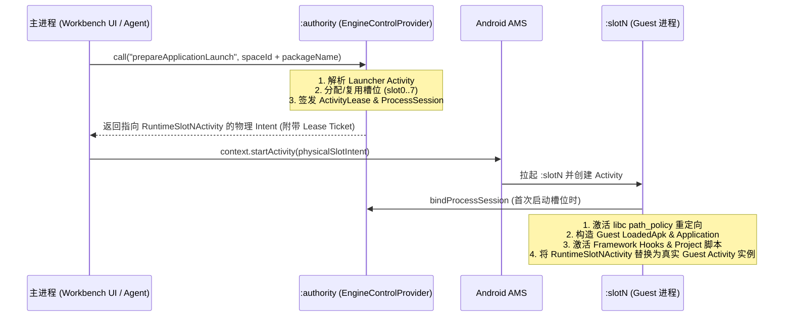

# Tripoder 当前架构 (Current Architecture)

## 1. 第一性原理与定位

Tripoder 是一个面向 Android 的**无需 Root 的免重打包应用虚拟化沙箱与 AI 原生动态安全测试平台**。

其核心边界由以下第一性原理约束决定：

1. **宿主即唯一操作系统身份**：在无 Root 的 stock Android 下，宿主进程（`dev.tripoder.engine`）是向系统 AMS/PMS 发起请求时的唯一真实 UID 身份。Guest 应用无法真正拥有独立的系统级 Linux UID，所有进程与组件隔离必须在宿主自身的进程池与虚拟化边界内完成。
2. **双层拦截闭环（Framework + Native/Syscall）**：
   - **Java / Framework 层**：通过 `SelfHook` 的 ART Hook 与 `RuntimeHookEngine` 拦截 Guest 对 `ActivityTaskManager`、`ActivityManager`、`PackageManager`、`ContentResolver`、`LoadedApk` 等系统服务的调用，将宿主身份重写为 Guest 逻辑身份，并将组件调度路由回 `:authority` 进程。
   - **Native / Libc 层**：通过 `SelfHook` 的 ARM64 Inline/PLT Hook 与固定 `libc` 双页导出包装器（10 个路径入口函数），在虚拟路径策略（`path_policy`）下将 `/data/data/<guest>`、`/proc/self/*` 等直接底层文件访问重定向至沙箱隔离目录。
3. **控制面与执行面严格分离**：
   - 控制面（`:authority`）持有唯一的 SQLite 权威状态（安装目录、进程槽位、组件租约、安全策略）。
   - 执行面（`:slot0` .. `:slot7`）按 `(spaceId, packageName, targetProcessName)` 唯一绑定，同一时间绝不混跑两个不同的 Guest 进程身份。

---

## 2. 单 APK 三类进程模型

Tripoder 编译并分发为单一 APK：**`dev.tripoder.engine`**（Debug 包名为 `dev.tripoder.engine.debug`）。所有进程共享同一应用 UID，消除跨 APK IPC 权限开销与中间跳板 Activity：

| 进程名 | 核心职责 | 关键入口与组件 |
| --- | --- | --- |
| `dev.tripoder.engine` (主进程) | Jetpack Compose 工作台 UI、项目管理、Hook 脚本编辑、网络抓包/日志查看、本地 MCP Server 桥接 | `EngineControlActivity`, `EngineStatusProvider`, `EngineAgentGatewayProvider`, `EngineAgentHttpServer` |
| `dev.tripoder.engine:authority` | 权威控制面（Authority Broker）：负责 APK 导入与解析、槽位分配、四大组件与 Job/PendingIntent 调度、权威状态持久化 | `EngineControlProvider` (`*.authority`), `RuntimeControllerDatabase`, `RuntimeSystemBroadcastReceiver` |
| `dev.tripoder.engine:slot0` .. `:slot7` | Guest 执行容器进程（共 8 个预声明槽位）：承载被测/多开 Guest 应用的 `Application`、四大组件、ART/Native Hook 与内嵌脚本引擎 | `RuntimeSlot0..7Activity` (含 Portrait / Landscape / Translucent 变体), `RuntimeSlot0..7Service`, `RuntimeSlot0..7JobService`, `RuntimeSlot0..7Provider` |

---

## 3. 应用模型：Space × App × Project

Tripoder 将**分身多开环境**与**动态安全分析工程**解耦为三层结构：

1. **Space（隔离空间）**：代表独立的虚拟设备环境与数据沙箱。每个 Space 拥有独立的虚拟设备指纹（`android_id`、IMEI/OAID、机型属性、定位等）与独立的存储命名空间（`dataId`）。
2. **App（空间内应用实例）**：已导入的 APK 在指定 Space 中的安装实例。同一 APK 在不同 Space 中拥有完全隔离的虚拟数据目录、SharedPreferences、SQLite 数据库与进程槽位。
3. **Project（安全测试与 Hook 工程）**：绑定到目标应用包名的动态分析配置集合，包含：
   - **Hook 脚本集（Restricted TypeScript）**：由 `DraftCompiler` 编译为确定性 JSON AST（`RestrictedAst`），在 Guest 进程启动 `Application.onCreate` 之前自动注入执行。
   - **运行时观测流**：结构化采集 Hook 命中事件、方法入参/返回值/调用栈、HTTP/HTTPS 明文流量、文件/数据库访问审计日志。

---

## 4. 无网关单跳启动链路 (Gateless Launch)

从工作台点击应用图标或由外部 Agent 发起启动时，不经过任何透明跳板 Activity（`RuntimeGuestGateway` 已彻底移除）：



---

## 5. 代码仓库结构

所有活跃工程代码均位于 `android/` 目录下：

| 模块路径 | 说明 |
| --- | --- |
| `android/engine` | 主 APK 模块：包含 Compose 工作台 UI（`workbench/`）、`:authority` 控制面服务与数据库、`:slot0..7` 宿主壳组件、MCP Server 与 Agent 控制接口 |
| `android/runtime` | 虚拟化沙箱核心库：包含 `RuntimeProcessBootstrapper`、`RuntimeHookEngine`、四大组件/Package/Storage/Job/Notification/Telephony/Audio 等系统服务虚拟化代理 |
| `android/self-hook` | 自研底层 Hook 与脚本引擎：包含 ART Java Hook（`ManagedHook` + Nterp 汇编解释器策略）、ARM64 Native Inline/PLT Hook、固定 `libc` 双页重映射（`fixed_libc`）及受限 TS AST 编译器与解释器 |
| `android/guest-fixtures` | 用于自动化契约验证的被测样本 APK 集合（覆盖四大组件、多进程 Provider、Native 文件访问、WebView 等场景） |
| `android/scripts` | 自动化构建与真机验证脚本（如 `run-self-hook-case.py`、`run-self-no-inline.py`） |

### 常用构建与测试命令

```bash
# 构建主引擎 Debug APK
./android/gradlew -p android :engine:assembleDebug

# 运行 Runtime 与 Self-Hook 单元测试
./android/gradlew -p android :runtime:testDebugUnitTest :self-hook:testDebugUnitTest :engine:testDebugUnitTest

# 运行真机 Instrumentation 测试
./android/gradlew -p android :self-hook:connectedDebugAndroidTest :engine:connectedDebugAndroidTest
```
