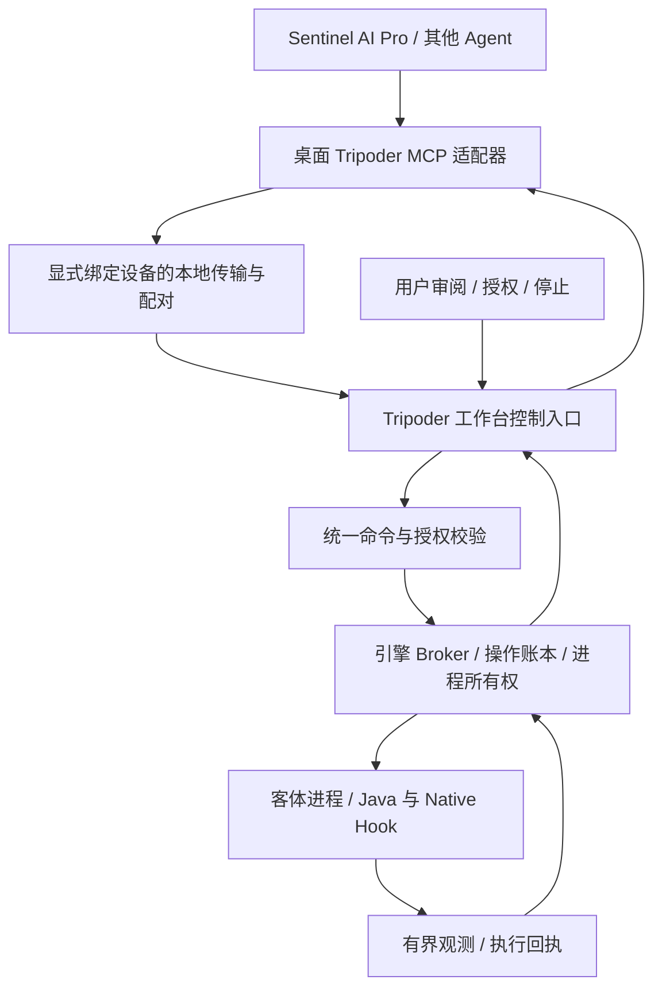

# Tripoder 外部 Agent 控制设计

2026-10-14：用户已授权实施“外部 Agent 操作 Tripoder，手机侧不内置 AI”。已实现手机前台控制入口、引擎签名授权、桌面 stdio MCP 适配器与首批 11 个工具。独立 MCP 客户端的自研计数器闭环已通过（18 项协议、10 项设备检查），**真实 Sentinel 桌面及模型调用已在自研计数器限定范围通过**（8 次工具调用、12 项手机检查，见 `sentinel-agent-02` 与 `sentinel-ai-verdict.json`）。本设计不改变 P2–P6 未完成状态；下面的扩展能力表仍是路线，不是当前完整能力清单。实际接入方式见 [MCP 使用与边界](../agent/README.md)。

## 已实现的第一批范围

- 手机审批真实项目和进程；客户端 P-256 签名由工作台入口及引擎验证，设备响应由 Keystore 密钥签名，桌面使用事先核对的设备公钥。主体由客户端指纹、会话、控制租约、项目与进程共同确定，不能复用公开 session ID 读取另一主体的操作。
- 单一排他会话，最长 10 分钟，256 个接纳请求，缓存响应正文预算 2 MiB；首次认证连接须在 8 分钟内建立，之后联系超时 45 秒由引擎独立撤销。接纳请求时同样检查截止时间，迟到请求不能抢在 watchdog 前续活；心跳不延长 10 分钟的绝对授权期限。保留最多 8 个未到期会话；只有已确认关闭且到期的记录可从内存释放，持久操作账本仍保留。
- 准备外部草稿不覆盖编辑器；手机准确源码/SHA 审批后才能激活。修改、命中查询、停用均复用生产 Hook 管线。
- 相同 operationId/内容只返回既有回执；不同内容拒绝。撤销后的原签名主体在原控制租约有效时可查询会话与自己的持久操作；不恢复旧授权、不重放未知副作用。
- 首批工具只覆盖 session/process/operation 查询和 observe/prepare/activate/status/modules/disable/discard/close。项目草稿 CAS、事件分页、任意应用启动/停止、有界免逐次审批均尚未开放。

当前关闭策略比后续平滑停用方案保守：有观察/准备/Hook 或在途操作即终止该客体进程；`session_close` 自身也是在途操作。只有停止得到确认才能显示 CLOSED，失败显示 CLOSE_UNKNOWN。新授权不得跨越尚未确认的关闭。没有把撤销、Hook 停用与业务数据回滚视为同一事实。

设备服务由前台用户动作开启，使用 connectedDevice 前台服务，监听 loopback；不自动重启或开机启动。权限前提依据 [Android connectedDevice 规范](https://developer.android.com/develop/background-work/services/fgs/service-types#connected-device)。桌面固定 MCP 2025-03-26，遵循 [stdio 帧规则](https://modelcontextprotocol.io/specification/2025-03-26/basic/transports)，不支持版本降级。

## 职责

Tripoder 负责确定性的应用运行、目标观测、脚本检查/激活、预算与授权执行、操作回执和证据。Agent 负责理解目标、推理、生成脚本与组织调试步骤。模型、API Key、聊天历史与多 Agent 编排留在外部助手。手机工作台保留项目管理、源码审阅、授权、执行状态和停止入口。

外部控制不能绕过现有控制权威，也不增加另一个运行器。工具调用返回成功只表示对应操作达到已定义状态；脚本 ACTIVE 与业务场景通过分别验证。

初版建议采用桌面 stdio MCP 适配器，加显式设备 serial 的 USB/ADB 转发。ADB 只提供传输，不成为客体运行依赖；没有连接时不切换后端。手机端入口默认关闭，仅在用户开启的配对会话内监听本地端点。localhost、ADB 授权和持有相同 APK 签名均不等同于调试授权，仍须验证配对身份与请求范围。

MCP 只作工具发现、参数/结果封装，Tripoder 控制协议承载状态和操作语义。避免把 Agent 框架、模型名、自然语言推理或 MCP 生命周期写进运行内核。协议版本不匹配明确拒绝，不静默降级。

工作台控制入口应是有明确生命周期的服务，不能依赖某个 Activity 或编辑器页面仍然存活。进入后台、手机锁屏、USB 断开、电脑休眠与进程死亡是不同事件：分别保存会话状态、停止接收新修改或执行既定停用策略；不能因 UI 导航就释放正在生效的 Hook，也不能绕过 Android 的后台执行限制维持隐形服务。用户可见的会话通知与停止入口属于产品的一部分。

## 复用与必要重构

| 已有能力 | 处理 |
|---|---|
| `ControlWire` / `RuntimeControllerCommands` | 复用业务命令；补齐版本、调用来源与授权范围，MCP 不直接代理任意 Binder code |
| `ControllerLease` / `RuntimeHookClaims` | 保留工作台到引擎的唯一控制连接；增加明确的 Agent 调试主体与排他修改会话，不能把所有外部客户端伪装成同一个 UI 操作者 |
| `ExecutionContract` / 操作查询 | 复用 operationId、状态和未知结果协调；桌面断线后查询同一操作，禁止生成新 ID 盲目重试副作用 |
| `hookProcesses` / observe / prepare / activate / status / disable | 首批工具的实际执行路径；安装代次、进程代次、证据、源码摘要、准备令牌继续由引擎核验 |
| `WorkbenchProjects` / 编辑器 / 部署面板 | 增加版本比较、外部草稿审阅、来源显示和授权管理；人工操作与 Agent 操作相互可见 |
| SDK AST 检查与受限执行器 | 继续复用；Agent 不获得任意 Frida eval、shell、原始进程内存地址写入或任意 Native 库装载入口 |
| 旧 `AiClient` / `AiSettingsActivity` / `ApiKeyVault` | 暂不纳入新工作台产品构建；历史代码保留，不把模型请求移入引擎 |

工作台当前只认证自身 UID；这不能直接证明某个外部 Agent 的操作被用户允许。新增调试授权应由可信工作台通过生产 API 提交，由引擎持久化并逐次核验。仅在 MCP 客户端设置“需要确认”不够，因为另一个客户端可以绕过它。

## 首批工具范围

工具以已验证能力为准，尚未实现的能力返回明确错误；不让 Agent 通过工具名字误以为支持任意应用。

| 类别 | 工具建议 | 关键结果或约束 |
|---|---|---|
| 发现 | capabilities、spaces、projects、processes | 设备身份、协议/支持范围、分页、实际 PID 与代次 |
| 观测 | symbols.observe、modules、hook.status、events.read | 真实 loader/module 身份、有界结果、cursor 与丢失记录提示 |
| 草稿 | project.read、draft.write、plan.prepare | 源码版本 CAS；写入草稿不覆盖未保存人工编辑；prepare 不激活 |
| 执行 | plan.activate、parameters.update、plan.disable | 操作 ID、授权会话、源码 SHA、准备 token、进程代次、参数版本 |
| 对账 | operation.get、session.get、evidence.read | 明确 RECEIVED/RUNNING/UNKNOWN/终态；不能以网络超时判断未执行 |
| 生命周期 | application.launch、application.stop | 后续补齐生产停止及冷恢复语义后开放，遵循项目绑定与真实组件回执 |

日志、类名和客体返回值是被测应用提供的数据，不是 Agent 的指令来源。读取堆对象、参数值、截图、文件和账号相关内容应分别授权；默认只传必要的符号结构与运行统计，不能因授予 Hook 权限就自动导出整个空间。

“调试”需要拆成具体能力：查询已有模块/回执属于读取；新增 trace、方法拦截、断点或修改参数会改变执行或开销，必须按修改授权并计入预算。初版并不等同于通用 JDWP/GDB 调试器；暂停线程、对象堆遍历、任意内存读写尚无实现和验收，不能通过一个 `debug` 工具笼统开放。

## 调试会话与授权

每个会话至少绑定 deviceId、控制端配对身份、projectId、spaceId、package、installGeneration、允许的命令、过期时间、执行预算和撤销代次。修改操作还须绑定 processGeneration；进程重启后重新观察。Agent 在电脑断线不应自动重放安装、启动、Hook 或业务操作。

ADB serial 只选择传输设备，不是安全身份。配对身份必须由设备端密钥与一次明确确认建立；重装或密钥更换后旧配对失效。会话预算与有效期由设备端执行，短期超时使用单调时钟，重启后不得因墙上时钟回拨恢复旧授权。

每次修改的持久 operationId 绑定主体、授权、完整目标代次与规范化请求摘要。同一 ID 的同一请求返回既有回执，不再次执行；同一 ID 携带不同内容必须拒绝。JSON-RPC 请求 ID 只用于当前传输关联。断线后先查询操作与进程事实；对于已经提交但未确认的效果，保留 UNKNOWN，而非承诺分布式“恰好执行一次”。事件读取采用有序 cursor、固定容量和明确截断标记，大型证据通过独立、有期限的引用读取。

两种显式授权方式：

1. 默认审阅：Agent 生成草稿并 prepare；工作台展示目标、源码差异、预期影响与风险，用户确认该源码摘要的激活。
2. 有界自动调试：用户一次性授权指定应用/进程、目标集合、允许的修改类型、持续时间与预算；Agent 可在这个范围内调用同一 prepare/activate 流程。范围外操作必须拒绝，不能把一句“自动调试”解释为任意设备控制。

UI 与多个 Agent 可以共享只读观察；同一进程的修改权必须显式排他。人工接管先撤销旧修改租约，确认当前 Hook 状态，再接受新操作；不能通过更换连接 ID 覆盖仍在运行的计划。

撤销授权与停用 Hook 是两个事实：撤销立即阻止新修改；已运行的计划按会话预先选择的断线/到期策略处理。初版建议断线留出短暂查询宽限，期限到达后由引擎请求停用。引擎无法确认停用或持续有在途回调时保留 DRAINING/UNKNOWN，达到预算后终止对应客体进程并记录原因。停止按钮不能未经回执就显示“已恢复”。具体时长在实现前固定并测试。

停用 Hook 只恢复后续方法调用规则，不能回滚应用已经写入的数据、发出的网络请求或完成的业务动作。工具结果必须分别报告 Hook 状态与业务结果，禁止把停用成功描述成业务回滚成功。

## 验收顺序

1. **控制协议**：从已有生产 API 提炼 schema、错误与能力表，补齐来源身份、源码 CAS 和日志分页。检查旧代次、跨项目、超范围及未知版本均被拒绝。
2. **配对与工具适配**：实现本地 stdio MCP、显式设备选择及可撤销配对；从真实 Sentinel 调用读取空间、进程、符号和状态。错误凭据/过期授权不能通过。测试 JSON-RPC/MCP call ID 与持久 operationId 分离。
3. **人工确认闭环**：Sentinel 写入草稿 → prepare → 手机审阅/确认 → 自研应用真实行为改变 → disable → 原始行为恢复；源码、回执和 PID 对应同一次运行。
4. **有界自动化**：授权会话内修改、参数更新与停止；覆盖多个 Agent 竞争、人工接管、断线、迟到 ACK、引擎/工作台死亡、到期和预算耗尽。不能重复执行未知操作。
5. **真实目标**：微信/王者运行能力与登录闭环单独验收；外部 Agent 调通不能替代 P6。登录仍由用户接管，不请求密码进入聊天或证据文件。

## 已核对的接入依据

本机 Sentinel 源码 `src-tauri/sentinel-tools/src/mcp_transport.rs` 已支持 stdio/Streamable HTTP 连接；`mcp_adapter.rs` 已将外部 MCP 工具接入统一工具系统，并保存持续连接。已复用这些入口完成 Sentinel 到 Tripoder 的真实 AI 工具调用。

接入前还需验证结果映射：当前 `mcp_result_to_json` 输出 `content` 与 `is_error`，没有显式保留 MCP 的结构化结果字段。必须定义并测试严格的 Tripoder 回执解码，保留状态、操作 ID 和证据，不能把外层传输 `Ok` 或工具调用已返回理解为业务 SUCCEEDED。本次验收已严格解析 content 文本中的业务回执，并逐字节匹配助手记录与 MCP 审计；没有依赖该外层成功标志。

[MCP Tools 规范](https://modelcontextprotocol.io/specification/2025-11-25/server/tools) 提供工具发现、输入/输出 schema 和结构化结果。这些协议机制不替代 Tripoder 自身的业务授权与回执核验。
