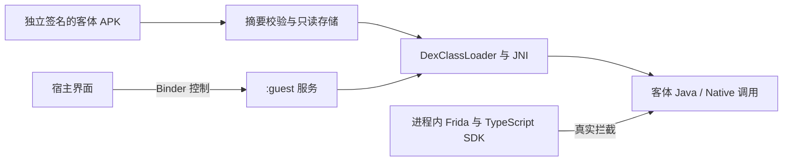

# 独立 APK 客体载荷 v0.2

本阶段把真实 Hook 从宿主自带函数推进到**独立 APK 中的自有 Java／Native 代码**。宿主通过 Android 非导出服务启动 `:guest` 进程，加载未经重打包或重新签名的测试 APK，再通过进程内 Frida 代理拦截其中的函数。

它是受控载荷运行器，不是完整 Android 虚拟机。只接受当前构建生成的 `dev.tripoder.fixture` 测试包；导入其他 APK 会明确拒绝。客体代码的系统身份仍为宿主包和 UID，未实现独立权限或系统服务身份。

## 工程与加载路径

- `android/guest-fixture`：独立 Android application 模块，可单独构建、签名和安装；不依赖宿主、SDK 或 Frida。
- `android/app`：包含原宿主 Hook Lab、新客体界面、Binder 控制服务和内嵌 Frida。
- Gradle `bundleGuest`：把独立生成的 APK 原样作为资源打包，并生成 SHA-256 清单；不会合并客体 DEX 或 SO 到宿主代码／库目录。
- `GuestStore`：验证摘要与包信息，使用应用私有目录和只读动态代码文件；只提取固定的 ARM64 库条目，有输入大小上限。失败导入不替换当前 APK。
- `GuestRuntime`：通过专用 `DexClassLoader` 载入客体类，反射调用其公开测试入口，并解析 JNI；确认父 ClassLoader 无法解析该类。
- `GuestService`：非导出、独立 `:guest` 进程，串行处理测试／参数／卸载／重启指令；运行时和串行队列随进程保留，页面解绑后再次进入复用 ClassLoader，避免 JNI 重复加载失败。
- `GuestClient`：Binder Messenger 请求关联与超时处理，界面销毁时解绑；Hook 回调不经过 Binder。
- `android/agent/index.ts`：根据进程内身份选择目标 ClassLoader，复用已有 TypeScript SDK，绑定客体 APK 摘要与实际 ELF Build ID。



Android 14+ 对动态代码只读状态有要求，因此复制器先打开输出 FD、将文件设为 `0400`，再通过已有 FD 写入，校验后原子移动到目标位置。实现依据：[Android 动态代码加载要求](https://developer.android.com/about/versions/14/behavior-changes-14#safer-dynamic-code-loading)、[DexClassLoader](https://developer.android.com/reference/dalvik/system/DexClassLoader)、[跨进程绑定服务](https://developer.android.com/develop/background-work/services/bound-services)。

## 在手机上使用

安装宿主 0.2.0，打开“独立 APK 客体实验”。内置独立测试 APK，无需额外安装客体、授权 ADB 或授予存储权限。

1. “运行客体自检”：验证实际加载身份、Java／Native Hook、参数更新、回滚、卸载与 1000 组连续调用。
2. “导入测试 APK”：通过系统文件选择器选择同版独立 APK，仅授予选中文件的读取能力；摘要不匹配时拒绝导入。
3. “重启客体并重新验证”：终止本应用的客体进程后重新绑定，检查宿主 PID 不变、客体 PID／进程证据更新、数据计数持续递增。
4. 编辑参数并调用、回滚或卸载 Hook；“15 秒后自检”可在拔掉 USB 后观察结果。

两个 APK 都是普通、非 debuggable 的测试签名包，均不申请任何权限。独立进程与独立目录**共享宿主 UID**，目录划分不提供恶意代码隔离。当前仅运行受控自有测试代码。

## 构建与复现

```sh
# 在 tripoder 中；同时构建宿主与独立客体
npm run android:build

# 当前构建已安装时
python3 android/scripts/verify-device.py --serial YOUR_DEVICE --skip-install --guest --restart
python3 android/scripts/verify-device.py --serial YOUR_DEVICE --skip-install --guest --restart --offline

# 原宿主 Hook Lab 回归；使用独立产物目录保留旧验收证据
python3 android/scripts/verify-device.py --serial YOUR_DEVICE --skip-install --label host-v0.2.0
```

宿主产物位于 `android/app/build/outputs/apk/release/app-release.apk`，客体产物位于 `android/guest-fixture/build/outputs/apk/release/guest-fixture-release.apk`。`--offline` 只停止电脑 ADB 服务并检测端口，不关闭手机 USB 调试，也不撤销电脑授权。

## 尚未实现的兼容层

- 任意 APK 的 Application／Activity／Service／Provider 生命周期、资源与窗口接管。
- 系统包身份、独立 UID、权限、签名查询、Binder 服务与文件路径虚拟化。
- Split APK、多 ABI、多客体并行、任意 JNI 依赖图及图形／音视频桥接。
- 通用 Hook 规则发布、任意脚本热替换、并发卸载、安全脚本隔离及 AI 生成。
- 客体失控后的自动故障策略；当前验证的是显式重启与恢复，不是恶意代码或任意 Native 崩溃恢复。
- 微信、钉钉、王者荣耀、原神的功能与性能验收。

下一阶段需要先用自有 Activity 与资源／图形样例验证组件兼容层，才能扩大到普通 APK 的启动；不能从两个函数的加载成功推断完整应用兼容。

当前手机的实际结果与证据见 [0.2.0 真机验收](guest-validation.md)。
