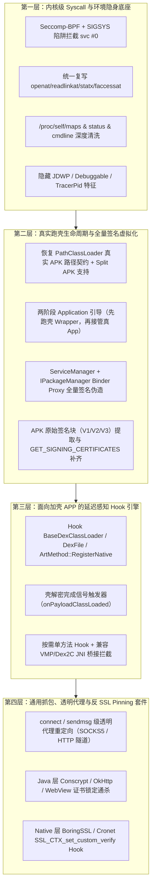
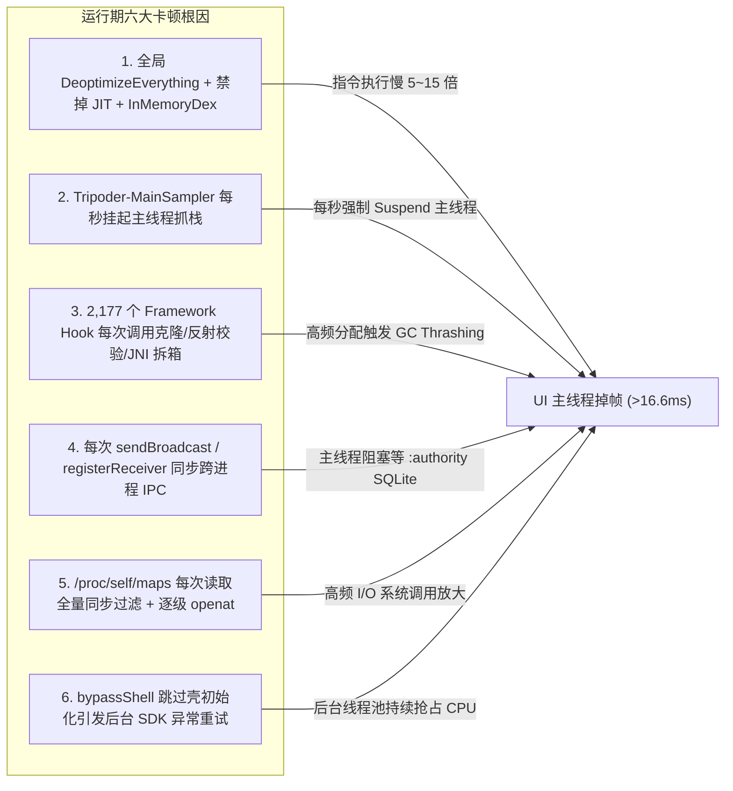

# 加壳/加固应用兼容与运行期性能优化方案

本文档沉淀了 Tripoder 针对**商业加壳/加固（Packer / Protector）应用无差别运行与安全测试（Hook / 抓包 / 代理）**以及**大型应用（如网易云音乐）运行期卡顿治理**的深度根因分析与工程演进方案。

---

## 第一部分：加壳与加固 APP 兼容运行及动态测试方案

### 1. 核心目标

让宿主机上的任意 Android 应用在 Tripoder 虚拟容器（`:slot0..7`）中稳定运行，无论目标应用是否存在以下加固/防护场景：
1. **一代/二代 DEX 整体加壳**：动态解密释放 DEX、替换 `ClassLoader`、代理 `Application`（如 360 加固、腾讯乐固、梆梆、爱加密、网易易盾）。
2. **三代指令抽空（Dex2C / VMP）**：函数体 `insns` 被抽空，在 `<clinit>` 或首次调用时由 Native `.so` 动态回填或通过 JNI 桥接执行。
3. **Native 层反调试、环境校验与 `svc #0` 内联系统调用**：绕过 `libc.so` 符号直接发起内核调用读取真实路径、校验签名、检测 `/proc/self/maps` 与 Virtual/Hook 特征。
4. **SSL Pinning 与自研网络协议栈**：OkHttp CertificatePinner、Conscrypt TrustManager、Cronet / BoringSSL 自校验以及绕过系统 HTTP 代理的直连 Socket。

同时确保在脱壳/运行后，测试人员与 AI Agent 仍能通过 **Java/Native Hook、流量抓包、透明代理** 完成 API、业务与安全测试。

---

### 2. 当前架构面对加壳/加固 APP 的六大阻断根因

| 序号 | 阻断维度 | 现状与代码位置 | 为什么导致加壳 APP 崩溃或无法 Hook |
| --- | --- | --- | --- |
| **1** | **手工硬编码跳壳而非真实跑壳** | [`RuntimeEngine.java` (L178-L236)](../android/runtime/src/dev/tripoder/runtime/RuntimeEngine.java#L178-L236) 中的 `bypassShell()` 仅针对网易云音乐硬编码实例化 `CloudMusicApplication`，跳过壳 `Application`。 | 绝大多数商业壳的真实 DEX 与 Native 初始化必须在壳 `Application.attachBaseContext()` 与 `onCreate()` 中由壳 `.so` 解密完成；直接跳过会导致业务类未解密、JNI 未注册或报 `UnsatisfiedLinkError`。 |
| **2** | **`InMemoryDexClassLoader` 破坏壳的 `DexElements` 反射契约** | [`RuntimeDexLoader.java` (L41-L82)](../android/runtime/src/dev/tripoder/runtime/RuntimeDexLoader.java#L41-L82) 将 APK 内 `classes*.dex` 读入匿名内存，构造 `InMemoryDexClassLoader`。 | 壳 `.so` 普遍强依赖 `PathClassLoader` 的 `pathList -> dexElements -> dexFile / zip` 真实 APK 路径去读取壳尾部加密数据块（Payload），匿名内存加载无磁盘路径导致壳解密失败。 |
| **3** | **安装来源与 Split APK 信息不完整** | [`RuntimePackages.java` (L231-L261)](../android/runtime/src/dev/tripoder/runtime/RuntimePackages.java#L231-L261) 仅同步了 `baseApkPath`，未完整注入 `splitSourceDirs` / `splitPublicSourceDirs`（见 [`RuntimeEngine.java` L375](../android/runtime/src/dev/tripoder/runtime/RuntimeEngine.java#L375)）。 | 现代 App Bundle（Split APK）及壳的完整性校验在检查 `ApplicationInfo.splitSourceDirs` 时会缺失资源或 Native 库路径。 |
| **4** | **I/O 重定向仅覆盖 `libc` 10 个导出函数，无法拦截 `svc #0`** | [`fixed_libc.c`](../android/self-hook/native/fixed_libc.c) 仅 Hook 了 `openat`/`faccessat`/`statx`/`readlinkat`/`execve` 等 10 个 libc 符号。 | 加固壳 `.so` 普遍使用内联汇编 `svc #0` 直接调用 Linux 内核（`__NR_openat = 56`、`__NR_readlinkat = 78` 等），彻底绕过 libc Hook，读出宿主真实包名 `dev.tripoder.engine` 后立即自杀。 |
| **5** | **Binder 签名伪造与 PMS 覆盖不全** | [`RuntimePackages.java` (L286-L315)](../android/runtime/src/dev/tripoder/runtime/RuntimePackages.java#L286-L315) 拦截了 Java 层 `PackageManager`，且仅填充 `signatures` 未完整覆盖 Android 9+ `SigningInfo`（`GET_SIGNING_CERTIFICATES`）及直接 `ServiceManager.getService("package")` 的裸 `IPackageManager.Stub.asInterface` 调用。 | 加固壳在 Native 层通过反射获取 `ActivityThread.sPackageManager` 甚至直接与 `IBinder` 通信校验签名，一旦发现宿主重打包签名或不一致即闪退。 |
| **6** | **动态加载 ClassLoader 脱管与强制解释器冲突** | [`RuntimeEngine.java` (L682-L702)](../android/runtime/src/dev/tripoder/runtime/RuntimeEngine.java#L682-L702) 仅在启动时枚举一次初始 `ClassLoader`；同时 [`art_managed_entry.c`](../android/self-hook/native/art_managed_entry.c) 强制 `SetJavaDebuggable(true)` 与修改 `ArtMethod` 入口。 | 壳在运行期动态创建的 `DexClassLoader` / `InMemoryDexClassLoader` 脱离容器内省索引；同时壳 `.so` 自身也会回填 `ArtMethod::data_` 与 `entry_point_from_quick_compiled_code_`，与容器启动期抢先 Hook 产生冲突。 |

---

### 3. 架构级解决方案：四层纵深突破体系

#### 3.1 第一层：Seccomp-BPF 拦截 `svc #0` 内联系统调用 + 环境隐身
1. **引入 `prctl(PR_SET_SECCOMP, SECCOMP_MODE_FILTER)` + `SIGSYS` 处理程序**：
   * 在 `libtripoder_runtime.so` 初始化阶段安装 BPF 过滤器，针对非 `libc.so` 代码段发起的文件路径类系统调用（`__NR_openat`、`__NR_faccessat`、`__NR_readlinkat`、`__NR_newfstatat`、`__NR_statx`、`__NR_execve`），触发 `SECCOMP_RET_TRAP`。
   * 在 `SIGSYS` 信号处理函数中读取 `ucontext_t` 的 `x0..x5` 与 `x8` 寄存器，直接复用 [`path_policy.c`](../android/runtime/native/path_policy.c) 的路径重写逻辑，将重写后的路径指针放回线程栈缓冲区并执行受控系统调用。
   * **效果**：即便加固壳使用 VMP + `svc #0` 读取 `/proc/self/cmdline`、`/data/data/<guest>` 或 `/data/app/<guest>/base.apk` 校验签名，也会 100% 落入容器虚拟化视图。
2. **抹除 `JavaDebuggable` 暴露面**：
   * 拦截壳对 `android.os.Debug.isDebuggerConnected()`、`ro.debuggable` 属性以及 `Runtime::IsJavaDebuggable()` 的探测。

#### 3.2 第二层：真实跑壳生命周期与全量签名/PMS 虚拟化
1. **废弃手工 `bypassShell` 硬编码，恢复标准壳生命周期**：
   * 将 [`RuntimeDexLoader.java`](../android/runtime/src/dev/tripoder/runtime/RuntimeDexLoader.java) 的默认加载器从 `InMemoryDexClassLoader` 切换为指向真实 Guest APK 路径的 **`PathClassLoader` / `DexClassLoader`**，保留完整的 `pathList.dexElements` 磁盘文件结构，让壳 `.so` 能正常打开 APK 提取加密 Payload。
   * 在 [`RuntimeEngine.java`](../android/runtime/src/dev/tripoder/runtime/RuntimeEngine.java) 中完整执行 `AndroidManifest.xml` 声明的壳入口 `Application`（如 `com.netease.nis.wrapper.MyApplication`、`com.stub.StubApp`）的 `attachBaseContext()` 与 `onCreate()`。
2. **补齐 Split APK 与 V2/V3 `SigningInfo` 伪造**：
   * 在 [`RuntimeEngine.java` (L375)](../android/runtime/src/dev/tripoder/runtime/RuntimeEngine.java#L375) 注入 `ApplicationInfo.splitSourceDirs` 与 `splitPublicSourceDirs`，并将 Split APK 中的 `.so` 目录一并加入 `nativeLibraryDirectories`。
   * 在 [`RuntimePackages.java` (L286-L315)](../android/runtime/src/dev/tripoder/runtime/RuntimePackages.java#L286-L315) 中，除 `GET_SIGNATURES` 外，完整构造 Android 9+ 的 `PackageInfo.signingInfo`（处理 `GET_SIGNING_CERTIFICATES = 0x08000000`），并在 `ActivityThread.sPackageManager` 的动态代理层兜底拦截所有未走 `ApplicationPackageManager` 的反射调用。

#### 3.3 第三层：面向动态脱壳与 VMP 的“延迟感知 Hook 引擎”
1. **动态 ClassLoader 实时捕获总线**：
   * Hook `dalvik.system.DexFile` / `BaseDexClassLoader` 构造函数以及 Native 层的 `art::ClassLinker::DefineClass` / `OpenCommon`。
   * 每当壳在运行期解密出新的 `ClassLoader` 或替换了 `LoadedApk.mClassLoader`，[`RuntimeEngine`](../android/runtime/src/dev/tripoder/runtime/RuntimeEngine.java) 立即将其纳入 `GuestClassLoaderRegistry`，无需重启即可通过 MCP `list_classes` / `hook_java` 检索并 Hook 脱壳后的真实业务类。
2. **延后 Hook 时机 + JNI `RegisterNatives` 拦截**：
   * 对业务类的 Hook 设置“类加载触发器（Deferred Hook on Class Prepare）”：不在壳解密前强行解析类，而是在壳完成 `attachBaseContext` 或目标类完成 `<clinit>` 后自动挂载 Hook。
   * 针对三代 Dex2C / VMP 抽取为 `native` 的方法，在 `jni_internal` 的 `RegisterNatives` 入口自动记录真实业务方法与 Native 函数地址的映射表，支持直接对 VMP 桥接点进行参数/返回值审计。

#### 3.4 第四层：内置全流量抓包、Socket 级透明代理与反 SSL Pinning 套件
1. **Socket 级透明代理（绕过 `Proxy.NO_PROXY`）**：
   * 在 `libtripoder_runtime.so` 中扩展 `connect()` / `sendto()` / `sendmsg()` 拦截：当安全测试项目配置了代理（如 BurpSuite / Mitmproxy）时，自动将目标进程的 TCP `connect(ip, 80/443)` 流量通过本地 SOCKS5 / HTTP CONNECT 隧道转发至代理服务器，彻底无视应用层代码中的 `.proxy(Proxy.NO_PROXY)`。
2. **一键式 SSL Unpinning 内置模块**：
   * **Java 层**：内置对 `com.android.org.conscrypt.TrustManagerImpl.verifyChain`、`okhttp3.CertificatePinner.check`、`WebViewClient.onReceivedSslError`、`X509TrustManager` 的默认旁路策略。
   * **Native 层**：通过符号与特征码扫描（Pattern Scanning）定位 `libssl.so` / `libsscronet.so` / `libflutter.so` 中的 `SSL_CTX_set_custom_verify` 与 `SSL_get_verify_result`，将其验证回调统一替换为返回 `ssl_verify_ok (0)`。

---

## 第二部分：应用运行期严重卡顿（以网易云音乐为例）根因剖析与优化方案

### 1. 现象描述

网易云音乐等大型商业应用在合入 `ExecuteNterpImpl` 启动加速后已经可以成功进入主页，但在**列表滑动、切歌、播放页唱针/频谱动画、页面跳转及常规功能交互时出现严重掉帧与卡顿**。

### 2. 六大运行期性能瓶颈代码级定位

#### 根因一：全局强制退优化（`DeoptimizeEverything`）+ 彻底关闭 JIT + 纯内存未编译 DEX（占比 >60%）
* **代码定位**：
  * [`art_interpreter_policy.c` (L23)](../android/self-hook/native/art_interpreter_policy.c#L17-L29)：调用 `DeoptimizeEverything("tripoder-managed-process-interpreter")`。
  * [`art_managed_entry.c` (L79-L86)](../android/self-hook/native/art_managed_entry.c#L60-L92)：在 [`claim_and_enable_nterp_locked()`](../android/self-hook/native/art_managed_entry.c#L60-L92) 中：
    1. 将 `jit_compiler_options` 首字节写 `0`（`*(uint8_t *)jit_opt = 0`），**彻底关闭了 ART 的 JIT 编译器**；
    2. 调用 `SetJavaDebuggable(runtime, 1)`；
    3. 调用 `DeoptimizeEverything` 将**全进程所有方法（包括 Android Framework 自身的 UI 渲染代码）**全部踢回解释器。
  * [`RuntimeDexLoader.java` (L72)](../android/runtime/src/dev/tripoder/runtime/RuntimeDexLoader.java#L41-L82)：使用 `InMemoryDexClassLoader` 加载所有 Guest DEX，无任何 `dex2oat` 预编译机器码（`.odex` / `.vdex`）。
* **机理剖析**：
  * `ExecuteNterpImpl` 虽然比 C++ `SwitchImpl` 快 10~30 倍，但**汇编解释器仍然比 JIT/AOT 机器码慢 5~15 倍**（无方法内联 Inlining、无循环展开、无逃逸分析）。
  * `DeoptimizeEverything` 是全进程级别的：网易云音乐滑动时的 `RecyclerView` 测量布局、播放时的 `Choreographer.doFrame` / `View.draw` 动画、Kotlin 协程、JSON 解析等**成千上万个根本没被 Hook 的热点方法**全部被迫以解释器逐条指令执行，直接击穿 60Hz（16.6ms）/ 120Hz（8.3ms）的帧率预算。

#### 根因二：调试采样线程每秒强制挂起 UI 主线程（`Tripoder-MainSampler` & `Tripoder-Scout-Immunity`）
* **代码定位**：
  * [`RuntimeEngine.java` (L153-L170)](../android/runtime/src/dev/tripoder/runtime/RuntimeEngine.java#L153-L170)：启动了 `Tripoder-MainSampler` 守护线程，内部是一个 **`while (true)` 死循环**，在进程整个生命周期内**每隔 1,000ms 调用一次 `mainThread.getStackTrace()`** 并打印 15 层堆栈到 `logcat`。
  * [`RuntimeEngine.java` (L263-L270)](../android/runtime/src/dev/tripoder/runtime/RuntimeEngine.java#L263-L270) 与 [`RuntimeFixedPreparation.java` (L13-L77)](../android/runtime/src/dev/tripoder/runtime/RuntimeFixedPreparation.java#L13-L77)：`Tripoder-Scout-Immunity` 线程在启动后前 30 秒内每秒执行一次 `neutralizeVendorMonitors()`，不断反射扫描并调用 `rootGroup.enumerate(threads, true)` 遍历全进程所有线程。
* **机理剖析**：
  * 在 ART 中，跨线程调用 `mainThread.getStackTrace()` 必须向主线程发送 Checkpoint 并**强制挂起（Suspend）UI 主线程**，随后在 Debuggable 解释栈上逐帧回溯并分配大量 `StackTraceElement` 字符串对象，导致 UI 主线程**每隔 1 秒必然出现一次周期性顿挫**。

#### 根因三：2,177 个 Framework Hook 点的热路径装箱、克隆、反射校验与 JNI 拆箱开销
* **代码定位**：
  * [`RuntimeSelfHookProduct.java` (L17-L66)](../android/runtime/src/dev/tripoder/runtime/RuntimeSelfHookProduct.java#L17-L66)：全量注册了 **2,177 个 Framework 方法 Hook**（包含 `TrafficStats`、`AudioManager`、`ActivityThread`、`ContextImpl`、`PackageManager`、`View.playSoundEffect` 等高频方法）。
  * [`ManagedHook.java` (L24-L45, L223-L253)](../android/self-hook/java/dev/tripoder/selfhook/ManagedHook.java#L24-L45)：每次触发 Hook 都构造 `Invocation`、执行 **2 次 `args.clone()`**、**2 次 `validateArguments()`（反射 `Class.isInstance` 循环）** 和 1 次返回值 `validate()`。
  * [`managed_abi.c` (L23-L55, L102-L163)](../android/self-hook/native/managed_abi.c#L23-L55) 与 [`art_method_storage.c` (L255)](../android/self-hook/native/art_method_storage.c#L251-L260)：调用原方法 `original.call(args)` 时，进入 JNI 循环遍历 `Object[]`，对每个参数调用 `GetObjectArrayElement` + `IsInstanceOf` + `Call<Type>Method` 拆箱，随后跳转到被强制设为 `art_quick_to_interpreter_bridge` 的备份 `ArtMethod`，返回时再次通过 JNI 反射装箱。
* **机理剖析**：
  * 原本几纳秒的轻量调用（如 OkHttp 每次 Socket 读写时的 `TrafficStats` 标记、音频播放状态查询、获取当前包名）被放大了上百倍，且每秒产生数万个短命对象，引发频繁 **GC 暂停（GC Thrashing）**。

#### 根因四：应用内广播（Broadcast）每次都在主线程发起跨进程同步 Binder IPC
* **代码定位**：
  * [`RuntimeReceivers.java` (L101-L122)](../android/runtime/src/dev/tripoder/runtime/RuntimeReceivers.java#L101-L122)：在 [`RuntimeReceivers.send()`](../android/runtime/src/dev/tripoder/runtime/RuntimeReceivers.java#L101-L122) 中，**每一次 `sendBroadcast` 都会无条件将 `Intent` 序列化为 `byte[]`，并在当前线程同步调用 `engine.brokerCall(RuntimeWire.BROADCAST_ROUTE, b)` 发往 `:authority` 进程**。
  * [`RuntimeReceivers.java` (L72, L88, L97, L124-L160)](../android/runtime/src/dev/tripoder/runtime/RuntimeReceivers.java#L124-L160)：每次 `registerReceiver` / `unregisterReceiver` 以及每次广播分发前后的 `before()`（`BROADCAST_CLAIM`）和 `after()`（`BROADCAST_EVENT`）全部发起同步跨进程 IPC，而 `:authority` 端会同步读写 SQLite（[`AuthorityStore.java`](../android/runtime/src/dev/tripoder/runtime/AuthorityStore.java)）。
* **机理剖析**：
  * 网易云音乐在播放进度刷新、曲目切换、组件状态通知中高频发送应用内广播。主线程每次发广播都被迫等待跨进程 Binder + SQLite 事务完成，造成切歌与交互明显卡顿。

#### 根因五：Native I/O 路径解析系统调用放大与 `/proc/self/maps` 实时全量过滤
* **代码定位**：
  * [`path_policy.c` (L282-L321)](../android/runtime/native/path_policy.c#L282-L321)：每次打开 `/proc/self/maps`、`status`、`stat` 时，[`open_filtered_proc()`](../android/runtime/native/path_policy.c#L282-L310) 都会同步创建 `memfd`，读取完整的真实 `/proc/self/maps`（数千行），逐行执行多次 `strstr` 后写入 `memfd`。
  * [`path_policy.c` (L63-L84, L172-L190)](../android/runtime/native/path_policy.c#L63-L84)：处理相对路径或 `dirfd` 时，[`fd_path()`](../android/runtime/native/path_policy.c#L63-L73) 每次发起 `SYS_readlinkat`，而 [`anchored()`](../android/runtime/native/path_policy.c#L172-L190) 按目录层级逐级执行 `SYS_openat` + `SYS_close` 循环。

---

### 3. 运行期性能优化落地清单

| 优先级 | 优化项 | 目标修改文件 | 具体工程措施 | 预期收益 |
| --- | --- | --- | --- | --- |
| **P0** | **移除主线程堆栈采样与高频线程枚举** | [`RuntimeEngine.java`](../android/runtime/src/dev/tripoder/runtime/RuntimeEngine.java) [`RuntimeFixedPreparation.java`](../android/runtime/src/dev/tripoder/runtime/RuntimeFixedPreparation.java) | 1. 移除 `Tripoder-MainSampler` 无限循环（或仅在显式诊断标志下启用）。 2. 将 `Tripoder-Scout-Immunity` 从 30 次每秒轮询改为启动完成时单次执行。 | 立即消除主线程每秒一次的周期性挂起与掉帧。 |
| **P0** | **恢复 JIT 编译 + 单方法按需退优化 + 磁盘 DEX 加载** | [`art_managed_entry.c`](../android/self-hook/native/art_managed_entry.c) [`art_interpreter_policy.c`](../android/self-hook/native/art_interpreter_policy.c) [`RuntimeDexLoader.java`](../android/runtime/src/dev/tripoder/runtime/RuntimeDexLoader.java) | 1. 停止清零 `jit_compiler_options`，停止调用全局 `DeoptimizeEverything`。 2. 仅针对被 Hook 的目标 `ArtMethod` 替换入口点（或单方法 `Deoptimize`），保留 Framework UI 与 Guest 业务代码的 JIT/AOT 机器码执行。 3. 将 `InMemoryDexClassLoader` 替换为带 `oatCacheDir` 的磁盘 `DexClassLoader`，启用 `dex2oat`。 | 释放 5~15 倍 CPU 算力，彻底解决列表滑动、动画与解码卡顿，同时降低 50MB+ 内存占用。 |
| **P1** | **`ManagedHook` 热路径零拷贝与高频 Hook 裁剪** | [`ManagedHook.java`](../android/self-hook/java/dev/tripoder/selfhook/ManagedHook.java) [`managed_abi.c`](../android/self-hook/native/managed_abi.c) [`RuntimeSelfHookProduct.java`](../android/runtime/src/dev/tripoder/runtime/RuntimeSelfHookProduct.java) | 1. 移除 `ManagedHook.dispatch` 中的 2 次 `args.clone()` 与每次调用的 `validateArguments()` 反射检查（仅当 Hook 改写了参数/返回值时校验）。 2. 为高频只读 Hook（如包名/UID 替换、空操作）提供 Fast-Path。 3. 裁剪 `RuntimeSelfHookProduct` 中非必需的高频 Hook（如 `View.playSoundEffect`、无状态 `TrafficStats`）。 | 降低 80% 以上的 Hook 临时对象分配与 JNI 往返耗时，消除 GC 抖动。 |
| **P1** | **同进程广播本地异步快路径** | [`RuntimeReceivers.java`](../android/runtime/src/dev/tripoder/runtime/RuntimeReceivers.java) | 1. 在 `RuntimeReceivers.send()` 中，若目标包名为当前 Guest 或匹配本地已注册 `registered` 列表，直接通过进程内 `Handler` 投递，跳过 `BROADCAST_ROUTE` / `BROADCAST_CLAIM` / `BROADCAST_EVENT` 三次跨进程同步 IPC。 2. `registerReceiver` 本地立即返回，后台异步同步至 `:authority`。 | 消除播放控制、进度刷新与组件通信时的主线程跨进程阻塞。 |
| **P2** | **Native 路径重写与 `/proc/self/maps` 缓存优化** | [`path_policy.c`](../android/runtime/native/path_policy.c) | 1. 对常见前缀不在重定向范围内的路径（如 `/system/`、`/apex/`、`/vendor/`）在入口直接 O(1) 放行。 2. 为 `/proc/self/maps` 过滤结果增加基于时间戳（如 500ms TTL）的 `memfd` 快照复用，避免监控 SDK 连续打开时重复解析数千行文本。 | 降低运行期 I/O 系统调用开销与尾延迟。 |

---

## 第三部分：分阶段演进路线图 (Phased Roadmap)

1. **阶段一：止血与流畅度恢复（即时见效）**
   * 关停 `Tripoder-MainSampler` 与 `Tripoder-Scout-Immunity` 轮询；
   * 去掉 `ManagedHook.dispatch` 中的冗余 `args.clone()` 与反射参数校验；
   * 修复 `RuntimeReceivers` 同进程广播本地直发，跳过主线程同步 `brokerCall`。
2. **阶段二：执行引擎与 ClassLoader 架构升级（兼顾性能与一代/二代壳兼容）**
   * 将 `RuntimeDexLoader` 升级为基于真实 APK 路径的 `PathClassLoader` / `DexClassLoader`，补齐 Split APK 路径与 `SigningInfo`（V2/V3 签名）；
   * 在 `art_managed_entry.c` 中恢复 JIT 编译器，移除全局 `DeoptimizeEverything`，实现单方法粒度 Hook 与动态 `ClassLoader` 自动追踪。
3. **阶段三：内核级对抗与全流量安全测试能力闭环（通杀三代壳与 SSL Pinning）**
   * 在 `libtripoder_runtime.so` 中落地 `Seccomp-BPF` + `SIGSYS` 系统调用重定向，彻底收口 `svc #0`；
   * 内置 Socket 级 `connect()` 透明代理转发与 Java/Native 双层 SSL Unpinning 模块，通过 MCP 工具向测试人员与 AI Agent 开放一键开关。
