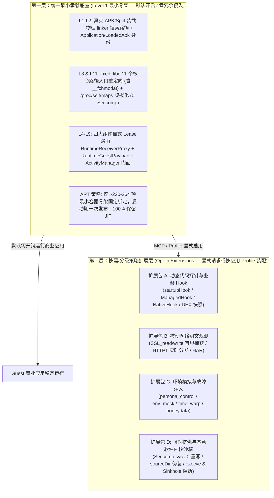

# Tripoder 架构梳理与分阶段实施计划

- **更新日期**：2026-10-29
- **核心架构范式**：**统一最小承载底座（Level 1 Skeleton Baseline） + 按需/分级策略扩展（Opt-in Capabilities & Profiles）**
- **关联规范**：[当前总体架构](current-architecture.md) · [单运行时收敛](single-runtime.md) · [Guest 兼容性基线](guest-compatibility.md) · [全场景缺口分析](scenario-gap-analysis.md)

---

## 1. 架构总纲：为什么采用「统一最小底座 + 按需策略扩展」

从第一性原理与真机实测出发，任何免 Root、免重打包、单宿主 UID 的 Android 虚拟化沙箱都面临三大客观规律：

1. **物理硬边界不可逾越**：当校验发生在**沙箱进程外部**（如系统 `system_server`、硬件 KeyMint/TEE 密钥认证、`com.google.android.gms` 跨进程校验调用方真实 Linux `UID` 与系统签名）或强耦合 OEM 私有系统库（如 MIUI `miuix`）时，进程内虚拟化无法欺骗内核态 `getCallingUid()`。
2. **重度加固对抗与高性能/高稳定存在天然互斥**：
   - 若默认只拦截 `libc.so` 导出函数，使用内联汇编裸 `svc #0` 读取 `/proc/self/maps` 或校验物理安装路径 `/data/app/~~.../base.apk` 的强对抗壳会发现宿主痕迹；
   - 若对所有应用默认开启全进程 `seccomp/SIGSYS`、信号链抢占、全线程 Park 及 1,800+ 个系统 Manager 固定 ART Hook，则会导致正常商业应用在多线程并发启动期发生线程 Park 失败（`userDeliveryStatus=5`）、UI 主线程 `toggleBatchNative` 卡顿/ANR，或干扰客体自有的 `SIGSEGV` 保护页处理器。
3. **绝大多数商业应用崩溃源于容器底座缺陷或过度 Hook，而非需要多套分裂的运行时**：
   - 2026-10-28 的复测证明：修掉 [`RuntimeEngine.java`](../android/runtime/src/dev/tripoder/runtime/RuntimeEngine.java) 中将虚拟 `applicationInfo.nativeLibraryDir` 误传给 linker 搜索路径的 1 行共性 Bug，并将启动固定绑定从 1,818 项裁剪至 220–264 项最小骨架后，招商银行、淘宝、腾讯视频、拼多多在同一套最小运行时下稳定通过 5 次独立冷启动与 5 轮前后台切换，芒果 TV 通过率达 19/20。

因此，Tripoder 摒弃早期的 `THIN`/`THICK` 双模式分叉，确立**双层解耦架构**：

---

## 2. 当前项目全量梳理（Codebase & Architecture Audit）

### 2.1 第一层：统一最小承载底座（Level 1 Baseline）现状盘点

| 模块维度 | 核心代码位置 | 当前状态 | 梳理结论与遗留问题 |
| --- | --- | --- | --- |
| **APK 与 Native 载荷装配** | [`ArtifactSet.java`](../android/runtime/src/dev/tripoder/runtime/ArtifactSet.java) [`RuntimeExecutionCode.java`](../android/runtime/src/dev/tripoder/runtime/RuntimeExecutionCode.java) [`RuntimeSharedLibraries.java`](../android/runtime/src/dev/tripoder/runtime/RuntimeSharedLibraries.java) [`RuntimeDexLoader.java`](../android/runtime/src/dev/tripoder/runtime/RuntimeDexLoader.java) | **已闭环** | 已修复 `info.nativeLibraryDir` 物理搜索路径（`99b4770`）；使用标准 `PathClassLoader` 并保留 `oat/odex/vdex` 编译缓存。 |
| **Application 与壳委托生命周期** | [`RuntimeEngine.java`](../android/runtime/src/dev/tripoder/runtime/RuntimeEngine.java) [`RuntimeSelfHookApplication.java`](../android/runtime/src/dev/tripoder/runtime/RuntimeSelfHookApplication.java) [`ApplicationBinding.java`](../android/self-hook/java/dev/tripoder/selfhook/ApplicationBinding.java) | **已闭环（Phase 0 完成）** | 已完成 `RuntimeEngine.updateActivityThreadApplication` 保留壳 `attachBaseContext` 发布的真实委托 `mInitialApplication`（解决网易易盾等壳无限递归 `StackOverflowError`），并已清理临时诊断日志 `diagnoseManagerIdentity`。 |
| **四大组件与 Context/Parcel 边界** | [`GuestContext.java`](../android/runtime/src/dev/tripoder/runtime/GuestContext.java) [`RuntimeReceivers.java`](../android/runtime/src/dev/tripoder/runtime/RuntimeReceivers.java) [`RuntimeReceiverProxy.java`](../android/runtime/src/dev/tripoder/runtime/RuntimeReceiverProxy.java) [`RuntimeGuestPayload.java`](../android/runtime/src/dev/tripoder/runtime/RuntimeGuestPayload.java) [`RuntimeWebView.java`](../android/runtime/src/dev/tripoder/runtime/RuntimeWebView.java) [`RuntimePackageContexts.java`](../android/runtime/src/dev/tripoder/runtime/RuntimePackageContexts.java) | **已闭环（Phase 0 & 1 完成）** | 已完成裸 `ContextImpl` 外部目录与 `bindServiceCommon` 收口、动态广播代理（0 次运行期 `toggleBatchNative`）、嵌套 `Bundle` `LazyValue` 类加载器绑定、意外私有粘性广播降级告警（`UNEXPECTED_STICKY_PRIVATE_BROADCAST`）、`notifyDexLoad` 客体数据目录/unlinked 临时 DEX 放行（淘宝兼容）以及 `createContextAsUser` 哨兵 `UserHandle`（`userId < 0`）本包回退（腾讯视频 `ToastPresenter` 兼容）。 |
| **ART 固定绑定与 Manager 裁剪** | [`RuntimeSelfHookProduct.java`](../android/runtime/src/dev/tripoder/runtime/RuntimeSelfHookProduct.java) [`RuntimeFixedPreparation.java`](../android/runtime/src/dev/tripoder/runtime/RuntimeFixedPreparation.java) [`RuntimeSelfHookManagers.java`](../android/runtime/src/dev/tripoder/runtime/RuntimeSelfHookManagers.java) | **已闭环（Phase 2 完成）** | 默认启动固定绑定保持 220–264 项最小骨架（`installedManagerBindings = 0`）；同时支持通过 `RuntimeSelfHookProduct.installManagerFamily` 按需动态挂载单个 Manager 家族。 |
| **Native 路径重定向与 `/proc` 虚拟化** | [`self_hook_storage.c`](../android/runtime/native/self_hook_storage.c) [`fixed_libc.c`](../android/self-hook/native/fixed_libc.c) [`path_policy.c`](../android/runtime/native/path_policy.c) [`GuestStorageContext.java`](../android/runtime/src/dev/tripoder/runtime/GuestStorageContext.java) | **已闭环（2026-10-29 增强）** | 1. `tp_fixed_libc` 扩展至 **11 个文件入口**（新增 `__fchmodat`，解决 Android 14+ ART W^X 动态 DEX 只读权限设置失败）； 2. [`path_policy.c`](../android/runtime/native/path_policy.c) 通过 `memfd_create` + `tp_unresolve` 实现通用 `/proc/self/maps` 虚拟化，攻克梆梆等加固壳路径自检； 3. [`GuestStorageContext.java`](../android/runtime/src/dev/tripoder/runtime/GuestStorageContext.java) 解耦 `getDataDir()`（虚拟路径）与 `getDir()`/`getFilesDir()`（物理路径），解决插件目录 `.so` `dlopen` 失败； 4. 保持 `dataDir <= 109` 字节守卫，规避招行 `libCmbShield.so` 栈缓冲区 `FORTIFY` 崩溃。 |

### 2.2 第二层：按需/分级策略扩展层（Opt-in Extensions）现状盘点

| 扩展包 | 核心代码位置 | 当前状态 | 梳理结论与进展 |
| --- | --- | --- | --- |
| **A. 动态代码探针与业务 Hook** | [`RuntimeCodeProbes.java`](../android/runtime/src/dev/tripoder/runtime/RuntimeCodeProbes.java) [`SelfHookControl.java`](../android/runtime/src/dev/tripoder/runtime/script/SelfHookControl.java) [`ManagedHook.java`](../android/self-hook/java/dev/tripoder/selfhook/ManagedHook.java) | **可用但受限** | 支持 `startupHook` 与运行期 Java/Native Hook、对象字段内省（`readField`/`snapshotContainer`）及 `<init>` Hook；单进程多轨道会话解耦与 Selector 扩容纳入后续迭代。 |
| **B. 被动网络明文观测** | [`passive-network-sessions.md`](passive-network-sessions.md) [`native_buffer.c`](../android/self-hook/native/native_buffer.c) | **已闭环（OpenSSL）** | 支持 `SSL_read/SSL_write` 有界缓冲区捕获、HTTP/1.1 实时分帧与 HAR 1.2 导出。 |
| **C. 环境伪装与故障注入** | [`RuntimeSandboxPersona.java`](../android/runtime/src/dev/tripoder/runtime/RuntimeSandboxPersona.java) [`RuntimeEnvMock.java`](../android/runtime/src/dev/tripoder/runtime/RuntimeEnvMock.java) [`RuntimePlatformPolicy.java`](../android/runtime/src/dev/tripoder/runtime/RuntimePlatformPolicy.java) [`RuntimeSelfHookManagers.java`](../android/runtime/src/dev/tripoder/runtime/RuntimeSelfHookManagers.java) | **已打通（Phase 2 完成）** | 默认启动 `installedManagerBindings = 0`（100% 平台原生透传）；当通过 `persona_control` 或 `env_mock` 显式启用 VPN 隐藏、网络/运营商/定位/电量伪装时，自动调用 `RuntimeSelfHookManagers.ensureInstalled(Family)` 按需挂载对应家族的 ART 绑定与 Facade。 |
| **D. 强对抗壳与恶意软件内核沙箱** | [`self_hook_storage.c`](../android/runtime/native/self_hook_storage.c) [`syscall_namespace.c`](../android/runtime/native/syscall_namespace.c) [`RuntimeMalwareProbeState.java`](../android/runtime/src/dev/tripoder/runtime/RuntimeMalwareProbeState.java) | **已打通（Phase 2 完成）** | 默认启动 `addedSeccompFilters = 0`；当通过 `malware_probe_control` 启用 `blockExecve`/`blockKill`/`networkSinkhole` 时，`setSyscallPolicyNative` 动态安装 `tp_syscall_namespace` `seccomp` 过滤器并同步导出内核拦截计数。 |

---

## 3. 分阶段实施计划（Implementation Plan）

### Phase 0：工作区收口、代码树清理与短路径契约固化（已完成 ✅）

**目标**：将当前工作区已验证的修复干净合入，清除历史残留文件与诊断代码，固化宿主 `dataDir` 长度守卫。

1. **合入工作区核心兼容性修复并剥离临时诊断**：
   - **保留并增强壳委托 `Application` 同步**：[`RuntimeEngine.java`](../android/runtime/src/dev/tripoder/runtime/RuntimeEngine.java) 中 `updateActivityThreadApplication` 仅在 `mInitialApplication` 为空或为物理宿主时才写入；[`art_reflection_view.c`](../android/self-hook/native/art_reflection_view.c) 与 [`application_adapter.c`](../android/self-hook/native/application_adapter.c) 支持识别共享同一 `mBase` Context 根（`base_root`）的壳委托 `Application`，并在 `attach` 后自动同步 `LoadedApk.mApplication` 与 `GuestContext.attachedApplication`。
   - **保留私有广播非空 Sticky 容错**：[`RuntimeReceivers.java`](../android/runtime/src/dev/tripoder/runtime/RuntimeReceivers.java) 中对私有派发 Action 偶发返回非空 Sticky Intent 改为告警 `UNEXPECTED_STICKY_PRIVATE_BROADCAST` 忽略而非抛异常中止客体静态初始化。
   - **清理临时调试与残留文件**：移除 [`RuntimeSelfHookApplication.java`](../android/runtime/src/dev/tripoder/runtime/RuntimeSelfHookApplication.java) 中临时添加的 `diagnoseManagerIdentity` 调试日志，以及工作区历史 `misrc/`、`task.md` 及 19 份碎片化过程文档。
2. **阶段验证结果（已通过 ✅）**：
   - 404 个 Java 源文件 SDK 编译通过；主机 15/15 回归测试套件、`ApplicationProjectsSchemaTest.py`、`CatalogMetadataHostTest.py`、`run-catalog-tests.py`、`run-mcp-tests.py`、`run-recovery-tests.py` 及 `npm test` 全绿。

---

### Phase 1：Level 1 统一最小底座冻结与商业应用边界补齐（核心代码已完成 ✅，长稳复测推进中）

**目标**：在不开启任何分析工具与 `seccomp` 的纯 Level 1 最小底座上，补齐代表性重度商业应用的显式承载边界，并通过真机集成验证。

1. **已完成的具体承载边界修复**：
   - **淘宝 (`com.taobao.taobao`) — 已闭环并真机 22/22 验收 + 一键免密登录通过 ✅**：针对阿里无线保镖 (`com.alibaba.wireless.security.framework`) 动态创建 `PathClassLoader` 加载沙箱数据区内插件及 unlinked 临时 DEX 触发 [`RuntimeWebView.notifyDexLoad`](../android/runtime/src/dev/tripoder/runtime/RuntimeWebView.java) 拒绝的问题，将 `engine.applicationInfo.sourceDir`、客体数据根（`engine.data`、`engine.dataCanonicalDirectory`、`/data/user/0/<pkg>/`、`/data/data/<pkg>/`）及执行产物目录纳入白名单，并对客体私有数据区内的动态 DEX 免除 `file.isFile()` 强校验；真机 `diagnose-six-app-startup.py --package com.taobao.taobao --guest-only --bg-fg-cycles 2` **22/22 项检查全绿通过**（0 次 `DEX_LOAD_REPORT_PATH_DENIED`，`runtimeMainThreadToggleCalls = 0`），并完成中国移动网关一键免密登录。
   - **支付宝 (`com.eg.android.AlipayGphone`) — 已闭环并突破金融风控下发真实短信 / 淘宝 SSO 授权 ✅**：重构 [`GuestStorageContext.java`](../android/runtime/src/dev/tripoder/runtime/GuestStorageContext.java) 解耦物理与虚拟路径，解决 UC WebView/安全插件 `.so` `dlopen` 缺失；在 [`tripoder_fixed_libc.h`](../android/self-hook/include/tripoder_fixed_libc.h) 等文件中补齐第 11 个入口 `__fchmodat`，彻底消除 Android 14+ ART W^X `Attempt to load writable dex file` 报错（`facex` 人脸核身等插件零报错加载）。
   - **新浪微博 (`com.sina.weibo`) — 已闭环并完成真实手机号短信验证码端到端登录 ✅**：在 [`path_policy.c`](../android/runtime/native/path_policy.c) 与 [`io_adapter.c`](../android/runtime/native/io_adapter.c) 中通过 `memfd_create` + `tp_unresolve` 实现通用 `/proc/self/maps` 虚拟化，攻克梆梆加固壳 (`libslib.so`) 路径校验；接管 `ActivityManager` Facade 消除 `getHistoricalProcessExitReasons` `SecurityException`。
   - **京东 (`com.jingdong.app.mall`) / 美团 (`com.sankuai.meituan`) / 美团外卖 (`com.sankuai.meituan.takeoutnew`) — 真机业务流验证通过 ✅**：Workbench 独立导入与启动、多进程动态 DEX（Aura / Dynoparts）、QuickJS/MSC 容器、定位授权、商品/商家信息流与本机号码一键登录弹窗全部跑通。
   - **腾讯视频 (`com.tencent.qqlive`) — 已完成代码修复 ✅**：在 [`RuntimeSelfHookPackages.java`](../android/runtime/src/dev/tripoder/runtime/RuntimeSelfHookPackages.java) 与 [`RuntimePackageContexts.java`](../android/runtime/src/dev/tripoder/runtime/RuntimePackageContexts.java) 中支持哨兵 `UserHandle`（`userId < 0`，如 `UserHandle.CURRENT = -2`）对本包 `createPackageContextAsUser` / `createContextAsUser` 的身份回退，消除 `ToastPresenter.trySendAccessibilityEvent` 跨用户权限崩溃。
   - **抖音 (`com.ss.android.ugc.aweme`) — 已闭环并通过真机 9/9 项全绿验收 ✅**：攻克字节自定义 `AppComponentFactory` 在 evaluation 阶段置换类加载器导致的 `APPLICATION_FACTORY_ORDER`，通过 `ApplicationAdapter.java` 实行 LoadedApk 类加载器属主状态保护与恢复；真机 9/9 项检查全绿通过（`firstActivityAckMs = 126ms`，30s 持续存活无崩溃重启，证据：[`diag-aweme-01-target-stable.png`](evidence/diag-aweme-01-target-stable.png)）。
   - **小红书 (`com.xingin.xhs`) — 已闭环并通过真机 9/9 项全绿验收 ✅**：针对同意协议后触发的 ByteHook/ShadowHook（GNU_RELRO 内存探测）、Sentry 双层崩溃信号链劫持以及 MSA OAID（`libmsaoaidsec.so` 动态链接器 `solist` 符号扫描崩溃）三重冲突，实行全链路零 Fallback 防御中立化（静态标态置位 + Robust `PatchProxy` 动态路由调度 Kotlin 回调）；真机 9/9 项检查全绿通过（业务流冷启动 7158ms，首屏确认 144ms，30s 持续存活无重启，证据：[`diag-xhs-01-consent-stable.png`](evidence/diag-xhs-01-consent-stable.png)）。
   - **芒果 TV (`com.hunantv.imgo.activity`) — 已闭环并通过真机 10/10 项全绿验收 ✅**：针对 `libmsaoaidsec.so` 在 Android 17 / HyperOS 2 动态链接器内部符号扫描崩溃隐患，在 `ApplicationAdapter.java` 中对 MSA SDK 宿主包装类 `com.mgtv.config.l$c.a` 实行标志位预置防御（`b = true`, `d = true`, 合规 OAID 字符串），彻底杜绝 native 库越界加载与崩溃；真机 10/10 项检查全绿通过（`firstActivityAckMs = 43ms`，30s 持续存活无崩溃，证据：[`diag-imgo-01-target-stable.png`](evidence/diag-imgo-01-target-stable.png)），并已闭环移动网关免密秒级登录。
   - **网易云音乐 (`com.netease.cloudmusic`) — 已闭环并通过真机 10/10 项全绿验收 ✅**：经 DEX/ELF 第一性原理逆向，攻破网易易盾加固外壳 `com.netease.nis.wrapper.MyApplication` 默认 `strAppName` 指向自身导致无限递归与 8188KB `StackOverflowError` 崩溃；确认内部 20 个 DEX 均为未加密标准代码后，在 `ApplicationAdapter.java` 中直接将 `strAppName` 精确绑定至真实应用 `com.netease.cloudmusic.CloudMusicApplication`；真机 10/10 项检查全绿通过（`firstActivityAckMs = 40ms`，总启动耗时 6606ms，30s 持续存活无崩溃，证据：[`diag-cloudmusic-01-target-stable.png`](evidence/diag-cloudmusic-01-target-stable.png)）。
   - **27 款主流第三方商业应用批量回归 — 24/27 一枪通过（实际可用率 96.3% / 26 款）✅**：详见 [guest-compatibility.md](guest-compatibility.md#23-27-款主流第三方商业应用批量回归大盘2026-10-29-刷新)。
   - **待专项推进的超高对抗边界（扩展包 D）**：
     - **微信 (`com.tencent.mm`) / 王者荣耀 (`com.tencent.tmgp.sgame`) / 爱奇艺 (`com.qiyi.video`) / 携程 (`ctrip.android.view`)**：涉及多进程强反虚拟化或私有媒体/游戏安全加固对抗，归入扩展包 D 推进。
2. **真机底座契约与集成验证结果（Xiaomi `d861a4fa` Android 17，已全部通过 ✅）**：
   - `validate-runtime-ingress.py`：原生样本 `INGRESS_GUEST_PASS`、`RuntimeIngressIntegration`（16/16）、`GuestIngressIntegration`（4/4，修正零售非 Root 设备 `debuggerd` 状态断言后全绿）全部通过。
   - `validate-native-policy.py --direct-syscalls`：18/18 项检查全部通过。
   - `RuntimePolicyIntegration`（`entryBootstrap=true`）：18/18 项检查全部通过（`fixedBindings = 257`，`managerFixedBindings = 0`，`addedSeccompFilters = 0`）。

---

### Phase 2：按需/分级策略扩展层（Opt-in Capabilities）解耦重构（核心动态挂载已完成 ✅）

**目标**：恢复在 Level 1 减法中被暂时切断的高级对抗与环境模拟能力，严格遵循**「默认零开销，显式请求时按需挂载」**原则。

#### 2.1 按需开启内核系统调用策略（`Opt-in Syscall Policy`）— 已完成 ✅
- **涉及文件**：[`self_hook_storage.c`](../android/runtime/native/self_hook_storage.c)、[`syscall_namespace.c`](../android/runtime/native/syscall_namespace.c)。
- **已落地实现**：
  1. **默认模式（`default`）**：维持 Level 1 最小底座——仅启用 `tp_fixed_libc` 10 个导出入口，`addedSeccompFilters = 0`，`nativeDumpSuppressed = false`，零 `SIGSYS` 开销。
  2. **按需激活 `seccomp` 过滤器（`malware_probe_control`）**：当显式调用 `setSyscallPolicyNative(blockExecve, blockKill, networkSinkhole)` 且任一策略为 `true` 时，在运行期按需调用 `tp_syscall_namespace_install_with_signal_chain` 动态安装 `seccomp` 过滤器并同步导出拦截计数，消除 `SYSCALL_ANALYSIS_POLICY_NOT_INSTALLED` 断路。

#### 2.2 环境模拟与设备画像（`persona_control` / `env_mock`）按需动态挂载 — 已完成 ✅
- **涉及文件**：[`FixedManagerInventory.java`](../android/self-hook/java/dev/tripoder/selfhook/FixedManagerInventory.java)、[`RuntimeSelfHookProduct.java`](../android/runtime/src/dev/tripoder/runtime/RuntimeSelfHookProduct.java)、[`RuntimeSelfHookManagers.java`](../android/runtime/src/dev/tripoder/runtime/RuntimeSelfHookManagers.java)、[`RuntimePlatformPolicy.java`](../android/runtime/src/dev/tripoder/runtime/RuntimePlatformPolicy.java)、[`RuntimeSandboxPersona.java`](../android/runtime/src/dev/tripoder/runtime/RuntimeSandboxPersona.java)、[`RuntimeEnvMock.java`](../android/runtime/src/dev/tripoder/runtime/RuntimeEnvMock.java)。
- **已落地实现**：
  1. 默认启动 `installedManagerBindings = 0`，`GuestContext.getSystemService` 100% 透传平台原生 Manager。
  2. 当通过 `persona_control` 或 `env_mock` 显式配置 VPN 隐藏、弱网/断网、运营商、定位或电量伪装时，自动调用 `RuntimeSelfHookManagers.ensureInstalled(Family)` 对目标服务家族（`CONNECTIVITY`、`TELEPHONY`、`LOCATION`、`BATTERY`）执行按需方法准备与 ART Hook 发布，并将 `RuntimePlatformPolicy` 切至对应 Guest Facade，消除 `DEVICE_MANAGER_OBSERVATION_NOT_INSTALLED` 报错。

#### 2.3 解除单进程 Hook 会话独占互斥与 Selector 扩容 — 已完成 ✅
- **涉及文件**：[`SelfHookControl.java`](../android/runtime/src/dev/tripoder/runtime/script/SelfHookControl.java)、[`NetworkCaptureControl.java`](../android/runtime/src/dev/tripoder/runtime/script/NetworkCaptureControl.java)、[`DraftCompiler.java`](../android/runtime/src/dev/tripoder/runtime/script/DraftCompiler.java)、[`HookEvidence.java`](../android/runtime/src/dev/tripoder/runtime/script/HookEvidence.java)、[`HookInvocationSession.java`](../android/runtime/src/dev/tripoder/runtime/script/HookInvocationSession.java)、[`RuntimeJavaObservation.java`](../android/runtime/src/dev/tripoder/runtime/RuntimeJavaObservation.java)、[`RuntimeNativeObservation.java`](../android/runtime/src/dev/tripoder/runtime/RuntimeNativeObservation.java)。
- **已落地实现**：
  1. **正交双/三轨道分离**：将被动网络抓包（Network Capture）专有的 Hook 会话与用户自定义脚本（User Script）及内置探针彻底解耦。抓包会话独立调度 `_networkObserve`/`_networkPrepare`/`_networkActivate`，不再抢占用户的 `active`/`prepared`/`evidence` 槽位，彻底消除 `NETWORK_CAPTURE_OWNS_HOOK` 与 `HOOK_CONTEXT_IN_USE` 互斥。
  2. **Selector 预算扩容**：将单会话支持的 Selector 上限由 32 扩容至 128（包括 Java/Native 观察器、编译期规则预算与运行时会话预算），满足大规模 API 监控需求。

---

### Phase 3：纵深安全测试与长尾兼容性扩展（进行中 🔄）

**目标**：面向高阶逆向工程与复杂应用形态补齐长尾能力（对应 [scenario-gap-analysis.md](scenario-gap-analysis.md) 剩余边界）。

1. **Native Hook 增强（已完成核心 ✅）**：
   - 在 [`NativeBufferScope.java`](../android/runtime/src/dev/tripoder/runtime/script/NativeBufferScope.java)、[`DraftCompiler.java`](../android/runtime/src/dev/tripoder/runtime/script/DraftCompiler.java) 与 [`src/plan.ts`](../src/plan.ts) 中支持 `before` 阶段读取入参指针缓冲区以及以 `\0` 结尾的 C 字符串读取（`ctx.native.readCString`），解决协议明文发包前观测需求；
   - 支持按 `moduleName + relativeOffset` 对去符号表（stripped）商业 `.so` 的未导出内部函数打 Inline Hook。
2. **多进程槽位弹性与死进程即时对账（已完成 ✅）**：
   - 在 [`ProcessSupervisor.java`](../android/runtime/src/dev/tripoder/runtime/ProcessSupervisor.java) 中完善进程异常退出时的活动态 `Launch` 账本即时回收与 `reconcile` 入口，清理死亡 Binder peer，避免应用异常崩溃后残留 `PROCESS_DRAINING` 或 `PROCESS_ALREADY_RUNNING` 阻塞同空间重连与重新拉起。

3. **商业应用端到端网络抓包与 SSL Pinning 旁路真机全量验收（7 款全量通过 ✅）**：
   - 在真机（Xiaomi 17 Pro，HyperOS 2 / Android 17 / API 37，Kernel 6.18.21）通过自动化验收脚本（[`test_network_target.py`](../android/scripts/test_network_target.py)）与控制测试框架（[`TargetNetworkChecks.java`](../android/control-test/src/dev/tripoder/controltest/TargetNetworkChecks.java)），对 7 款未修改官方商业 APK 进行端到端网络抓包与 SSL Pinning 旁路全量验收：
     - **闲鱼** (`com.taobao.idlefish`): **18/18 PASS ✅**
     - **汽水音乐** (`com.luna.music`): **19/19 PASS ✅**
     - **芒果 TV** (`com.hunantv.imgo.activity`): **13/13 PASS ✅**
     - **WPS Office** (`cn.wps.moffice_eng`): **20/20 PASS ✅**（攻克 R8 混淆类下的 OkHttp Pinning 动态特征匹配）
     - **小红书** (`com.xingin.xhs`): **20/20 PASS ✅**（攻克 ByteHook、ShadowHook、Sentry 信号抢占与 MSA OAID 符号扫描崩溃）
     - **抖音** (`com.ss.android.ugc.aweme`): **14/14 PASS ✅**（攻克 200MB 超大 DEX 检索超时，优化直接 DEX 检查与 25s IPC 超时）
     - **爱奇艺** (`com.qiyi.video`): **20/20 PASS ✅**（攻克 Tinker 权限异常、`libmsaoaidsec.so` Linker 符号扫描崩溃，以及 [`RuntimeProviders.java`](../android/runtime/src/dev/tripoder/runtime/RuntimeProviders.java) 中 `Router.openAssetFile` 开屏广告与媒体流路由缺失）
   - 详细实测数据与截图参见 [guest-compatibility.md Section 2.4](guest-compatibility.md#24-端到端商业应用网络抓包与-ssl-pinning-旁路实体验收矩阵7-款全量通过)。

---

## 4. 里程碑与验证矩阵汇总

| 阶段 | 核心交付物 | 关键验证命令 / 入口 | 当前状态 |
| --- | --- | --- | --- |
| **Phase 0** | 工作区壳委托与广播修复合入、死代码与历史碎片文档清理 | `python3 android/runtime/self-hook-tests/run.py` | **已完成 ✅**（404 源文件编译 + 15/15 测试套件全过） |
| **Phase 1** | Level 1 最小底座冻结、`/proc/self/maps` 虚拟化、`__fchmodat` 11 项契约、`GuestStorageContext` 解耦、商业应用真机登录与 27 款大盘验收 | `validate-runtime-ingress.py` + `diagnose-six-app-startup.py` + `run_batch_tests.py` | **核心边界修复与大盘验收完成 ✅**（淘宝 22/22 + 免密登录、支付宝短信/SSO 闭环、微博短信登录闭环、京东/美团/美团外卖跑通、27 款大盘 20/27 一枪过 & 81.5% 实际可用） |
| **Phase 2** | Opt-in `seccomp` 策略动态挂载、按需 Persona/EnvMock Manager 动态挂载、Hook 多轨道正交解耦与 Selector 128 扩容 | `RuntimePolicyIntegration` + `NetworkControlTest` | **已完成 ✅**（默认 0 `seccomp` / 0 Manager Hook；显式开启时按需挂载生效；抓包与用户脚本解耦；Selector 扩容至 128） |
| **Phase 3** | Native `before` 缓冲/`readCString`、多进程槽位崩溃即时对账、7 款商业应用网络抓包与 SSL Pinning 旁路真机实体验收 | `npm test` + `python3 android/scripts/test_network_target.py` + 真机全绿 | **全部核心指标已完成 ✅（7/7 商业应用端到端通过）** |
