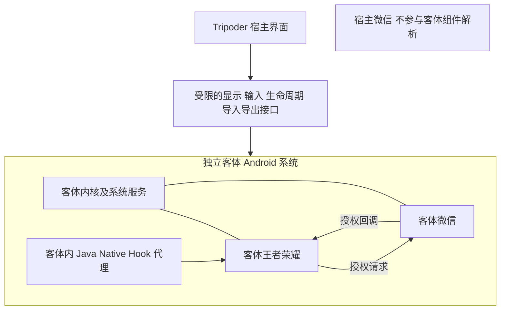

# 完整 Android 隔离后端可行性

2026-10-13 的源码检查与普通应用真机探针确认：当前 Tripoder 使用宿主 UID 加载游戏，不能满足客体与宿主隔离。测试手机虽然声明支持 AVF，但普通安装应用没有管理／自定义虚拟机权限，直接打开已检查的虚拟化设备节点也失败。**当前没有通过验证、可用于产品的完整 Android 隔离后端。**

本轮目标是验证后端可行性，保留完整 Android、Java／Native Hook、宿主零 Root、零 ADB 激活的产品要求。独立软件虚拟机 APK 已改为从源码构建引擎，原协程 PAC 失败已定位并修复，真机协程回归通过。客体已进入内核、init、Zygote 和 SurfaceFlinger；启动动画阶段的后续 SIGILL 已取到故障指令，确认 CMLE 操作码错误并修复，完整 Android 启动仍在验证。产品运行代码尚未切换后端，现有版本的宿主微信跳转问题仍未修复。

## 微信登录跨环境的根因

当前调用链由客体代码进入宿主 Android：

1. `GameRuntime.prepare()` 使用 `DexClassLoader` 加载安装包，把 `ApplicationInfo.uid` 设置为 Tripoder UID。
2. `GamePackageManager` 只处理游戏自身的少量查询。其他包的查询、启动 Intent，以及继承的组件解析都直接交给宿主包管理器，所以会发现宿主微信。
3. `GameContext` 没有接管完整的组件分发；大部分系统服务也使用宿主实例。客体 Activity 仍由宿主系统管理，启动请求可以到达宿主 ActivityTaskManager。
4. 仓库没有客体微信的安装、进程、组件或授权回调运行时。因此当前没有可以接收请求的独立微信环境。

代码位置：[GameRuntime.java](../android/app/src/main/java/dev/tripoder/hooklab/GameRuntime.java)、[GamePackageManager.java](../android/app/src/main/java/dev/tripoder/hooklab/GamePackageManager.java)、[ForwardingPackageManager.java](../android/app/src/main/java/dev/tripoder/hooklab/ForwardingPackageManager.java)、[GameContext.java](../android/app/src/main/java/dev/tripoder/hooklab/GameContext.java)。

修改微信包名查询或拦截一个 `startActivity` 入口，不能覆盖显式组件、IntentSender／PendingIntent、Service、Provider、广播、Native 与直接 Binder 调用。完整隔离的执行边界必须覆盖全部客体代码，不能依赖代码自愿经过 Context 包装器。

## 目标边界

一个客体 Android 系统是应用互通的边界。同一客体系统内同时安装王者荣耀和微信，各自有独立应用 UID 与数据；登录请求与回调由该客体自己的包管理器和组件管理服务处理。项目是脚本和任务的组织单元，不能将每个项目简单视为互不连通的 Android 系统，否则无法完成正常跨应用授权。



必须满足以下规则：

- 客体包查询、Intent 解析和账号数据只来自当前客体系统。宿主是否安装或登录微信，不改变客体解析结果。
- 客体内未安装微信时返回目标缺失，不能打开宿主微信、宿主浏览器或宿主应用选择器补齐能力。
- Activity、Service、Provider、广播、PendingIntent 和授权回调均留在同一客体。未实现的能力明确拒绝，不交回宿主系统执行。
- 客体数据盘、账号、Keystore、剪贴板和文件选择默认不与宿主共享。明确的导入导出操作只传递选定数据，不传递宿主 Context、原始系统 Binder 或宿主私有目录。
- 客体网络使用受控虚拟网卡。面向宿主本地服务和局域网的访问须有独立策略，不能把“有虚拟网卡”视为网络隔离已经完成。
- Hook 执行于客体内。客体内部的管理权限不能转化为宿主 Root／ADB 权限；宿主 AI 密钥与运行控制数据不进入客体。
- 后端不可用时拒绝隔离运行，不能自动使用当前同 UID 运行器。

## 普通应用真机证据

新建独立 `dev.tripoder.isolationprobe` APK，使用与当前产品相同的 targetSdk 36，`debuggable=false`。探针在 Manifest 中声明两项虚拟机权限，检查系统是否实际授予，并尝试 `open(O_RDWR)` 后立即关闭设备节点。没有调用设备 ioctl、创建虚拟机或运行游戏。

通过 ADB 安装并启动 Activity；所有访问检查由应用 UID 10395 执行，SELinux 域为 `untrusted_app_34`，不是 shell／root。ADB 仅用于部署和取回报告，没有授予权限。取证后临时探针已卸载；原 Tripoder 和微信未替换。

| 检查项 | 2026-10-13 实测 |
|---|---|
| 系统与 ABI | Android 17，API 37，arm64-v8a |
| AVF feature | true |
| 普通探针 MANAGE_VIRTUAL_MACHINE | 未授予，即使 Manifest 已声明 |
| 普通探针 USE_CUSTOM_VIRTUAL_MACHINE | 未授予，即使 Manifest 已声明 |
| Tripoder | 0.6.0-preview，UID 10389；两项权限均未申请、未授予 |
| `/dev/kvm` | `ENOENT`，节点不存在 |
| `/dev/gunyah` | `EACCES`，应用无法打开 |
| `/dev/vhost-vsock` | `EACCES`，应用无法打开；此节点本身也不提供虚拟 CPU |
| VM 创建／Android 启动／GPU／Hook／跨应用登录 | 均未验证通过 |

系统权限定义另经只读查询核对：`MANAGE_VIRTUAL_MACHINE` 为 `signature|development|preinstalled`，`USE_CUSTOM_VIRTUAL_MACHINE` 为 `signature|development`。AOSP 的虚拟机创建代码会检查管理权限，自定义配置还检查自定义 VM 权限。[AOSP 权限检查源码](https://android.googlesource.com/platform/packages/modules/Virtualization/+/0f849a4bdf2e42e24986f05b0a6c9f8060320c8a/android/virtmgr/src/aidl.rs)

原始应用报告：[app-probe.json](evidence/android-isolation-2026-10-13/app-probe.json)。构建与源码摘要：[build-receipt.json](evidence/android-isolation-2026-10-13/build-receipt.json)。设备系统升级后应重新测量；这些结果不能推广为所有 Android 设备都不支持。

## 后端判断

| 路线 | 隔离及 Hook 目标 | 当前判断 |
|---|---|---|
| AVF／硬件虚拟机加完整 Android 镜像 | 架构方向符合；还需要图形和客体 Hook 集成 | 当前普通 APK 的权限前置条件不满足，需要厂商／系统集成；不是添加 Manifest 权限即可解决 |
| 普通 APK 内 QEMU TCG 全系统模拟加 ARM64 Android | 可作为独立系统候选，Hook 设计在客体内 | 源码引擎已修复协程 PAC 问题，启动推进至图形服务与启动动画；后续 CMLE 编码错误已修复且原生回归通过，完整 Android、GPU、Hook 均未通过 |
| 当前 DexClassLoader 加 Context 包装 | 共享宿主权限与服务 | 不符合目标，不能作为隔离后端 |
| Android 工作资料空间 | 可以分离应用与账号，但共享宿主系统，现有 Hook 方式不能直接沿用 | 用户已选择保留完整 Android 与 Hook 目标，本轮不采用 |

AVF 提供虚拟机执行机制，但自带的 Microdroid **不支持 Android Java 框架、SystemServer／Zygote、图形 UI**，不能直接承载微信和王者荣耀。完整 Android 镜像与虚拟显示／GPU、音频、输入和网络集成仍是必要工程。[AVF](https://source.android.com/docs/core/virtualization) · [Microdroid 能力边界](https://source.android.com/docs/core/virtualization/microdroid)

QEMU TCG 能模拟 CPU 并用于全系统模拟；该能力不证明其在这台手机上已能运行 Android 或达到游戏帧率。若保持普通 APK、零 Root、零 ADB 激活约束，这是下一项独立验证候选，不是自动回退路径。[QEMU TCG](https://www.qemu.org/docs/master/about/emulation.html) · [ARM 全系统模拟](https://www.qemu.org/docs/master/system/target-arm.html)

## 预编译引擎历史实测

独立原型位于 [`android/vm-probe`](../android/vm-probe/README.md)。固定引擎为 Limbo 6.0.1 发布的 QEMU 5.1.0 ARM64 原生库，固定镜像为 LineageOS 23.2 `virtio_arm64only user 20260917`。下载文件、动态库和原始磁盘均已校验 SHA-256，当时摘要与来源保存在 [预编译依赖锁](evidence/android-software-vm-2026-10-13/prebuilt-dependencies.lock.json)。该版本组合是待测候选，不因镜像可在其他 QEMU 环境启动而视为此处可用。

APK 使用 UID 10396，`debuggable=false`，未申请权限，包括 INTERNET。模拟器固定为 TCG、2 个虚拟 CPU、2 GiB 客体内存；无客体网卡、端口转发、共享文件系统、宿主 Intent／Binder／包管理桥接。ADB 只承担安装、预置镜像、发送固定动作和取证，没有执行 Root、权限授予或运行器激活。安装与导入完成后，UI 按钮可启动同一路径；物理断开 USB 后启动尚未验收。

| 检查项 | 真机结果 |
|---|---|
| 普通 APK 安装、原生库加载、镜像摘要校验 | 通过 |
| 客体 ARM64 CPU 与 UEFI 执行 | 固件串口已有实际执行日志 |
| 完整 Android 内核、系统服务、桌面 | 未通过，进入客体内核前进程崩溃 |
| 重复性 | 保留客体磁盘重开应用，两次出现相同崩溃栈 |
| 图形性能、Java／Native Hook、跨应用隔离验收 | 第一阶段未通过，未开展 |

两次系统退出记录均为 `APP CRASH(NATIVE)`、状态 4；crash dump 指向 `SIGILL / ILL_ILLOPN`，ESR 为 `0x72000000 (PAC Exception)`。栈顶为宿主 `libc.so siglongjmp+428`，调用者为 `libqemu-system-aarch64.so qemu_coroutine_switch+100`。可以确定失败边界在原生引擎协程切换，不能把它解释为客体微信、Android 权限不足或纯粹模拟速度慢。

所用移植启用了 `sigaltstack` 协程。上游实现通过 `sigsetjmp/siglongjmp` 切换执行上下文；Bionic ARM64 实现会认证保存的返回地址。它们与崩溃位置一致，但当时尚未证明具体是哪一步造成 PAC 认证失败；下节源码诊断补齐了跨线程复用证据。[QEMU 协程源码](https://github.com/qemu/qemu/blob/v5.1.0/util/coroutine-sigaltstack.c) · [Bionic setjmp 源码](https://android.googlesource.com/platform/bionic/+/17d017b676f27ac4c87644756f19dc5ba7adcd57/libc/arch-arm64/bionic/setjmp.S)

结论是**本次预编译引擎组合不通过**，不是证明所有普通 APK 软件模拟路线均不可行。该失败推动了下节的源码构建、协程最小回归与完整 Android 再验证。保留宿主 PAC 与普通应用权限边界，不通过关闭保护、宿主提权或退回同 UID 游戏运行器绕过失败。

完整证据：[result.json](evidence/android-software-vm-2026-10-13/result.json)、[构建摘要](evidence/android-software-vm-2026-10-13/build-receipt.json)、[首次崩溃](evidence/android-software-vm-2026-10-13/first/native-crash.txt)、[重复崩溃](evidence/android-software-vm-2026-10-13/repeat/native-crash.txt)、[系统退出记录](evidence/android-software-vm-2026-10-13/process-exit-info.txt)。本次结束时测试进程已退出，保留独立 APK 与实验磁盘用于复现。

## 源码引擎与 PAC 修复进展

当前 APK 只加载从固定源码构建的 `libtripoder-qemu.so`，不再加载上述 Limbo 库。QEMU、GLib、Pixman、libffi、gettext 与 NDK r30 的来源和摘要见 [原生依赖锁](../android/vm-probe/native/dependencies.lock.json)，构建过程与协程生命周期规则见 [原生引擎说明](../android/vm-probe/native/README.md)。

源码诊断在 `siglongjmp` 之前捕获了保存线程 23559、恢复线程 23579。Android Bionic 为现代 targetSdk 应用的线程分别设置 PAC APIA 密钥；旧全局协程池将带有已签名返回地址的栈跨线程复用，违反这一边界。[Bionic 线程创建源码](https://android.googlesource.com/platform/bionic/+/9405602385fe80d117a6e53f81ac93699c9460b1/libc/bionic/pthread_create.cpp)

修复使用线程内池，并在首次执行线程创建栈。新任务跨线程领取已终止的空闲协程时重新创建栈；活动协程不能跨线程恢复，违规在跳转前终止并记录。线程退出通过 pthread-key 析构释放池，信号引导初始化用互斥锁串行化。没有关闭 PAC、降低 targetSdk、移除 FORTIFY 或改变宿主保护。

真机回归已经通过 4 个线程、12,293 个协程、73,758 次切换，以及多层栈 canary、归属检查和线程退出回收。客体首次启动完成 APEX 初始化，启动 Zygote、SurfaceFlinger 并注册图形分配器，但在启动动画阶段进程收到 `SIGILL / ILL_ILLOPC`，ESR 为 0、PC 在匿名执行区。指令诊断版再次复现，PC `0x6c54e44760` 对应非法字 `0x6ee0a800`，与错误的 `I3617_CMLE0` 常量吻合。已修正为正确 CMLE 编码并覆盖相邻标量形式问题；另移植单指令 TB 链接，消除已知的两指令并发更新竞态。最终版真机通过 100 万次并发跳转及 56 组向量／标量比较，客体已显示 LineageOS 启动动画。但同轮在客体约 1048 秒出现 watchdog 诊断，1094 秒 Zygote 被终止，1105 秒重新启动，未进入桌面。原生引擎未崩溃，随后经 QMP 正常停止。

完整日志轮在固定 EFI 的普通启动配置追加 `androidboot.seriallogging.logcat_buffer=all`，捕获到主线程 60 秒 watchdog：包管理器完成 188 个应用的数据核对后，主线程仍连续启动系统服务，最后在 `AppHibernationService` 构造时被终止。原生引擎没有再次发生 PAC 或 SIGILL。

后续轮追加镜像上游提供的 `androidboot.low_perf=1`，验证纯软件模拟器的超时配置。该配置将硬件超时乘数设为 50、启用低内存策略并跳过首次设置向导，默认 watchdog 阈值成为 3000 秒，检查与终止路径仍开启。未修改 PAC、SELinux、宿主权限或客体 ADB 认证。磁盘配置仍采用整盘临时副本加原子替换；独立 GPT/FAT 读取及整盘字节审计确认仅 GRUB 内容和长度字段变化，旧诊断配置升级不丢失客体数据。延长超时本身不算启动通过，仍等待启动完成及桌面证据。实验 APK 自身的 60 分钟运行上限与客体 watchdog 阈值分别记录。

软件模拟器配置轮已越过原 watchdog 位置，完成核心服务 phase 500/520，随后客体 SurfaceFlinger 因 `No matching frame rate modes for primary range` 断言退出。日志中的 60.00384 Hz 模式满足 DisplayManager 的 0.01 Hz 容差，却不满足 SurfaceFlinger 的 0.001 Hz 容差。默认模式自身匹配分辨率、DPI 与分组；真正清空候选的是 60 Hz 的 render 上限与镜像关闭帧率覆盖的组合。[模式投票](https://github.com/LineageOS/android_frameworks_base/blob/lineage-23.2/services/core/java/com/android/server/display/mode/VoteSummary.java#L247-L264) · [SurfaceFlinger 过滤](https://github.com/LineageOS/android_frameworks_native/blob/lineage-23.2/services/surfaceflinger/Scheduler/RefreshRateSelector.cpp#L1661-L1684) · [帧率容差](https://github.com/LineageOS/android_frameworks_native/blob/lineage-23.2/services/surfaceflinger/Scheduler/include/scheduler/Fps.h#L112-L119)

已在设备模型层把固定屏幕描述为唯一的 1024×768、精确 60 Hz DTD，不再使用通用桌面显示器的多模式 EDID。独立时序解码、校验和及边界回归通过；客体 `DisplayDeviceInfo` 已确认唯一模式为 60.0 Hz，系统越过旧断言点并进入 phase 600。保持客体检查和断言，未增加显示 fallback。HWC fence 超时仍有记录，必须继续观察实际显示提交，不能只以 SurfaceFlinger 存活判断图形链通过。

该轮又揭示了上游低内存配置与镜像桌面能力的冲突：SystemUI 两次创建 `windowingMode=5` root task 时被框架拒绝。`ro.config.low_ram=true` 使 [ActivityTaskManager](https://github.com/LineageOS/android_frameworks_base/blob/lineage-23.2/core/java/android/app/ActivityTaskManager.java#L246) 关闭多窗口，而镜像的 tablet overlay/freeform 声明及 Shell 桌面入口仍开启。当前将这两个条件分开：在完整 inode 和文件摘要校验后，派生只保留软件执行超时及已有向导设置的客体 init 配置，恢复默认 RAM/LMK/dexopt 策略，不绕过 Task 能力检查。修改与 GRUB 在同一整盘副本中原子提交；独立 EXT4 读取及整盘审计确认原始镜像和其他数据不变。新配置的完整启动仍在设备验证中。

证据：[源码阶段结果](evidence/android-source-vm-2026-10-13/result.json)、[协程回归日志](evidence/android-source-vm-2026-10-13/fault-diagnostic/qemu.txt)、[后续 SIGILL](evidence/android-source-vm-2026-10-13/thread-local-pool/native-tombstone.txt)、[显示模式故障](evidence/android-source-vm-2026-10-13/software-profile/display-mode-failure.txt)、[精确面板回归](evidence/android-source-vm-2026-10-13/fixed-panel/panel-edid-regression.json)。本阶段仍未验证完整桌面、图形性能、客体 Hook 或真实登录。

## 下一阶段及通过条件

在当前普通安装约束下，先验证软件虚拟机，不继续扩展同 UID 游戏启动链路。

1. **最小系统启动**：将 ARM64 全系统模拟器集成到普通非调试 APK，准备来源与摘要可追踪的完整 Android 镜像。手机断开电脑后，能进入客体桌面，拥有客体自身的包管理器与组件服务；停止、重启及独立数据盘持久化成功。不能以 Microdroid 原生函数执行成功代替完整 Android 启动。
2. **边界及图形**：用两个自有客体测试 APK 验证 Activity／Service／Provider／广播和回调只在客体解析；重复测试宿主安装同包应用、客体缺包、客体进程重启。验证 Native 文件访问、宿主本地网络、剪贴板和 URI／FD 传递边界。然后运行 GLES／Vulkan 样例，记录帧时间、CPU、内存、温度及输入延迟；软件 CPU 和图形成本未通过前，不承诺大型游戏可玩。
3. **客体 Hook**：只在客体中接入代理，复用现有 TypeScript 方案和证据绑定，验证 Java／Native Hook、卸载和进程重启。宿主密钥与控制权限不向代理开放。
4. **真实登录闭环**：在同一个客体系统安装原版微信和王者荣耀，用专用测试账号验证授权与返回。必须由用户完成账号登录和授权；不能读取或迁移宿主登录态来替代客体登录。

登录验收矩阵：

| 客体微信 | 宿主微信 | 预期 |
|---|---|---|
| 未安装 | 已安装并登录 | 客体显示目标缺失；宿主微信没有收到启动／授权请求 |
| 已安装但未登录 | 已登录 | 打开客体微信，要求在客体中登录 |
| 已安装并登录 | 未安装或不同账号 | 只使用客体账号完成授权并返回客体游戏 |
| 已安装并登录 | 已安装并登录 | 宿主 Activity／任务栈不因客体授权发生切换，回调不离开客体 |

上述矩阵还需覆盖显式／隐式 Intent、PendingIntent、自重启、取消授权与客体进程死亡。真实微信／游戏对运行环境、签名及服务端授权的接受程度要独立验证；隔离边界通过不等于第三方业务兼容通过。

## 复现权限前置检查

探针独立于产品 Gradle 构建，不会修改产品 APK。需要指定本机已安装的 SDK、build-tools 与 JDK 17+；本次使用平台 `android-37.0`、build-tools `37.0.0` 和 JDK 25，探针 targetSdk 仍为 36。

```sh
python3 android/scripts/build-isolation-probe.py \
  --sdk "$ANDROID_HOME" \
  --platform android-37.0 --build-tools 37.0.0 \
  --java-home "$JAVA_HOME"
adb install android/isolation-probe/build/isolation-probe.apk
adb shell am start -W -n dev.tripoder.isolationprobe/.ProbeActivity
adb pull /sdcard/Android/data/dev.tripoder.isolationprobe/files/isolation-probe.json ./isolation-probe.json
adb uninstall dev.tripoder.isolationprobe
```

应在界面显示本轮 JSON 后取回报告。安装不覆盖已有同包探针；若已有安装，先核对来源与保留需要的报告。探针运行失败会明确显示错误，不能把缺失报告当成权限被拒绝或验证通过。
