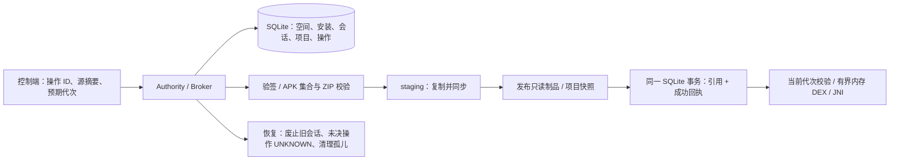

# P1：安装、空间与恢复

2026-10-14。实现范围是共享 runtime 的安装权威、项目迁移 API 和验收工具。工作台全面接入仍属于 P5；本轮不迁移真实用户数据。最终通过情况以 [验收报告](evidence/runtime-p1-2026-10-14/README.md) 为准。

## 从资源所有权出发

APK 集合是不可变制品，空间是安装命名空间，数据是可写实例，项目只是显式引用。四者不能用一个“项目目录”或 `runnable=true` 代替。进程只允许绑定当前安装和数据实例；存活进程阻止升级、卸载与数据迁移。

`RuntimeAuthorityService` 在 `:authority` 进程持有唯一 `RuntimeStore`，所有控制变更与客体会话事件使用同一个 Broker 串行门禁。模块自身的 `synchronized` 不能代替这一边界，调用者不得把底层 Store/ApkStore/ProjectBindings 作为额外并行写入口。

## 唯一写入者与执行契约

- `tripoder-runtime-v2.db` 是本轮新 schema。旧实验 DB 保留，不自动升级或恢复成已安装应用。
- 进程内所有者登记先于锁文件打开；然后持有系统文件锁。原因：POSIX record lock 可能被本进程关闭同 inode 的另一个 FD 释放，不能先打开第二个 FD 再依赖 `OverlappingFileLockException`。
- `close()` 永久关闭该 Store 对象；所有重新打开数据库的入口拒绝。Authority 销毁期间停止接受请求，退出独立进程，使客体收到 Binder 死亡。
- 安装、升级、卸载、迁移使用操作 ID 与完整参数摘要。提交引用和 `SUCCEEDED` 使用同一 SQLite 事务；客户端丢失 ACK 不会触发副作用重放。
- 重启将 ACCEPTED/RUNNING 标记 UNKNOWN，保留已提交终态。UNKNOWN 只查询或基于证据协调；不自动再安装、再迁移、再执行。
- 会话持久化 allocated/attached/running/dead。恢复时发现旧 PID 仍在同 UID 运行则拒绝启用新权威，不按数据库 PID 猜测并杀进程。客体绑定的旧 Broker 死亡则退出。

## 制品发布与恢复

1. 从显式 FD/验收资产复制完整 APK 集合，边读边限制单包 128 MiB、集合 256 MiB、最多 64 包，校验输入 SHA。
2. 使用 SDK 37 的官方 `apksig` 在设备上验签，验证 base 唯一、包名/版本/签名一致、split 依赖与循环、必要 split、Manifest 声明、组件冲突和 ARM64 ELF。
3. ZIP 拒绝穿越、重复路径、链接、特殊文件、超限内容；提取 native 库并记录所有输入及提取文件的 SHA。生成确定性 descriptor；descriptor SHA 存入数据库。
4. 同步并封存文件；发布时只临时开放 staging 目录的 owner write，以完成跨父目录 rename，然后重新封存并同步目录。APK/native 文件全程不变为可写。
5. 再验证已发布集合，最后提交安装与操作成功回执。升级要求当前代次匹配、签名相同、版本严格递增，沿用原数据实例。
6. 恢复清理无引用 staging、制品、数据和迁移快照；已登记但损坏的安装标记 CORRUPT，保留反证并拒绝运行，不自动替换。

加载前仍验证完整集合及只读状态。Android 在文件式 DexClassLoader 的代码目录创建 `oat`，与不可变集合要求冲突；现在通过 `InMemoryDexClassLoader` 加载验签 APK 内连续的 classes.dex/classes2.dex 等，每段再次核验 SHA，最多 32 段、合计 64 MiB，显式指定验过的 JNI 目录。资源继续来自原 APK。没有重写客体 APK，也没有旧 ClassLoader fallback。

## 显式项目迁移

`inspectProjectSource → migrateProject → resolveProject` 是公开控制 API。源路径、projectId、package、space、预期安装代次与已审查的源摘要必须由调用者显式提交。

迁移检查完整目录树（含隐藏文件与空目录），最多 512 文件/512 目录、深度 32、单文件 16 MiB、合计 64 MiB；拒绝符号链接、特殊文件、超限、源变更、错误项目 ID/包名、目标已有数据和运行中安装。源与 runtime 目录不能重叠。旧字段 `runnable` 和 `source` 不是安装证据。

源树复制为不可变项目快照，`runtime/` 内容复制为独立可写 dataId。快照发布、数据发布之后，在同一数据库事务里切换安装数据引用、插入项目绑定与成功回执。中断前后只能解析完整旧状态或完整新状态。升级/卸载使原绑定 STALE，旧项目不能凭包名悄悄指向新安装。项目重新绑定、工作台导航与真实数据导入 UI 留在 P5。

旧工作台本轮只修正状态与导入语义：本机包扫描记录显示“未导入”；原示例明确标记 legacy 实验；首次自有 fixture 初始化有记录，后续缺失/损坏拒绝，不隐式覆盖；严格复制不跳过失败文件；只读导出返回未绑定源元数据。新 runtime 没有调用旧 GuestRuntime/GameRuntime。

## 本轮审查发现并处理

| 问题 | 处理 |
|---|---|
| 封存目录不能直接跨父目录移动 | 显式发布权限协议、重新封存与同步 |
| Binder death 早于 Android Service 清理，立即重绑产生竞态 | 验收同时等待 Binder 死亡与系统 disconnected，再解除旧连接；超时仍失败 |
| ART `oat` 改写只读制品集合 | 有界内存 DEX 装载，不放宽制品文件集合校验 |
| 卸载代次冲突在 ACCEPTED 状态调用 fail | 先 RUNNING，再持久化明确 FAILED |
| 项目迁移后旧 BundleInstall 缓存仍引用旧 dataId | allocate 同时核对当前安装代次和数据路径，提前校验支持的组件形态 |
| 源项目 B 可绑定到项目 A | 迁移与解析均校验项目 ID |
| 关闭 Store 仍可重开 | 永久关闭状态与有效 authority 锁门禁 |
| 第二次同进程开锁失败后 close 会释放原系统锁 | 开文件前进程内所有者登记，并增加真正跨进程拒绝测试 |

## 支持边界

本轮完成 APK 集合**安装校验**，不等于 split 组件执行。执行仍锁定已测固件、ARM64/4 KiB、两个进程槽、一个自有显式 Activity；通用组件、split 资源装载、多声明进程、系统语义与性能扩展属于 P2/P3。内存多 DEX 顺序校验已实现，但最终设备夹具为单 DEX，不宣称多 DEX 应用验收通过。

故障测试是真实终止控制进程并重新打开 SQLite，覆盖已列出的发布/事务断点；没有测试突然断电、内核崩溃、存储硬件故障或任意指令位置的中断。`fsync` 与 SQLite FULL 是实现约束，不能替代这些尚未执行的测试。

运行进程与客体同 UID，文件锁和摘要不是恶意 Native 隔离。未使用 VirtualApp 代码。新增运行依赖仅官方 apksig；其来源、摘要与 SDK notices 随构建记录。产品级第三方许可审计、可信控制端跨 UID 和四款目标应用的验收仍分别属于发布门槛、P5 与 P6。
