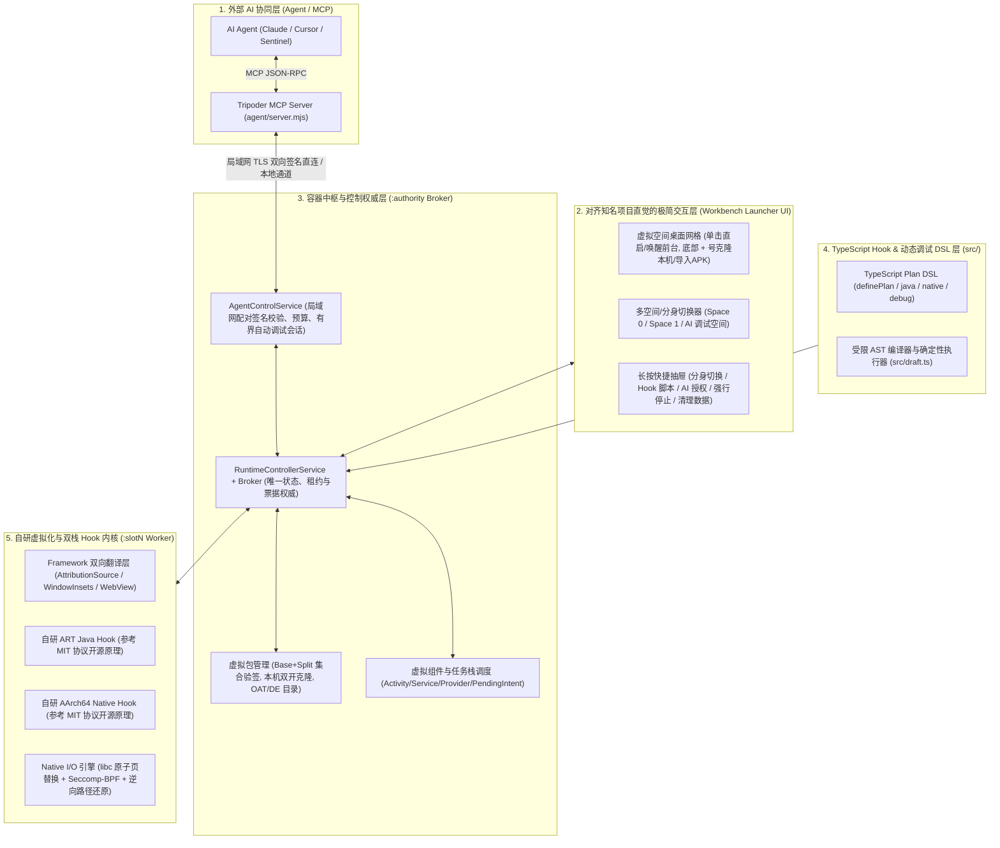
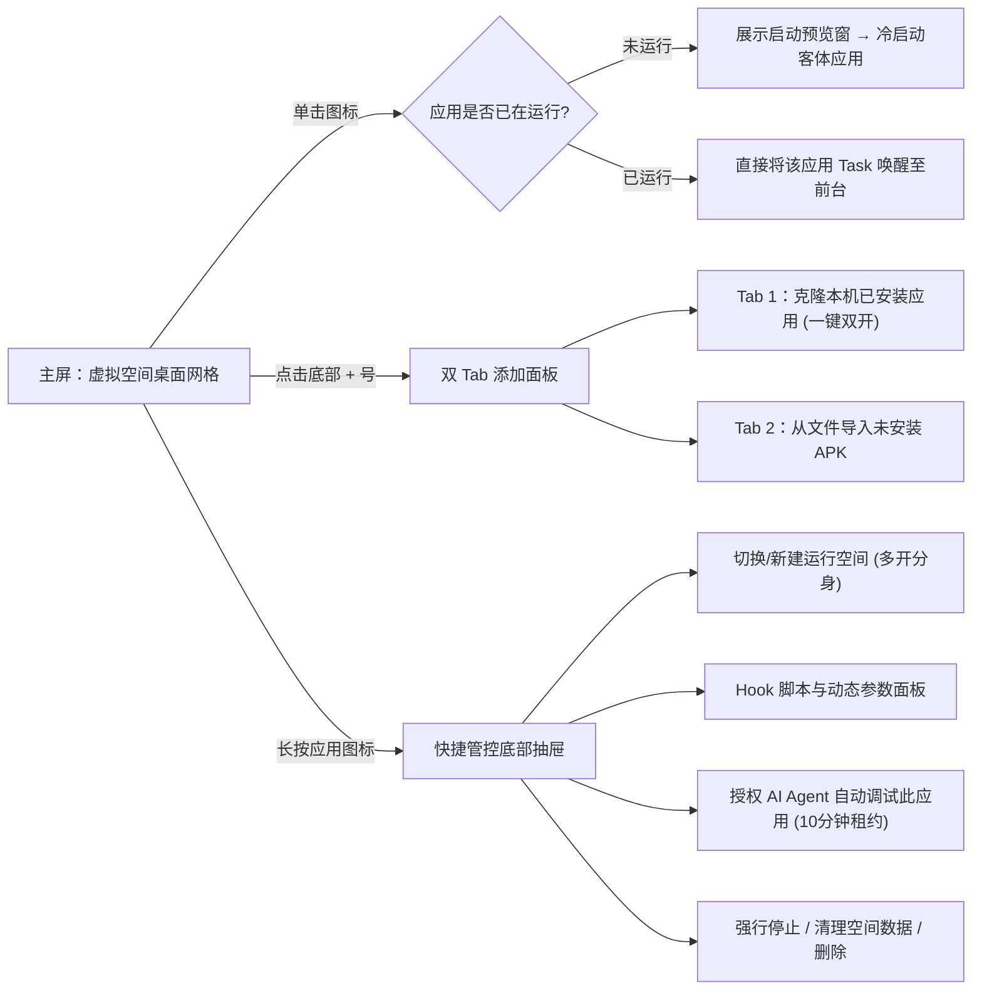

# Tripoder 容器虚拟化与 AI 动态调试完整改造方案

更新时间：2026-10-17。

> **【AI Agent 净室合规红线（最高优先级）】**
> 1. **严禁查阅闭源商业沙盒源码**：本方案及后续所有研发工作严格遵循 **100% 净室（Clean-Room）自研原则**。严禁任何 AI Agent 或研发人员在互联网、代码托管平台或本地环境中搜索、查阅、下载、反编译或移植任何“知名项目”（或同类商业应用沙盒）的源代码、类名或内部结构。
> 2. **唯一合法依据**：应用虚拟化与系统适配仅允许以 **Android AOSP 公开源码（Apache-2.0）、Linux 内核公开接口文档（man pages）以及本机真机实测日志**为唯一技术依据。
> 3. **Hook 引擎合法参考范围**：Java 层与 Native 层 Hook 核心在 `android/self-hook` 自研基础上演进，仅允许参考本文明确列出的 **MIT / Apache-2.0 宽松开源协议项目**的公开原理，所有代码必须独立编写并通过本仓构建回执与真机断言验收。
> 4. **零隐式 Fallback**：在用户未明确要求下，严禁编写任何静默兜底（Fallback）逻辑；未支持的能力必须返回明确的结构化错误码。

---

## 一、 核心目标与第一性原理

### 1.1 产品终极目标
在不依赖 Root 权限、运行期不依赖 ADB 连接的前提下：
1. **对标“知名项目”的容器运行效果与直觉式交互**：在同一台 Android 设备上提供独立虚拟空间，支持一键克隆本机已安装应用（双开/多开）或免安装直接导入外部 APK，完整跑通微信（`com.tencent.mm`）、王者荣耀（`com.tencent.tmgp.sgame`）等大型复杂应用与游戏。
2. **原生融合 AI Agent 远程协同（MCP 驱动）**：将应用 Java/Native 动态 Hook、符号探索、调用栈观测、UI 视图树读取与触控/手柄注入通过标准 MCP 协议暴露给外部 AI Agent（如 Claude、Cursor、Sentinel 等），使 Agent 能够远程完成自动化应用测试与游戏动态调试。
3. **面向 AI 友好的 TypeScript Hook DSL**：采用强类型、基于 AST 静态校验的 TypeScript 子集作为 Hook 与调试脚本语言，让大模型能够高准确率生成、热更新和回滚调试代码，同时从根源杜绝非法内存操作搞崩客体进程。

### 1.2 第一性原理剖析
Android 操作系统只信任两个底层权威：**Linux 内核分配的进程身份（UID/PID/SELinux Context）** 与 **`system_server`（AMS/PMS 等系统服务）维护的已安装包注册表**。
要让未安装到系统的 APK（或同包名的多个分身）在普通宿主内运行并接受 AI 动态调试，本质上必须在**客体代码与系统边界之间构建一层确定性的“双向语义翻译与观测层”**：
- **向内（对客体应用）**：呈现客体预期的包名、签名、Application、Context、ClassLoader、四大组件生命周期、独立文件沙盒与进程名视图。
- **向外（对 Android Framework 与 Linux Kernel）**：将客体发起的跨进程 Binder 请求与底层文件/系统调用改写为宿主合法拥有的身份（宿主 UID、宿主包名、预置占坑组件、宿主私有子目录），并在系统返回时逆向还原为客体逻辑视图。
- **向旁路（对外部 AI Agent）**：在容器内部直接挂载零侵入的观测探针（AST 受限执行器 + 无锁环形事件缓冲 + 容器内窗口视图树提取），通过加密网络通道向 MCP Server 吐出结构化运行时证据。

---

## 二、 总体五层架构蓝图



---

## 三、 模块一：应用虚拟化底座改造（对标知名项目运行效果）

基于现有 `android/runtime`（`:authority` 控制中枢 + `:slot0..7` 隔离工作槽 + 25 项客体启动前固定适配），针对真实商业应用/游戏的运行需求，进行以下 5 项核心改造：

### 3.1 双模式安装引擎：“本机应用一键克隆” + “外部 APK 免安装导入”
- **目标体验**：对齐知名项目最核心的两种安装模式——用户既可以从手机已安装应用列表中一键勾选克隆（双开/多开），也可以从文件选择器导入未安装的 APK 文件。
- **实施方案**：
  1. **本机已安装应用克隆通道**：在 `WorkbenchAddActivity` 与 `RuntimeControllerInstall` 中支持读取本机已安装应用的 `sourceDir` 及 `splitSourceDirs`，通过只读 FD 流式导入容器并执行 `apksig` 完整集合签名校验与摘要固化。
  2. **Split APK 执行层挂载**：将 Base APK 与 `split_config.arm64_v8a.apk`、资源 Split APK 在 `LoadedApk` 初始化阶段联合挂载至同一 `ClassLoader` 与 `AssetManager`。
  3. **可写编译缓存与图形缓存目录**：保持原始 APK 制品目录严格只读，同时为客体动态 DEX 加载（如腾讯插件框架、热更新模块）重定向空间内可写的 `oat/` 与 `code_cache/` 目录，并为 `libEGL` 着色器缓存分配空间内可写目录，消除因只读权限导致的初始化失败。

### 3.2 任务栈唤醒与失效票据自动收口（解决“运行中再点图标被拒”）
- **目标体验**：对齐知名项目的桌面直觉——单击应用图标时，若应用未运行则冷启动（配合启动预览窗消除黑屏等待）；若应用已在后台运行，则直接将其任务栈切回前台，绝不弹窗报错或拒绝进入。
- **实施方案**：
  1. **区分“全新冷启动”与“存活会话唤醒”**：在 `RuntimeControllerLaunch` 中，当收到桌面图标点击请求时，先查询 `(spaceId, packageName)` 在当前空间下是否持有已确认 `LIVE` 的根 Activity 会话。若存活，直接通过 `ActivityManager.moveTaskToFront` 或向对应占坑 Root Activity 投递前台唤醒 Intent，直接恢复至用户视野。
  2. **死进程残留票据自动收口**：当 `:slotN` 物理进程因崩溃或重装已终止，但账本中残留 `PREPARED` / `ROUTE` 票据时，由 `ProcessSupervisor` 基于进程死亡事实（PID/进程代次不复存在）在启动前自动完成旧票据退役归档，不再阻塞新一次冷启动。

### 3.3 Android 12~17 系统服务与 `AttributionSource` 统一翻译器
- **目标体验**：大型游戏（如王者荣耀）与社交应用（如微信）内部集成的定位、地图、蓝牙、音频、安全 SDK 均能无感通过系统权限与归属校验。
- **实施方案**：
  1. **出站 `AttributionSource` 规范化**：针对 Android 12~17（API 31~37）在 Binder 事务中强制校验 `android.content.AttributionSource` 的机制，在 `GuestContext` 与 Manager 门面层实现统一的 `AttributionSource` 构造器，将客体包名与虚拟身份在出站前翻译为宿主真实 UID 与宿主包名。
  2. **关键系统服务补齐**：
     - 显式实现 `Context.createDeviceProtectedStorageContext()`（映射至空间内独立的 `de_data/` 子目录，解决 HMS SDK 等组件报错）。
     - 按平台契约补齐 `WifiManager`、`ClipboardManager`、`AudioManager`、`Vibrator`、`TextClassificationManager` 等门面适配。

### 3.4 宿主与客体 `targetSdkVersion` 窗口契约解耦（修复 Edge-to-Edge 顶栏遮挡）
- **问题本质**：宿主 Engine 的 `targetSdk` 为 36/37（系统强制开启 Edge-to-Edge，内容延伸至状态栏下方），而部分客体应用（如微信登录页）的原始布局依赖低 `targetSdk` 的非边到边窗口坐标契约，导致标题栏被状态栏遮挡一半。
- **实施方案**：
  - 在占坑 Activity Attach 客体 Activity 阶段（参见 `docs/runtime-activity-design.md`），读取客体 Manifest 声明的真实 `targetSdkVersion`：
  - 当客体 `targetSdkVersion < 35` 且未声明全屏穿透时，在宿主窗口 Decor/Content 根容器层根据客体契约消费状态栏/导航栏 `WindowInsets`，向客体视图树提供与其原始 `targetSdkVersion` 完全一致的坐标系起点。

### 3.5 Native I/O 引擎升级：正向重定向 + 逆向路径还原 + 可选 `Seccomp-BPF`
- **问题本质**：大型游戏引擎（如 `libunity.so` / `libil2cpp.so`）和安全组件不仅通过路径打开文件，还会通过 `readlinkat("/proc/self/fd/N")`、`/proc/self/maps` 反查真实路径，或绕过 `libc` 直接使用内联汇编 `svc #0` 发起系统调用。
- **实施方案**：
  1. **双向路径映射**：在现有 10 个 `libc` wrapper 基础上，补齐 `readlinkat`、`getcwd`、`realpath` 的**逆向路径还原（Physical Path $\to$ Guest Logical Path）**，并完善基于目录文件描述符（`dirfd`）的相对路径解析。
  2. **标准 `Seccomp-BPF` 系统调用过滤层**：基于 Linux 内核标准 `prctl(PR_SET_SECCOMP, SECCOMP_MODE_FILTER)` 接口，独立实现可选的 `seccomp-bpf` 拦截模式，捕获客体直接发出的 `openat`/`openat2`/`faccessat2`/`statfs`/` truncate`/`execve` 系统调用并统一走同一套 `path_policy`。

---

## 四、 模块二：自研 Java & Native Hook 引擎演进（参考 MIT 协议开源方案）

在 `android/self-hook` 现有自研代码基础上，仅参考业界采用 **MIT / Apache-2.0 协议**的开源项目公开原理，补齐通用动态调试与拦截能力：

| 演进方向 | 合法参考的开源项目（协议） | 核心第一性原理与借鉴点 | Tripoder 自研落地模块 |
| :--- | :--- | :--- | :--- |
| **1. ELF PLT/GOT Hook** | **ByteHook** (`MIT` 协议) | 解析 ELF 动态段 `DT_JMPREL` / `DT_REL(A)` 重定位表，直接原子替换 GOT 表项指针；无需修改 `.text` 可执行代码段，天然不受短函数指令长度限制，且不触发加固对代码段的完整性校验。 | 新增 `android/self-hook/native/elf_plt_hook.c`：支持按模块名或全局批量拦截外部导入C函数，并与模块加载代次（Generation）绑定。 |
| **2. ARM64 紧凑 Inline Hook 与栈回溯保护** | **ShadowHook** (`MIT` 协议) / **Dobby** (`Apache-2.0` 协议) | 1. **邻近跳板池（Island Pool）**：在目标 `.so` 映射虚拟地址 $\pm 128\text{MB}$ 内分配匿名可执行页，仅需单条 4 字节 `B imm26` 指令即可完成入口跳转，解决 $<16$ 字节短函数（如 `renameat`）覆盖相邻函数的问题；<br>2. **完整指令重定位**：覆盖 `ADR`/`ADRP`/`LDR literal`/`B.cond`/`CBZ`/`TBZ` 正负偏移计算；<br>3. **Frame Pointer (FP/LR) 链完整性**：在 Trampoline 中严格维护 `x29`/`x30` 栈帧链，防止游戏引擎崩溃收集器或栈回溯器在 `unwind` 时发生 SIGSEGV。 | 升级 `android/self-hook/native/a64_relocate.c`、`a64_entry.c` 与 `code_page.c`，确保满足 $\le 5\%$ 的性能基准门槛。 |
| **3. ART 通用 Java 方法与构造器 Hook** | **Pine** (`MIT` 协议) | 1. **ArtMethod 入口替换与独立备份槽**：替换目标 `ArtMethod` 编译入口为通用汇编跳板，将原方法结构备份在受 Native GC Root 保护的独立存储区；<br>2. **全类型装箱与对象句柄表（Object Handle Table）**：除基本标量与 `String` 外，将客体任意 Java `Object` 映射为有界安全句柄（`ObjectHandle`），允许脚本读取字段或原样透传，同时避免跨线程/GC 悬垂引用；<br>3. **安全选择性反优化**：在 `SuspendAll` 独占 mutator 锁边界内执行栈检查与去内联。 | 扩展 `android/self-hook/native/art_method_storage.c` 与 `art_int_entry.c`，支持任意实例方法、静态方法与构造器（`<init>`）。 |

---

## 五、 模块三：面向 AI 编排的 TypeScript Hook & 动态调试 DSL

在现有 [`src/plan.ts`](file:///Users/like/code/tripoder/src/plan.ts) 与 [`src/draft.ts`](file:///Users/like/code/tripoder/src/draft.ts) 的基础上，保留 **“无 `eval`、纯 AST 静态类型与预算检查、每次调用捕获不可变参数快照”** 的设计优势，扩展 `ctx.debug` 动态观测原语与对象字段只读投影能力：

```ts
import { definePlan, param } from "@abox/hook";

export default definePlan({
  id: "ai-live-probe",
  target: {
    packageName: "com.tencent.mm",
    versionCode: "2800",
    apkSha256: "f2a725bc04302ad218a563533ae79356e66b64aa711b275bc919a8d432f7e15d",
  },
  params: {
    enableTrace: param.boolean(true, { title: "开启调用栈追踪" }),
    overrideLevel: param.int(2, { min: 0, max: 6, title: "日志级别覆盖" }),
  },
  setup(ctx) {
    // 1. Java 方法拦截 + 有界调用栈与对象字段快照
    ctx.java.method("com.tencent.mars.xlog.Xlog", "getLogLevel", ["long"])
      .after((call) => {
        if (call.params.enableTrace) {
          ctx.debug.emitEvent("java_xlog_level", {
            handle: call.args[0],
            originalResult: call.result,
            stack: ctx.debug.captureJavaStack(8), // 最多采集 8 层调用栈，有界不阻塞
          });
        }
        return call.params.overrideLevel;
      });

    // 2. Native 函数拦截（支持 export 符号或确认后的模块内偏移）
    ctx.native.function("libwechatxlog.so", "__xlogger_Level_impl", {
      argumentTypes: [],
      returnType: "int32",
      buildId: "confirmed-build-id",
    }).after((call) => {
      ctx.debug.emitEvent("native_xlog_hit", {
        callerModuleOffset: ctx.debug.callerModuleOffset(), // 自动解析调用方所属 .so 及偏移
        ret: call.result,
      });
      return call.result;
    });
  },
});
```

### DSL 核心安全不变量
1. **编译期阻断 AI 幻觉**：AI 若编写了异步函数、无限循环、未知对象属性或未验证的 Native 签名，[`src/draft.ts`](file:///Users/like/code/tripoder/src/draft.ts) 在 `hook_prepare` 阶段直接拒绝并返回精确 AST 错误定位，绝不注入到客体进程。
2. **无锁环形事件队列（Lock-Free RingBuffer）**：`ctx.debug.emitEvent` 在客体进程内写入固定容量（如 1024 条）的环形缓冲区；即使高频函数每秒触发上万次，也只会按采样/容量上限覆写并递增 `droppedCount`，绝不阻塞客体主线程或渲染线程。

---

## 六、 模块四：免 Root / 免 ADB 的 MCP 远程动态调试架构

### 6.1 传输与配对层：脱离 ADB 数据线，支持局域网 / 虚拟局域网直连
- **配对与鉴权**：
  - 手机端 `AgentControlService`（前台 `connectedDevice` 服务）除支持本地回环外，新增**局域网 TLS + P-256 双向签名端点**。
  - 用户在手机工作台点击“配对外部 AI 助手”，展示一次性配对码（含局域网地址、设备公钥 SHA-256、短期配对 Token）。
  - 电脑端 `agent/pair.mjs` 完成密钥交换后，MCP Server（`agent/server.mjs`）即可直接通过无线网络控制手机容器，**运行期彻底摆脱 ADB 与 USB 线束缚**。
- **有界自动调试授权（Bounded Auto-Debug Lease）**：
  - 除“每次激活脚本需人工点确认”的严格模式外，提供**针对指定空间 + 指定应用的“10 分钟 / N 次操作有界自动调试租约”**：用户授权一次后，AI Agent 可在该应用范围内自主循环执行“搜索类 $\to$ 编写脚本 $\to$ `prepare` $\to$ `activate` $\to$ 触发 UI $\to$ 读取事件 $\to$ 调参/停用”，大幅提升 AI 自动化测试与逆向调试效率。

### 6.2 扩展后的 MCP 工具集矩阵（`agent/tools.mjs`）

| 领域 | 工具名称 | 输入关键参数 | 赋能 AI Agent 的核心作用 |
| :--- | :--- | :--- | :--- |
| **会话与容器管理** | `session_get` / `session_close` | `operationId` | 查询当前授权范围、剩余预算、关联空间或安全关闭会话。 |
| | `app_list` / `process_get` | `spaceId` | 列出虚拟空间内已安装应用、版本、安装代次及当前存活的 `:slotN` 进程。 |
| | `app_launch` / `app_stop` | `operationId`, `spaceId`, `packageName` | 远程冷启动、唤醒已运行应用至前台，或强行停止客体进程。 |
| **符号与结构发现** | `dex_search_classes` | `packagePrefix`, `classLoaderId`, `limit` | 在客体进程已加载的 ClassLoader 中搜索匹配的类名列表。 |
| | `dex_inspect_class` | `className`, `classLoaderId` | 反射读取指定类的声明方法重载签名与字段类型，生成 `hook_observe` 所需的准确选择器。 |
| | `hook_modules` / `native_exports_search` | `moduleName`, `symbolPrefix` | 枚举客体已加载的 Native `.so` 模块、Build ID、基址及导出函数符号。 |
| **动态 Hook 与遥测** | `hook_observe` | `operationId`, `selectors` | 对目标 Java 方法或 Native 符号采集真实运行时身份证据（`evidenceId`）。 |
| | `hook_prepare` | `operationId`, `evidenceId`, `source` | 使用受限 AST 编译校验 AI 生成的 TypeScript 脚本并绑定目标符号。 |
| | `hook_activate` / `hook_disable` | `operationId`, `token`, `sourceSha256` | 原子激活已准备的 Hook 计划，或停用并排空（Drain）在途调用。 |
| | `hook_update_params` | `operationId`, `revision`, `params` | 在不重新编译/重装 Hook 的情况下，毫秒级热更新脚本参数快照。 |
| | `hook_read_events` | `cursor`, `limit` | 按游标分页读取 `ctx.debug.emitEvent` 采集的入参、返回值、调用栈与命中统计。 |
| **免 ADB 容器内 UI 与输入** | `ui_dump_hierarchy` | `includeInvisible` | 直接在客体进程内遍历当前 Activity/Dialog 的真实 View 树（坐标、文本、类名、资源名），无需 ADB `uiautomator`。 |
| | `ui_capture_frame` | `maxWidth`, `quality` | 通过容器内 `PixelCopy` 截取当前客体窗口画面，供多模态大模型进行视觉验证。 |
| | `ui_dispatch_action` | `operationId`, `action` (`tap`/`swipe`/`text`/`key`) | 在客体窗口内直接注入触控点击、滑动、文本输入或虚拟手柄按键映射。 |
| **故障与沙盒诊断** | `crash_diagnostics_get` | `processGeneration` | 获取客体最近一次 Java 未捕获异常堆栈、Native 崩溃信号/寄存器/栈回溯或未支持系统服务告警日志。 |

---

## 七、 模块五：用户交互（UI/UX）全面对齐知名项目体验

重构 `android/workbench` 界面，将工程化的复杂概念隐藏在符合直觉的**虚拟桌面（Virtual Launcher）**之下：



1. **首页虚拟桌面（`WorkbenchActivity` / `WorkbenchLibraryUi`）**：
   - **顶部状态栏**：左侧为**空间切换下拉胶囊**（如 `主空间` / `分身空间 #1` / `AI 测试沙盒`），右侧为 **AI 协同状态胶囊**（点击可查看配对码、当前连接的 Agent 名称、实时工具调用流水及一键物理熔断按钮）。
   - **应用网格**：三列/四列大图标展示当前空间的应用；正在运行的应用显示绿色呼吸点，已挂载 Hook 脚本的应用显示角标计数。
   - **单击行为**：未运行时直接启动；已在后台运行时**直接唤醒回前台**（彻底消除“已在运行时点击报错拒绝”的反直觉体验）。
2. **添加应用页（`WorkbenchAddActivity`）**：
   - 对齐知名项目体验，顶部提供 **「本机应用克隆」** 与 **「本地 APK 文件导入」** 两个标签页，支持一键导入并自动完成签名校验与环境准备。
3. **长按应用快捷菜单（`WorkbenchAppActions`）**：
   - 长按任意应用图标弹出底部抽屉：**「打开/切换分身空间」「配置 Hook 脚本」「授权 AI 调试」「强行停止进程」「清除沙盒数据 / 卸载」**，无需在多层设置页中寻找故障恢复入口。

---

## 八、 分阶段实施与真机验收路线图

| 阶段 | 核心目标 | 关键改动范围 | 真机验收准出标准（Xiaomi Madrid Android 17） |
| :--- | :--- | :--- | :--- |
| **阶段一：容器交互直觉化与微信/王者首屏及登录闭环** | 1. 单击已运行应用直接切回前台（`moveTaskToFront`）；<br>2. 进程死亡后自动收口残留启动票据；<br>3. 按客体 `targetSdk` 修复微信登录页顶栏遮挡；<br>4. 补齐 `wifi`、`device_protected_storage`、`oat` 可写目录与 `readlink` 逆向路径还原。 | `RuntimeControllerLaunch.java`<br>`WorkbenchLibraryUi.java`<br>`GuestContext.java`<br>`RuntimePackages.java`<br>Native `path_policy` | 1. 微信登录页顶栏无遮挡、完成登录、切后台再点图标秒回前台；<br>2. 王者荣耀越过 `wifi`/`HMSSDK` 阻塞，消除 `libunity.so` 崩溃，稳定进入游戏登录首屏。 |
| **阶段二：自研双栈 Hook 引擎增强（参考 MIT 开源原理）** | 1. 新增 ELF PLT/GOT Hook（参考 ByteHook `MIT` 原理）；<br>2. 补齐 ARM64 邻近跳板与栈帧 FP/LR 保护（参考 ShadowHook `MIT` 原理）；<br>3. 扩展 ART 任意对象句柄与构造器拦截（参考 Pine `MIT` 原理）。 | `android/self-hook/native/`<br>`android/self-hook/java/` | 自研探针及微信/王者荣耀真实 Java+Native 组合 Hook 连续运行零崩溃，停用后完整恢复，CPU 性能开销满足 $\le 5\%$ 门槛。 |
| **阶段三：TypeScript 动态调试 DSL 与免 ADB 容器内工具** | 1. 在 `src/plan.ts` 与 `src/draft.ts` 实现 `ctx.debug`（有界调用栈、模块偏移、环形事件缓冲）；<br>2. 在客体进程内实现 `dex_search`、`ui_dump_hierarchy`、`ui_capture_frame` 与 `ui_dispatch_action`。 | `src/plan.ts`<br>`src/draft.ts`<br>`RuntimeControllerHooks.java`<br>`android/runtime` UI 探针 | 不使用 `adb shell uiautomator`，完全通过容器内接口完成类搜索、View 树提取、触控点击注入与 Hook 遥测事件读取。 |
| **阶段四：无线 MCP 远程协同与有界自动调试闭环** | 1. 升级 `agent/tools.mjs` 至完整工具矩阵；<br>2. 支持局域网 TLS 双向签名配对与单应用 10 分钟有界自动调试租约；<br>3. 完成虚拟桌面 UI 与 AI 状态胶囊整合。 | `agent/tools.mjs`<br>`agent/server.mjs`<br>`AgentControlService.java`<br>`RuntimeAgentSessions.java` | 拔掉 USB/不依赖 ADB 命令行，外部 AI Agent 通过 MCP 独立完成对微信/王者荣耀或测试应用的“搜索方法 $\to$ 编写 TS Hook $\to$ 激活并操作 UI $\to$ 采集调用栈与返回值 $\to$ 停用恢复”端到端验收。 |
