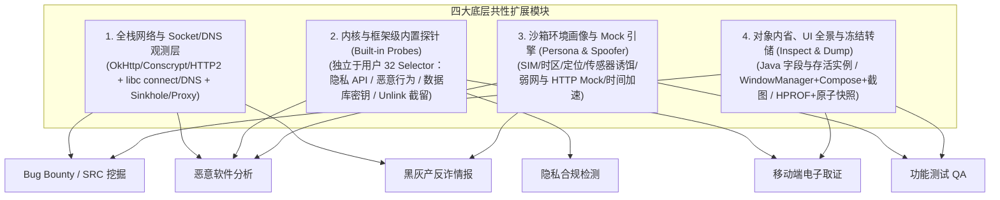

# Tripoder 全场景能力评估与演进缺口分析 (Scenario Gap Analysis)

- **更新日期**：2026-10-26
- **评估范围**：基于当前 `android/runtime`、`android/self-hook`、`android/engine`、`android/workbench`、`src/` 与 `agent/`（MCP v3）的实际代码实现，对照六大目标业务场景进行全景能力盘点与差距分析：
  1. **Bug Bounty 与 SRC 安全风险挖掘**
  2. **隐私合规检测（工信部 / 监管测评标准）**
  3. **功能测试与自动化 QA**
  4. **恶意软件与病毒动态分析（Malware / Trojan Analysis）**
  5. **黑灰产对抗与反诈情报分析（Black/Gray-Market & Fraud Analysis）**
  6. **移动端电子数据取证（Mobile Digital Forensics）**

---

## 1. 总体评估结论

**当前状态：底层核心底座已闭环，但距离“全面满足六大场景的端到端实战需求”仍有显著差距。**

### 1.1 已攻克的底层护城河
1. **免 Root 免重打包虚拟化沙箱**：单 APK 三类进程模型（主进程 UI + `:authority` 权威控制面 + `:slot0..7` 隔离执行槽位），支持 `LoadedApk`/四大组件代理、[`fixed_libc`](self-hook-design.md) + [`syscall_namespace.c`](../android/runtime/native/syscall_namespace.c) (`SYS_SECCOMP`) 路径重定向、[`ptrace_namespace.c`](../android/runtime/native/ptrace_namespace.c) 调试信号隔离及 `/proc/self/*` 隐身。
2. **零外部依赖的自研 Hook 与探测引擎**：ART Nterp Java Hook、ARM64 W^X `mremap` Native Hook、运行时 ClassLoader/DEX 内存快照（[`RuntimeCodeProbes`](../android/runtime/src/dev/tripoder/runtime/RuntimeCodeProbes.java)），天然无 Frida/Xposed 特征（见 [`AntiDetectChecks`](../android/anti-detect-fixture/src/main/java/dev/tripoder/antidetect/AntiDetectChecks.java)）。
3. **高确定性的 MCP v3 全局控制面**：[`agent/tool-groups.mjs`](../agent/tool-groups.mjs) 提供的 33（HTTP）/ 37（stdio）个工具，具备显式代次（`installGeneration` / `processGeneration`）隔离、CAS 并发保护、幂等操作日志及 SHA-256 产物校验链（[`file-pull.md`](file-pull.md)）。

### 1.2 全景场景匹配度矩阵

| 目标业务场景 | 当前底座匹配度 | 核心已具备能力 | 最关键的 1–2 个阻塞短板（Missing Pieces） |
| :--- | :---: | :--- | :--- |
| **1. Bug Bounty / SRC 挖掘** | ⭐⭐⭐☆ (65%) | Manifest 导出审计、存储/SP 审计、动态 DEX 快照、主动 HTTP/反射调用 | 缺通用抓包（OkHttp/Conscrypt/HTTP2 + 放开 4KB 限制）、缺四大组件 Intent/Provider 投递工具、Java 对象字段不可读 |
| **2. 隐私合规检测** | ⭐⭐⭐ (60%) | `Application` 构造前 `startupHook`、Java 32 层调用栈与 Native 偏移采集 | 缺内置 100+ 敏感 API 专用监控通道（受限于 32 Selector 上限）、缺“同意前/同意后”阶段打标、缺第三方 SDK 归属识别库 |
| **3. 功能测试与自动化 QA** | ⭐⭐☆ (50%) | 多 Space 隔离、`ui_tree` 基础转储、5 种基础 UI 动作、启动/异常诊断 | `ui_tree` 看不到 Compose 和 Dialog 弹窗且硬限 256 节点、缺截图工具（`ui_screenshot`）、缺环境 Mock 与数据快照回滚 |
| **4. 恶意软件与病毒分析** | ⭐⭐☆ (50%) | 免 Root 真机抗反沙箱、内存 DEX 捕获、16 个路径/调试 Syscall 拦截 | 缺沙箱网络隔离（FakeNet/Sinkhole 防止真机外联传染）、缺 `unlink` 删除文件自动截留、缺 Shell/无障碍/短信等恶意行为探针 |
| **5. 黑灰产对抗与反诈情报** | ⭐⭐ (45%) | 沙箱多开隔离、基础 Native 导出符号扫描与内存 DEX 快照 | 缺底层 DNS/Socket 级 IOC（C2 域名/IP）全量提取、缺 Flutter/uni-app/H5 套壳解包、缺 SIM 国家码/时区/VPN 隐藏等反马甲伪装 |
| **6. 移动端电子数据取证** | ⭐⭐☆ (55%) | 导出清单 SHA-256 校验链、精确代次绑定、只读存储目录导出 | 缺 SQLCipher/MMKV 运行时密钥自动截获与解密、跳过 `-wal` 导致无法恢复删除记录、缺 Java Heap HPROF 转储与进程冻结原子导出 |

---

## 2. 底层引擎与脚本底座的共性缺口（制约所有场景）

在 [`src/`](../src/plan.ts) 与 [`android/runtime/src/dev/tripoder/runtime/script/`](../android/runtime/src/dev/tripoder/runtime/script/SelfHookControl.java) 中，存在 **5 项共性底层限制**，同时制约了上层所有业务场景：

### 2.1 Java 对象为“不透明引用”，无法读取字段或展开常见容器
- **现状**：在 [`JavaObjectFrame`](../src/java-objects.ts) 与 [`JavaObjectSnapshots`](../android/runtime/src/dev/tripoder/runtime/script/JavaObjectSnapshots.java) 中，除基本类型、`String`、`byte[]` 外的所有 Java 对象均作为单次调用内不透明的 `JavaObjectRef` 传递；脚本仅能调用 `ctx.java.objectInfo`（仅返回类名与 Loader）、`snapshotThread`、`snapshotThrowable`。
- **缺失**：
  - 无法在 Hook 回调中读取入参或返回值对象的**任意字段（Field）**（例如拦截到 `Intent`、`Uri`、`Bundle`、`Location`、OkHttp `Request` 或业务自定义 Model 时，无法查看内部属性值）。
  - 缺少针对常见容器与框架对象（`Map`、`List`、`Set`、`Bundle`、`Intent`、`ContentValues`、`JSONObject`、`Uri`）的受控浅层结构化快照（Bounded Object/Field Snapshot）能力。

### 2.2 不支持构造函数（`<init>`）与方法重载通配 Hook
- **现状**：[`SelfHookControl.selectors`](../android/runtime/src/dev/tripoder/runtime/script/SelfHookControl.java) 强制要求 `!text(selector, "methodName").startsWith("<")`，[`agent/tool-schema.mjs`](../agent/tool-schema.mjs) 明确声明 `constructors are unsupported`。
- **缺失**：安全逆向、取证与合规审计极度依赖拦截构造函数（如 `new SecretKeySpec(key, alg)`、`new IvParameterSpec(iv)`、`new File(path)`、`new URL(str)`、`new Intent(...)`、`new JSONObject(str)`）。

### 2.3 受限 TypeScript (`RestrictedAst`) 语法与内置标准库过于受限
- **现状**：[`prepareDraft`](../src/draft.ts) 与 [`DraftCompiler`](../android/runtime/src/dev/tripoder/runtime/script/DraftCompiler.java) 禁止循环语句（无 `for`/`while`），变量仅限 `const`，数组长度上限 64，字符串仅支持 8 个基础方法，且每次回调完全无状态。
- **缺失**：
  - 缺少基础编码与序列化辅助函数（`Hex` $\leftrightarrow$ `UTF-8`、`Base64` 编解码、`JSON.parse` / `JSON.stringify`）。
  - 缺少受控的会话级状态存储（如 `ctx.state` 键值字典或原子计数器），导致无法在脚本内做跨方法上下文关联（如将同一线程内 `Cipher.init` 的密钥与随后 `Cipher.doFinal` 的明文关联）或按调用频次采样限流。

### 2.4 单进程 Hook 会话独占互斥 & 32 个 Selector 上限
- **现状**：[`SelfHookControl`](../android/runtime/src/dev/tripoder/runtime/script/SelfHookControl.java) 限制单进程同一时间只能激活 **1 个** Hook 会话，且与被动网络抓包互斥（开启 `network_control(action=start)` 会报 `NETWORK_CAPTURE_OWNS_HOOK` 阻塞一切用户 Hook）；单次最多注册 **32 个** Selector，事件环仅 256 条。
- **缺失**：无法同时运行“网络抓包 + 业务逻辑加解密 Hook + 隐私/恶意行为监控”，且 32 个 Selector 远不足以覆盖隐私合规（80–150+ API）或批量插桩需求。

### 2.5 Native Hook 缺少 `before` 阶段缓冲区读取、任意偏移 Hook 与 C 字符串读取
- **现状**：[`NativeBufferScope`](../android/runtime/src/dev/tripoder/runtime/script/NativeBufferScope.java) 规定 `ctx.native.captureBuffer` 只能在 `after` 阶段调用、要求原函数返回值为有符号字节数，且单次最多读取 1024 字节；[`SelfHookControl`](../android/runtime/src/dev/tripoder/runtime/script/SelfHookControl.java) 仅支持已导出 ELF 符号（`native_exports`）。
- **缺失**：
  - 无法在 `before` 阶段读取入参指针缓冲区（如 `SSL_write` 或 `EVP_EncryptUpdate` 执行前的输入缓冲区、或以 `\0` 结尾的 `const char*` 字符串参数）。
  - 无法按 `moduleName + offset` Hook 去符号表（stripped）商业 `.so` 中的内部未导出函数（`sub_xxxx`）。

---

## 3. 六大业务场景缺失项逐一列举

### 3.1 场景一：Bug Bounty 与 SRC 安全风险挖掘

#### 已具备能力
- 静态 Manifest 组件导出性与权限声明解析（[`InstalledManifestAudit`](../android/runtime/src/dev/tripoder/runtime/InstalledManifestAudit.java)）。
- 沙箱存储目录、`shared_prefs` 敏感键匹配、SQLite 表结构枚举（[`RuntimeSecurityAudit.inspectStorage`](../android/runtime/src/dev/tripoder/runtime/RuntimeSecurityAudit.java)）。
- 动态 ClassLoader 与内存 DEX 快照导出（[`runtime-observation.md`](runtime-observation.md)）。
- 客体上下文 HTTP 发包（[`sendHttpRequest`](../android/runtime/src/dev/tripoder/runtime/RuntimeSecurityAudit.java)）与静态/无参构造类方法反射调用（[`invokeGuestMethod`](../android/runtime/src/dev/tripoder/runtime/RuntimeSecurityAudit.java)）。

#### 缺失清单（6 项）
1. **全栈网络流量捕获与主流协议支持缺失（头号短板）**
   - **现状**：被动抓包 [`NetworkCaptureControl`](../android/runtime/src/dev/tripoder/runtime/script/NetworkCaptureControl.java) 只支持客体自带且导出 `SSL_new/SSL_free/SSL_read/SSL_write` 四个符号的单一 `.so`，仅解析 HTTP/1.1，且限制单段 1 KiB、每方向 4 KiB、单会话最多 16 条连接 / 64 KiB（[`passive-network-sessions.md`](passive-network-sessions.md)）。
   - **缺失**：
     - 不支持 Android 系统默认 TLS 栈（Conscrypt / 系统 `libssl.so`）与主流 Java 网络框架（OkHttp3 / `HttpURLConnection` / Cronet / WebView）的自动流量捕获。
     - 不支持 HTTP/2、gRPC、WebSocket、QUIC (HTTP/3) 协议解析。
     - 4 KiB 正文上限与 16 条连接上限过小，真实业务 JSON 响应极易被截断。
     - 缺少请求/响应实时拦截篡改（MITM Breakpoint）或一键转发至外部代理（Burp Suite / mitmproxy）并自动注入沙箱级 SSL Pinning Bypass 的能力。
2. **四大组件安全测试与 Fuzzing 投递工具缺失**
   - **现状**：[`RuntimeAgentAnalysis.prepareLaunch`](../android/engine/src/dev/tripoder/runtime/RuntimeAgentAnalysis.java) 仅支持按组件名空参启动。
   - **缺失**：
     - **任意 Intent / Deeplink 构造与投递工具**：支持通过 MCP 指定 `action`、`data (Uri)`、`mimeType`、`categories`、`flags`、复杂 `extras`（含嵌套 `Intent`、`Bundle`、`ClipData`）向导出或内部 `Activity`、`Service`、`BroadcastReceiver` 发起调用（用于挖掘 Deeplink 劫持、Intent 重定向、WebView 任意 URL 加载、越权页面访问）。
     - **ContentProvider 读写与注入探测工具**：支持通过 MCP 直接对目标 URI 执行 `query`、`insert`、`update`、`delete`、`call`、`openFile`（检测 SQL 注入与 `..` 路径穿越）。
     - **Binder / AIDL 接口探测辅助**：支持枚举已绑定 Service 的 `IBinder` 描述符并观测/构造 `transact` 调用。
3. **`guest_invoke`（主动 RPC 调用）无法操作存活对象实例**
   - **现状**：[`RuntimeSecurityAudit.invokeGuestMethod`](../android/runtime/src/dev/tripoder/runtime/RuntimeSecurityAudit.java) 调用实例方法时，强制调用无参构造函数新建空实例，且不支持对象参数。
   - **缺失**：接口加签/加解密函数往往依赖已初始化的单例或 `Context` 实例。缺少**在堆上检索存活实例（类似 `Java.choose`）或在 Hook 命中时保留 receiver 引用供 `guest_invoke` 主动调用**的能力。
4. **WebView 与 Hybrid / JSBridge 安全审计套件缺失**
   - **现状**：仅实现了 `WebView.setDataDirectorySuffix` 隔离（[`RuntimeWebView`](../android/runtime/src/dev/tripoder/runtime/RuntimeWebView.java)）。
   - **缺失**：自动枚举 `addJavascriptInterface` 注册的 JSBridge 对象与 `@JavascriptInterface` 方法；强制开启 `setWebContentsDebuggingEnabled(true)`；监控 `loadUrl`、`evaluateJavascript`、`shouldOverrideUrlLoading` 及 File 域访问设置。
5. **本地存储深度审计能力缺失（仅看表头、不看内容）**
   - **现状**：[`inspectDatabases`](../android/runtime/src/dev/tripoder/runtime/RuntimeSecurityAudit.java) 仅返回表名、列名和行数，不读取数据行；不支持 MMKV、DataStore。
   - **缺失**：沙箱内 SQLite 只读查询入口（`sqlite_query`）、MMKV 键值解析、以及针对沙箱文件/内存/DEX 的**敏感凭据扫描器**（正则 + 熵值扫描硬编码 AK/SK、JWT、私钥、内网域名）。
6. **高对抗壳脱壳与还原能力缺口**
   - **现状**：[`RuntimeAgentAnalysis`](../android/engine/src/dev/tripoder/runtime/RuntimeAgentAnalysis.java) 标记 `compactDex=false`、`methodBodyReconstruction=false`。
   - **缺失**：针对指令抽取壳的主动调用触发与 `CodeItem` 回填重组、CompactDEX 转标准 DEX、内存加密 `.so` 的 Dump 与重定位修复（SoFixer）。

---

### 3.2 场景二：隐私合规检测（工信部 / App 侵害用户权益测评）

#### 已具备能力
- 支持 `Application` 构造前的启动探针（`startupHook`，见 [`runtime-observation.md`](runtime-observation.md)）。
- 支持采集 Java 调用栈（`ctx.debug.captureJavaStack`，上限 32 帧）与 Native 调用偏移（`callerModuleOffset`）。

#### 缺失清单（5 项）
1. **缺少内置的“全量隐私敏感 API 监控探针（Privacy Compliance Probe）”**
   - **现状**：需手写脚本声明 Selector，受限于 32 个 Selector 上限与单进程单 Hook 会话限制。
   - **缺失**：需提供不占用用户 32 Selector 配额的**原生隐私探针模块**，一次性覆盖 100+ 个 Java 与 Native 敏感接口：
     - **设备标识**：IMEI/MEID/IMSI/ICCID（`TelephonyManager`）、`ANDROID_ID`（`Settings.Secure/System`）、OAID、序列号（`Build.getSerial` / Native `__system_property_get`）。
     - **网络与硬件特征**：MAC 地址（`WifiInfo` / `NetworkInterface` / Native `netlink`）、Wi-Fi SSID/BSSID/扫描列表、蓝牙、基站 `CellInfo`。
     - **个人隐私与权限数据**：位置（`LocationManager`）、剪贴板读取（`ClipboardManager`）、已安装应用列表（`PackageManager.getInstalledPackages/getInstalledApplications/queryIntentActivities` / Native `stat` `/data/data/<pkg>`）、通讯录/短信/通话记录/日历/相册（`ContentResolver.query`）、传感器监听（`SensorManager.registerListener` 摇一摇广告合规）、自启动与关联启动拦截日志。
2. **缺少“隐私弹窗同意前 / 同意后 / 后台静置”的时间线里程碑（Consent Timeline）**
   - **现状**：事件流仅有单调递增 `seq`，无业务合规阶段标记。
   - **缺失**：支持通过 MCP 标记合规里程碑（如 `privacy_mark_stage("CONSENT_GRANTED")`、`privacy_mark_stage("ENTER_BACKGROUND")`），自动判定**“同意前私自收集”**、**“同意后高频超范围收集”**与**“后台静默收集”**。
3. **缺少第三方 SDK 自动归属识别（SDK Attribution Engine）**
   - **现状**：调用栈仅返回原始类名字符串，且最大深度限制为 32 层。
   - **缺失**：内置主流第三方 SDK（极光、友盟、穿山甲、高德、微信、Bugly 等）包名特征库，根据调用栈自动标记责任主体（宿主 App 自身 vs 第三方 SDK），并支持 >32 层异步/反射栈回溯。
4. **缺少“本地敏感信息采集 $\rightarrow$ 网络外发”的数据流关联**
   - **缺失**：在网络请求明文/载荷中自动比对是否外发了采集到的设备指纹（含原始值及 MD5/SHA1/Base64 变体）及目标第三方追踪域名归属。
5. **缺少标准化《隐私合规检测报告》自动生成**
   - **缺失**：按测评规范自动汇总违规项、发生阶段、调用频次、责任 SDK、完整调用栈与参数详情。

---

### 3.3 场景三：功能测试与自动化 QA

#### 已具备能力
- 多 Space 沙箱隔离（支持多账号/干净初始态并行回归）。
- 基础视图树转储 [`dumpUiHierarchy`](../android/runtime/src/dev/tripoder/runtime/RuntimeStartupDiagnostics.java) 与 5 类基础动作 [`dispatchUiAction`](../android/runtime/src/dev/tripoder/runtime/RuntimeStartupDiagnostics.java)（`tap`、`swipe`、`clickText`、`setText`、`key`）。
- 近期未捕获 Java 异常诊断（`process_inspect(action=diagnostics)`）。

#### 缺失清单（6 项）
1. **UI 树采集存在三大盲区（Compose 不可见、Dialog 弹窗不可见、256 节点截断）**
   - **现状**：[`dumpUiHierarchy`](../android/runtime/src/dev/tripoder/runtime/RuntimeStartupDiagnostics.java) 仅遍历 `activity.getWindow().peekDecorView()` 的传统 `ViewGroup` 子树，且硬编码 `nodes.size() < 256` 即停止遍历。
   - **缺失**：
     - **不支持 Jetpack Compose 语义树**：Compose 页面在传统 View 树中仅表现为一个 `AndroidComposeView` 节点，内部按钮与文本在 `ui_tree` 中完全不可见（需接入 `SemanticsOwner` / `AccessibilityNodeInfo`）。
     - **不支持独立窗口（Dialog / PopupWindow / BottomSheet）**：弹窗拥有 `WindowManagerGlobal` 下的独立 Window Root，不在 `activity.getWindow().peekDecorView()` 内，导致出现弹窗时既看不见也点不到。
     - **256 节点上限过小且无截断标记**：复杂页面下半屏控件被静默丢弃。
2. **缺少界面截图（Screenshot）与视觉取证能力**
   - **现状**：MCP 工具集中无截图工具。
   - **缺失**：在进程内通过 `PixelCopy` 或 `decorView.draw(Canvas)` 零权限截取当前窗口 PNG/WebP 图像，支撑视觉断言、Bug 留证及多模态 VLM 定位（游戏/Canvas/验证码）。
3. **UI 交互原语单薄，缺少按 ID/描述点击与智能同步等待（Wait/Idle Sync）**
   - **现状**：[`dispatchUiAction`](../android/runtime/src/dev/tripoder/runtime/RuntimeStartupDiagnostics.java) 的点击动作仅有坐标 `tap` 和精确全文匹配 `clickText`（不支持按 `id` 或 `contentDescription` 点击）。
   - **缺失**：补齐 `clickById`、`clickByDescription`、`clickTextContains`、`longPress`、`doubleTap`、`scrollIntoView`，以及 `waitForElement` / `waitForIdle` 同步等待机制。
4. **缺少测试环境 Mock 与故障注入（Fault Injection）能力**
   - **现状**：[`RuntimeSelfHookManagers`](../android/runtime/src/dev/tripoder/runtime/RuntimeSelfHookManagers.java) 主要透传宿主真实系统状态。
   - **缺失**：网络 Mock（拦截指定 URL 返回自定义状态码/报文/注入延迟模拟弱网）、虚拟 GPS 定位注入、虚拟电量/网络状态切换、运行时权限动态授予/拒绝模拟。
5. **缺少沙箱数据快速快照与回滚（State Checkpoint & Rollback）**
   - **缺失**：支持对某个 `(space, package)` 数据目录创建本地毫秒级快照（如“已登录基线态”）并在每条测试用例执行后一键回滚，免去重复登录步骤。
6. **缺少完整的进程级日志（Logcat）、Native 崩溃栈与性能指标采集**
   - **缺失**：按进程读取 `Logcat` 缓冲区的 MCP 接口；Native 崩溃时的寄存器与回溯栈（Unwind Backtrace）；以及 Java Heap / Native PSS 内存水位与主线程 Jank 卡顿监控。

---

### 3.4 场景四：恶意软件与病毒动态分析（Malware / Trojan Analysis）

#### 已具备能力
- 真机免 Root 运行，具备 `/proc/self/maps`、`/proc/self/status` (`TracerPid`)、[`ptrace_namespace.c`](../android/runtime/native/ptrace_namespace.c) 隐身与 25 项反检测基线（[`AntiDetectChecks`](../android/anti-detect-fixture/src/main/java/dev/tripoder/antidetect/AntiDetectChecks.java)）。
- [`RuntimeCodeProbes`](../android/runtime/src/dev/tripoder/runtime/RuntimeCodeProbes.java) 支持捕获动态加载的 DEX 载荷。

#### 缺失清单（5 项）
1. **沙箱爆炸半径控制与网络隔离（Blast Radius & Sinkhole）缺失 —— 安全性红线**
   - **现状**：客体与宿主共享 Linux UID（`dev.tripoder.engine`）。[`syscall_namespace.c`](../android/runtime/native/syscall_namespace.c) 仅拦截了 16 个文件系统与 `ptrace` 系统调用，完全放行了 `socket`/`connect`/`sendto` 与 `execve`/`execveat`/`clone`/`kill`。
   - **缺失**：
     - **沙箱断网 / 虚拟网络 Sinkhole（FakeNet）模式**：防止真机运行勒索软件、蠕虫或木马时直接发起外网攻击或感染局域网，拦截外联并重定向到本地蜜罐仅记录目标地址。
     - **高危 Syscall 阻断策略**：在 Seccomp 层支持拦截或管控 `SYS_execve` / `SYS_execveat` / `SYS_kill`。
2. **高危恶意行为全景遥测探针（Malware Behavior Telemetry）缺失**
   - **现状**：[`syscall_namespace.c`](../android/runtime/native/syscall_namespace.c) 的 64 条 `audit_row` 缓冲未向 MCP 暴露完整行为流，且缺少 MITRE ATT&CK Mobile 核心行为监控。
   - **缺失**：
     - **子进程与 Shell 命令监控**：自动拦截并记录 `Runtime.exec`、`ProcessBuilder` 及 Native `execve`（如执行 `su`、`sh`、`pm`、`am`、`chmod`）。
     - **驻留与特权滥用监控**：监控诱导开启 `AccessibilityService`（无障碍盗刷）、`DevicePolicyManager`（设备管理器锁机）、`SYSTEM_ALERT_WINDOW`（透明钓鱼悬浮窗）、隐藏桌面图标（`setComponentEnabledSetting`）。
     - **资费与通信劫持监控**：监控 `SmsManager.sendTextMessage`、短信/通知拦截。
3. **文件删除拦截与自动隔离区（Unlink Quarantine / Dropper Capture）缺失**
   - **现状**：木马（Dropper）常在释放并加载二级载荷后立即调用 `unlinkat` 删除文件毁灭痕迹；[`syscall_namespace.c`](../android/runtime/native/syscall_namespace.c) 虽已拦截 `SYS_unlinkat`，但目前直接执行物理删除。
   - **缺失**：在 `tp_unlinkat` 中支持 **“删除即隔离转存（Quarantine on Unlink）”**，将被删载荷自动硬链接/移入取证产物区后再向客体返回删除成功。
4. **反沙箱休眠绕过（Time Warping）与高仿真诱饵画像（Decoy Persona）缺失**
   - **缺失**：
     - **时间流速加速（Time Acceleration）**：可控偏移 `System.currentTimeMillis`、`SystemClock.elapsedRealtime`、`Handler.postDelayed`，快速触发木马的延时/定时任务。
     - **高仿真诱饵数据（Honey Data）**：向沙箱注入虚拟通讯录、虚拟短信、虚拟通话记录、虚拟相册图片及传感器微扰，欺骗木马的“真人手机环境检测”。
5. **YARA 扫描与 MITRE ATT&CK 行为报告生成缺失**
   - **缺失**：对内存 DEX、释放文件与网络特征运行 YARA 规则并输出结构化威胁行为报告。

---

### 3.5 场景五：黑灰产对抗与反诈情报分析（Black/Gray-Market & Fraud Analysis）

#### 已具备能力
- 沙箱多开隔离、基础 Native 导出符号扫描与内存 DEX 快照。

#### 缺失清单（4 项）
1. **底层全协议 IOC（失陷指标：C2 域名、IP、证书、收款通道）自动提取器缺失**
   - **现状**：[`NetworkCaptureControl`](../android/runtime/src/dev/tripoder/runtime/script/NetworkCaptureControl.java) 无法覆盖黑灰产广泛使用的自定义 TCP 二进制协议、WebSocket、DoH（DNS over HTTPS）及无导出符号的静态链接 BoringSSL。
   - **缺失**：在 `libc` / Syscall 层拦截 `getaddrinfo`、`connect`、`sendto`/`recvfrom` 及 TLS 握手数据包，无死角提取**所有解析域名、远端 IP:Port、TLS SNI、服务端证书指纹**，并自动高亮 OSS/COS/Telegram/GitHub 等云端死信配置下发通道。
2. **跨平台套壳框架（Flutter / uni-app / H5 / ReactNative）专向提取缺失**
   - **现状**：黑灰产 App 超 70% 使用 uni-app、WebView H5 套壳或 Flutter 以极速换皮。
   - **缺失**：缺少自动提取 uni-app 运行时解密的 `.wgt`/JS 页面资源、WebView 完整 DOM/H5 源码与请求、ReactNative Hermes 字节码，以及针对 Flutter `libapp.so` 基于特征码偏移的 BoringSSL 明文抓包。
3. **黑灰产“地域围栏 / 运营商校验 / 马甲包（Cloaking）”反欺骗伪装缺失**
   - **现状**：[`RuntimeSelfHookManagers.telephony`](../android/runtime/src/dev/tripoder/runtime/RuntimeSelfHookManagers.java) 直接透传宿主的真实 SIM 状态与运营商。
   - **缺失**：支持按 Space 配置**虚拟 SIM 卡国家码（ISO）/ 运营商（MCC/MNC）、系统语言、时区、虚拟剪贴板邀请码，并隐藏 VPN/代理标志**，突破黑灰产 App 的地域白屏封锁与假马甲页（Cloaking）。
4. **涉诈通联方式与资金链特征提取器缺失**
   - **缺失**：从运行时内存、UI 树与网络报文中自动抽取涉诈通联账号（Telegram、WhatsApp、企业微信、在线客服 SDK ID）及收款卡号/USDT 钱包地址。

---

### 3.6 场景六：移动端电子数据取证（Mobile Digital Forensics）

#### 已具备能力
- [`FileExports`](../android/workbench/src/dev/tripoder/hooklab/FileExports.java) 与 [`artifact-verify.mjs`](../agent/artifact-verify.mjs) 提供 SHA-256 清单固证、精确代次绑定与只读文件导出。

#### 缺失清单（4 项）
1. **SQLite WAL 日志与已删除记录（Freelist / Unallocated Space）恢复缺失**
   - **现状**：[`RuntimeSecurityAudit.inspectDatabases`](../android/runtime/src/dev/tripoder/runtime/RuntimeSecurityAudit.java) 第 128 行显式跳过日志：
     ```java
     if (name.endsWith("-journal") || name.endsWith("-wal") || name.endsWith("-shm")) continue;
     ```
   - **缺失**：嫌疑人删除的聊天记录、转账明细往往残留在 `-wal`（Write-Ahead Log）或 SQLite 数据页自由块（Freelist）中。需支持 `.db + .db-wal` 联合解析及已删除记录恢复（Carving）。
2. **加密数据库（SQLCipher / WCDB）与加密 MMKV 的“运行时密钥截获与自动解密”缺失**
   - **现状**：[`inspectDatabases`](../android/runtime/src/dev/tripoder/runtime/RuntimeSecurityAudit.java) 遇到非标准 `"SQLite format 3\0"` 头部直接跳过。
   - **缺失**：发挥动态沙箱优势，内置**“取证密钥截获探针”**，在应用启动打开加密存储时自动拦截 `sqlite3_key` / `SQLiteDatabase.openDatabase` / `MMKV.mmkvWithID` / `SecretKeySpec`，直接提取内存态明文密钥并自动导出解密后的标准数据库。
3. **进程静止一致性快照（Quiesced Atomic Snapshot）与完整内存转储（Heap / Core Dump）缺失**
   - **现状**：文件导出标记为 `LIVE_FILES_NOT_ATOMIC_SNAPSHOT`（导出期间若文件被改写则任务报错中止）；内存仅支持导出 DEX 段。
   - **缺失**：
     - **冻结态原子导出（Freeze & Export）**：导出前暂停（Freeze/Park）客体进程线程，确保数据库主文件与 `-wal` 处于严格一致的事务切面。
     - **全量 Java 堆转储（HPROF）与匿名内存页 Dump**：支持触发 `Debug.dumpHprofData` 或转储指定内存区间，提取“阅后即焚”消息、内存态会话密钥与未落盘凭据。
4. **取证超级时间线（Super Timeline）与标准取证固证包缺失**
   - **缺失**：将文件系统 `mtime/ctime/atime`、SQLite 记录时间戳、SharedPreferences 变更、网络通信与系统调用事件聚合为统一时间线，并附带设备信息、UTC/NTP 时间校准与完整哈希链生成合规取证报告。

---

## 4. 架构收敛与演进路线图 (Roadmap)

上述六大场景的 30 项具体缺口，在底层架构上可高度收敛为 **四大共性引擎模块**，分三阶段演进：



### 分阶段实施优先级

| 阶段 | 核心交付项 | 解锁的里程碑能力 |
| :--- | :--- | :--- |
| **Phase 1 (P0)**<br/>**基础突破** | 1. **UI 全景与截图**：遍历 `WindowManagerGlobal` 全部顶层窗口（覆盖 Dialog/Popup）+ 接入 `AccessibilityNodeInfo`（覆盖 Compose）+ 新增 `ui_screenshot` 与 `clickById`。<br/>2. **Java 对象内省与 `<init>` Hook**：开放构造函数 Hook + 提供受控字段读取（`ctx.java.readField`）与容器（`Map`/`Bundle`/`Intent`）浅快照 + `RestrictedAst` 补齐 Base64/Hex/JSON/会话状态字典。<br/>3. **实用化抓包与 Socket/DNS 观测**：放开 4KB/16连接限制，新增 Java 层 OkHttp/Conscrypt 抓包与底层 `connect`/`getaddrinfo` IOC 记录，支持代理转发与 SSL Pinning Bypass。 | **功能测试**不再卡在弹窗与 Compose；**SRC 挖掘**与**黑灰产分析**能抓全主流报文与 C2 域名，并看清加密方法入参对象。 |
| **Phase 2 (P1)**<br/>**场景专精** | 1. **内置遥测探针引擎（Built-in Probes）**：不占用户 Hook 槽位，内置 **隐私合规探针**（100+ API + 同意前后阶段打标 + SDK 归属库）、**恶意行为探针**（`execve`/无障碍/短信 + `unlink` 删除文件自动截留）与 **取证密钥探针**（SQLCipher/MMKV 密钥截获）。<br/>2. **四大组件投递与存活实例 RPC**：新增 `component_send_intent`（含 Deeplink/Extras）、`provider_interact`，以及 `guest_invoke` 绑定存活实例调用。 | 完整闭环 **工信部隐私合规检测**、**恶意软件行为沙箱**、**加密数据库取证解密** 与 **SRC 组件漏洞挖掘**。 |
| **Phase 3 (P2)**<br/>**高阶壁垒** | 1. **环境画像伪装与网络隔离（Persona & Sinkhole）**：沙箱断网/FakeNet 蜜罐模式、SIM 运营商/国家码/时区伪装（破除黑灰产 Cloaking）、高仿真诱饵数据注入、时间加速与 QA 弱网/定位 Mock。<br/>2. **冻结态原子快照、HPROF 堆转储与 WAL 恢复**：支持暂停进程后原子导出数据、沙箱数据秒级回滚（QA Checkpoint）、Java HPROF 内存转储、SQLite `-wal`/已删除记录恢复与 Flutter/uni-app 专向解包。 | 全面达到商用级 **移动威胁情报沙箱**、**司法级电子数据取证平台** 与 **企业级自动化回归测试平台** 标准。 |

---

## 5. MCP 工具契约暴露设计（Capability → Tool Group）

本节回答“这些能力怎么以 MCP 工具的形式交给 Agent 自由调用”。不是把第 3 节的每一项缺口都做成一个会自己下结论的黑盒工具，而是延续 [`mcp-tool-groups.md`](mcp-tool-groups.md) v3 已经确立的契约风格（显式 `action` 枚举、查询/修改严格分离、显式 `target`、CAS/幂等 `operationId`、SHA-256 产物校验链）。

### 5.1 三层职责划分（新增能力必须遵守）

| 层 | 归属 | 本次新增示例 | 不做的事 |
| :--- | :--- | :--- | :--- |
| **确定性原语** | 引擎，暴露为 MCP 工具 | 内存/堆导出、规则匹配命中位置、Intent/Provider 投递、敏感 API 原始调用记录 | — |
| **判断与综合** | Agent（LLM 推理） | “这段行为序列算不算吸费”“这是不是马甲包”“这是否超范围收集” | 不在引擎侧写死分类/评分函数 |
| **规则与情报内容** | 可检索、可导入的资产，不是硬编码逻辑 | YARA 规则集、第三方 SDK 包名特征库、绕过脚本模板 | 不把规则写进 Java 判定分支，便于复用与版本化 |

任何新工具若发现自己在“下结论”而不是“交事实”，说明分层放错了，应改为返回原始证据，把结论留给调用方。

### 5.2 Phase 1（P0）新增/扩展工具

| 工具/能力 | action | 查询/修改 | 对应缺口 | 要点与护栏 |
| :--- | :--- | :---: | :--- | :--- |
| `process_inspect` | `ui_tree` 扩展 | 查询 | 3.3-①、3.1-④ | 加入 `windows` 维度遍历 `WindowManagerGlobal` 全部顶层根（覆盖 Dialog/Popup），`AccessibilityNodeInfo` 补齐 Compose 语义节点；256 节点硬截断改为 `cursor` 分页并显式标记 `truncated`。 |
| `process_inspect` | `ui_screenshot`（新增） | 查询 | 3.3-② | `PixelCopy`/`decorView.draw` 零权限截图，产物走既有 `captureEvidence`/`artifact_query` 通道落盘与 SHA-256 校验，不新开传输协议。 |
| `ui_dispatch_action` | `kind` 枚举新增 `clickById`/`clickByDescription`/`clickTextContains`/`longPress`/`doubleTap`/`scrollIntoView`/`waitForElement` | 修改 | 3.3-③ | 沿用现有 `uiAction` anyOf 分支结构（见 [`tool-schema.mjs`](../agent/tool-schema.mjs)），新增分支即可，不改调用约定。 |
| `hook_prepare` | 放开 `<init>` selector | 修改 | 2.2 | 需要 [`SelfHookControl.selectors`](../android/runtime/src/dev/tripoder/runtime/script/SelfHookControl.java) 与 `agent/tool-schema.mjs` 的 `methodName` 校验同步放宽；选择器契约形状不变。 |
| `java_object_query`（新增工具组） | `read_field`、`snapshot_container` | 查询 | 2.1 | 字段/容器读取严格绑定本次调用内的不可伪造 `JavaObjectRef` 生命周期，字段数/深度有界，不支持跨调用保留或任意反射。 |
| `RestrictedAst` 内置库 | 不是 MCP 工具，是脚本语言能力 | — | 2.3 | 新增 `Hex`/`UTF-8`/`Base64`/`JSON.parse`/`stringify` 与受限 `ctx.state` 会话字典；通过现有 `hook_prepare` 脚本直接使用，MCP 工具契约不变。 |
| `probes_control` / `events_query(network)` | 新增 `attach(tlsImpl=auto|okhttp|conscrypt)`、放开容量上限为可配置值 | 修改/查询 | 3.1-① | 容量上限从硬编码改为“默认值 + 显式更高值需额外确认”，不是无限放开；新增 `export_har` 查询动作导出 Burp/mitmproxy 可读格式。 |

### 5.3 Phase 2（P1）新增工具

| 工具（新增） | action | 查询/修改 | 对应缺口 | 要点与护栏 |
| :--- | :--- | :---: | :--- | :--- |
| `privacy_probe_control` | `configure`、`status` | 修改/查询 | 3.2-①②③ | 内置 100+ 敏感 API 探针，**不占用**用户 32 Selector 配额；默认 `enabled=false`，显式开启；`configure` 同时接受 `markConsentStage` 子字段写入同意时间线里程碑。 |
| `malware_probe_control` | `configure`、`status` | 修改/查询 | 3.4-② | 覆盖 `exec`/Shell/无障碍/短信等高危行为监控；默认仅记录不阻断，阻断（如拒绝 `execve`）需要显式 `blockExecve=true` 等分字段，且复用既有 Seccomp 管线而非新开一套。 |
| `component_send_intent` | 独立动作 | 修改 | 3.1-② | 支持 `action`/`data`/`mimeType`/`categories`/`flags`/嵌套 `extras`；走既有 `ActivityLease`/`Operation` 机制，不绕过租约与代次校验。 |
| `provider_interact` | 独立动作（`query`/`insert`/`update`/`delete`/`call`/`openFile`） | 修改 | 3.1-② | 对目标 URI 的读写都归为“修改”属性以统一审计，防止把注入探测误判为只读查询。 |
| `heap_query`（新增） | `choose_instances` | 查询 | 3.1-③ | 返回候选存活实例句柄，生命周期约束与现有 `JavaObjectRef` 一致（单次调用内有效、不可伪造）；`guest_invoke` 新增可选 `instanceId` 绑定该句柄后调用。 |
| `forensics_key_probe_control` | `configure`、`status` | 修改/查询 | 3.6-② | 拦截 `sqlite3_key`/`SQLiteDatabase.openDatabase`/`MMKV.mmkvWithID`/`SecretKeySpec` 截获运行态明文密钥；工具描述必须显式声明**不构成司法链条证据**，仅用于已授权的调查/合规场景。 |

### 5.4 Phase 3（P2）新增工具

| 工具（新增） | action | 查询/修改 | 对应缺口 | 要点与护栏 |
| :--- | :--- | :---: | :--- | :--- |
| `sandbox_network_policy` | `configure`、`status` | 修改/查询 | 3.4-① | Sinkhole/FakeNet 模式与高危 Syscall 阻断策略；默认关闭，比照 [`agent-mcp-design.md`](agent-mcp-design.md) 已有“网络入口首次默认关闭”先例。 |
| `sandbox_persona_control` | `configure`、`status` | 修改/查询 | 3.5-③ | 虚拟 SIM 国家码/MCC-MNC、语言、时区、VPN 标志隐藏，按 Space 配置。 |
| `time_warp_control` | `set_offset`、`set_scale`、`reset` | 修改 | 3.4-④ | 偏移/加速 `currentTimeMillis`/`elapsedRealtime`/`postDelayed`，仅影响目标 Space。 |
| `honeydata_control` | `inject`、`clear` | 修改 | 3.4-④ | 注入虚拟通讯录/短信/通话记录/相册诱饵数据。 |
| `process_snapshot` | `freeze_export`、`heap_dump` | 修改 | 3.6-③ | 复用既有 `file_export`/`artifact_query` 产物链路与 SHA-256 校验，不新开产物体系；`freeze_export` 需先 Park 客体线程再导出以保证数据库主文件与 `-wal` 一致。 |
| `storage_recovery_query` | `wal_merge`、`deleted_record_scan` | 查询 | 3.6-① | `.db`+`.db-wal` 联合解析与 Freelist 已删除记录 Carving，只读。 |
| `state_checkpoint` | `create`、`restore`、`list` | 修改/查询 | 3.3-⑤ | 基于既有 `dataId` 存储隔离做数据目录快照/回滚，服务 QA 回归场景。 |
| `env_mock_control` | `configure`、`status` | 修改/查询 | 3.3-④ | 网络 Mock、虚拟 GPS、电量/网络状态切换、运行时权限授予/拒绝模拟。 |
| `signature_scan` | `scan_target`（查询）、`list_rulesets`（查询）、`import_ruleset`（修改） | 查询/修改分离 | 3.4-⑤ | YARA 规则匹配返回命中位置与规则 ID，**不返回“是否恶意”的结论**；规则库作为可导入资产而非硬编码逻辑。 |
| `evidence_export` | `export_iocs`、`export_report` | 查询 | 3.5-①④ | 按 Agent 指定字段映射，从既有 `events_query`/`artifact_query` 证据中抽取结构化 IOC/报告骨架；判断“什么算 IOC”仍由调用方在映射中指定。 |

### 5.5 跨阶段的治理护栏（新增能力必须共用）

1. **风险分级默认关闭**：任何会主动改变客体/设备行为或可能外联的新能力（Sinkhole、Syscall 阻断、时间偏移、诱饵数据注入、密钥截获）默认 `enabled=false`，需显式 opt-in 字段打开——比照 [`agent-mcp-design.md`](agent-mcp-design.md) 中“网络入口首次默认关闭”的既有先例，不因为是新模块就放宽默认值。
2. **不新开状态机**：所有新工具沿用既有 `operationId` 幂等日志、CAS 并发保护（代次/revision 比对）与 SHA-256 产物校验链，复用 [`file-pull.md`](file-pull.md) 已定义的产物生命周期，不为某个场景单独起一套恢复/重试语义。
3. **第三方联网情报比对不在本次四阶段范围内**：若未来要接哈希情报库（如威胁情报云查），必须把“把样本/哈希发给外部服务”作为独立的显式 opt-in 能力单独评审（涉及把分析对象信息外泄给第三方），不得挂在 `intel_query` 之类工具的默认路径上。
4. **第 6 场景（移动端电子数据取证）的能力边界声明**：`forensics_key_probe_control`、`storage_recovery_query`、`process_snapshot` 提供的是**已授权调查/合规场景下的取证辅助**（密钥截获、已删除记录恢复、原子快照），**不等同于**符合 ISO/IEC 27037 等链式证据保全要求的司法级取证——因为采集动作本身（Hook 注入、运行时改写）就不满足“采集不改变原始证据状态”的前提。如需司法效力的证据链，应建立独立的只读采集子系统，不应复用本 Hook 引擎的信任边界，相关工具的描述文案需显式写明此边界，防止 Agent 或用户误用于法律场景。
