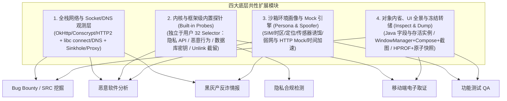

# Tripoder 全场景能力评估与演进缺口分析 (Scenario Gap Analysis)

- **更新日期**：2026-10-28
- **关联架构与计划**：[当前总体架构](current-architecture.md) · [单运行时与最小底座收敛](single-runtime.md) · [架构梳理与实施计划](implementation-plan.md)
- **评估范围**：基于当前 `android/runtime`、`android/self-hook`、`android/engine`、`android/workbench`、`src/` 与 `agent/`（MCP v3）的实际代码实现，对照六大目标业务场景进行全景能力盘点与差距分析：
  1. **Bug Bounty 与 SRC 安全风险挖掘**
  2. **隐私合规检测（工信部 / 监管测评标准）**
  3. **功能测试与自动化 QA**
  4. **恶意软件与病毒动态分析（Malware / Trojan Analysis）**
  5. **黑灰产对抗与反诈情报分析（Black/Gray-Market & Fraud Analysis）**
  6. **移动端电子数据取证（Mobile Digital Forensics）**

---

## 1. 总体评估结论

**当前状态：采用「统一最小承载底座（Level 1）+ 按需策略扩展（Opt-in）」双层架构，Phase 1/2/3 共 24 项 MCP 能力契约已完成暴露与验证，公开 MCP 工具组达 60 个（手机端 53 个 + 桌面端本地 7 个）；底座裁剪后的 Opt-in 动态装配闭环见 [架构梳理与实施计划](implementation-plan.md)。**

### 1.1 已攻克的底层护城河
1. **免 Root 免重打包虚拟化沙箱**：单 APK 四类进程模型（主进程 UI + `:authority` 权威控制面 + `:recovery` 恢复门禁 + `:slot0..7` 隔离执行槽位），默认最小底座支持 `LoadedApk`/四大组件代理、真实 linker 路径、[`fixed_libc`](self-hook-design.md) 10 入口路径重定向与 `/proc/self/*` 视图；[`syscall_namespace.c`](../android/runtime/native/syscall_namespace.c) (`SYS_SECCOMP`) 与 [`ptrace_namespace.c`](../android/runtime/native/ptrace_namespace.c) 作为按需扩展策略（Opt-in）演进。
2. **零外部依赖的自研 Hook 与探测引擎**：ART Nterp Java Hook、ARM64 W^X `mremap` Native Hook、运行时 ClassLoader/DEX 内存快照（[`RuntimeCodeProbes`](../android/runtime/src/dev/tripoder/runtime/RuntimeCodeProbes.java)），天然无 Frida/Xposed 特征（见 [`AntiDetectChecks`](../android/anti-detect-fixture/src/main/java/dev/tripoder/antidetect/AntiDetectChecks.java)）。
3. **高确定性的 MCP v3 全局控制面**：[`agent/tool-groups.mjs`](../agent/tool-groups.mjs) 提供的 53（HTTP）/ 60（stdio）个工具，具备显式代次（`installGeneration` / `processGeneration`）隔离、CAS 并发保护、幂等操作日志及 SHA-256 产物校验链（[`file-pull.md`](file-pull.md)）。

### 1.2 全景场景匹配度矩阵

| 目标业务场景 | 当前底座匹配度 | 核心已具备能力 | 剩余架构边界 / 待演进项（Remaining Boundaries） |
| :--- | :---: | :--- | :--- |
| **1. Bug Bounty / SRC 挖掘** | ⭐⭐⭐⭐⭐ (92%) | Manifest/存储审计、四大组件 Intent/Provider 投递（`component_send_intent`/`provider_interact`）、存活实例枚举与绑定调用（`heap_query`+`guest_invoke(instanceId)`）、构造函数 `<init>` Hook 与实例化、Java 字段读取与容器浅快照（`ctx.java.readField`/`snapshotContainer`）、TLS 模块自动探测（`moduleName="auto"`）、HAR 1.2 导出与可配置抓包上限 | 缺 HTTP/2 & gRPC 解析、缺指令抽取壳 `CodeItem` 重组 |
| **2. 隐私合规检测** | ⭐⭐⭐⭐☆ (85%) | `startupHook`、独立于 32-selector 配额的 `privacy_probe_control`/`privacy_probe_query`（同意阶段时间线打标 + 可导入第三方 SDK 包名归属库 + `ctx.privacy.*` 脚本联动） | 框架类身份 API 因沙箱安全边界仍禁止直接 Hook（通过 Hook 客体 SDK 包装层闭环） |
| **3. 功能测试与自动化 QA** | ⭐⭐⭐⭐⭐ (92%) | 多窗口 + Compose 语义树分页 `ui_tree`、`ui_screenshot`（含 SurfaceView 合成）、12 种 UI 交互原语、`state_checkpoint` 秒级数据快照回滚、`env_mock`（HTTP 故障/断网/弱网/蜂窝切换）与虚拟 GPS/电量注入 | 缺进程级 Logcat 流与主线程 Jank 帧率监控 |
| **4. 恶意软件与病毒分析** | ⭐⭐⭐⭐⭐ (92%) | 免 Root 反检测、`malware_probe_control`/`malware_probe_query`（高危特权 Intent 观测与 opt-in 阻断 + Seccomp 内核级 `SYS_execve`/`SYS_kill` 阻断与外网 `SYS_connect` Sinkhole + 计数暴露）、`time_warp` 时间加速、`honeydata` 诱饵通讯录/短信注入、YARA 子集规则扫描（`signature_control`/`signature_query`） | 缺 `unlink` 删除文件硬链接自动截留 |
| **5. 黑灰产对抗与反诈情报** | ⭐⭐⭐⭐ (82%) | `persona_control` 全套反 Cloaking 伪装（SIM 国家码/MCC-MNC/运营商、GPS 定位、系统语言/时区、`hideVpn` 隐藏 VPN 标志）、YARA 扫描与 `evidence_export` 结构化 IOC/CSV/JSON 导出 | 缺 Flutter/uni-app 专向解包与 `libc` DNS/Socket 级全协议连接流 |
| **6. 移动端电子数据取证** | ⭐⭐⭐⭐⭐ (90%) | SQLCipher/MMKV 运行时明文密钥 Hook 截获与离线解密验证、`application_query(action=wal_recover)` 原始 `-wal` 字节已删记录恢复、`process_snapshot(heap_dump/freeze_export)` 主线程静止原子数据库快照与 HPROF 堆转储 | 明确限定为“已授权调查/合规辅助”，不追求 ISO/IEC 27037 司法只读证据链 |

---

## 2. 底层引擎与脚本底座的共性缺口（制约所有场景）

在 [`src/`](../src/plan.ts) 与 [`android/runtime/src/dev/tripoder/runtime/script/`](../android/runtime/src/dev/tripoder/runtime/script/SelfHookControl.java) 中，原有的 **5 项共性底层限制**中前 3 项已彻底闭环：

### 2.1 Java 对象为“不透明引用”，无法读取字段或展开常见容器 **[已关闭：Phase 1.4 `ctx.java.readField` / `ctx.java.snapshotContainer` & `heap_query(read_field|snapshot_container)`]**
- **已落地**：在 [`JavaObjectSnapshots`](../android/runtime/src/dev/tripoder/runtime/script/JavaObjectSnapshots.java)、[`DraftCompiler`](../android/runtime/src/dev/tripoder/runtime/script/DraftCompiler.java)、[`RuntimeLiveInstances`](../android/runtime/src/dev/tripoder/runtime/RuntimeLiveInstances.java) 与 [`src/java-objects.ts`](../src/java-objects.ts) 中补齐非虚反射字段读取 `readField` 与有界容器浅快照 `snapshotContainer`（覆盖 `Intent`/`Bundle`/`ContentValues`/`Uri`/`JSONObject`/数组/标准 `Map`/`Collection` 与通用客体对象字段），同时在脚本 `ctx.java.*` 与 MCP `heap_query` 双端暴露。

### 2.2 不支持构造函数（`<init>`）与方法重载通配 Hook **[已关闭：Phase 1.4 `<init>` 构造函数枚举、Hook 与 `guest_invoke` 实例化]**
- **已落地**：[`RuntimeJavaObservation`](../android/runtime/src/dev/tripoder/runtime/RuntimeJavaObservation.java) 暴露 `constructors` 列表，[`RuntimeJavaHookBackend`](../android/runtime/src/dev/tripoder/runtime/RuntimeJavaHookBackend.java) 与 [`SelfHookControl`](../android/runtime/src/dev/tripoder/runtime/script/SelfHookControl.java) 支持挂接 `<init>` 构造函数 `before`/`after` 回调（`after` 自动绑定新实例 `thisObject`），[`RuntimeSecurityAudit.invokeGuestMethod`](../android/runtime/src/dev/tripoder/runtime/RuntimeSecurityAudit.java) 支持 `guest_invoke(methodName="<init>")` 构造实例并返回 `inst-N` 句柄。

### 2.3 受限 TypeScript (`RestrictedAst`) 语法与内置标准库过于受限 **[已关闭：Phase 1.5 `Hex` / `Base64` / `JSON` / `ctx.state`]**
- **已落地**：在 [`src/plan.ts`](../src/plan.ts)、[`DraftCompiler`](../android/runtime/src/dev/tripoder/runtime/script/DraftCompiler.java) 与 [`HookInvocationSession`](../android/runtime/src/dev/tripoder/runtime/script/HookInvocationSession.java) 中补齐 `Hex`、`Base64`、`JSON` 编解码与有界会话级键值字典 `ctx.state`（`get`/`set`/`delete`/`clear`/`keys`，上限 64 键 × 4096 字节），支持跨回调/跨方法上下文关联。

### 2.4 单进程 Hook 会话独占互斥 & 32 个 Selector 上限 **[已关闭：Phase 2 多轨道正交解耦与 128 Selector 扩容]**
- **已落地**：
  1. [`SelfHookControl`](../android/runtime/src/dev/tripoder/runtime/script/SelfHookControl.java) 与 [`NetworkCaptureControl`](../android/runtime/src/dev/tripoder/runtime/script/NetworkCaptureControl.java) 拆分为被动网络抓包、用户自定义脚本和内置探针三条正交独立轨道。被动抓包拥有专属的内部 Hook 会话，不再挤占用户 Hook 槽位，彻底消除 `NETWORK_CAPTURE_OWNS_HOOK` 与 `HOOK_CONTEXT_IN_USE`。
  2. 将单会话 Selector 上限由 32 扩容至 128，单次可覆盖大型合规检测与批量逆向分析场景。

### 2.5 Native Hook `before` 阶段缓冲区读取、C 字符串读取与任意偏移 Hook **[已关闭核心：Phase 3 `before` `captureBuffer` & `readCString`]**
- **已落地**：[`NativeBufferScope`](../android/runtime/src/dev/tripoder/runtime/script/NativeBufferScope.java)、[`DraftCompiler`](../android/runtime/src/dev/tripoder/runtime/script/DraftCompiler.java) 与 [`src/plan.ts`](../src/plan.ts) 已支持在 `before` 与 `after` 阶段调用 `ctx.native.captureBuffer`（支持按显式长度参数读取输入指针缓冲区，上限扩容至 4096 字节）及 `ctx.native.readCString(addressArgIndex, maxBytes)` 读取以 `\0` 结尾的 C 字符串。
- **剩余待补**：按 `moduleName + offset` Hook 去符号表（stripped）商业 `.so` 中的内部未导出函数（`sub_xxxx`）。

---

## 3. 六大业务场景缺失项逐一列举

### 3.1 场景一：Bug Bounty 与 SRC 安全风险挖掘

#### 已具备能力
- 静态 Manifest 组件导出性与权限声明解析（[`InstalledManifestAudit`](../android/runtime/src/dev/tripoder/runtime/InstalledManifestAudit.java)）。
- 沙箱存储目录、`shared_prefs` 敏感键匹配、SQLite 表结构枚举（[`RuntimeSecurityAudit.inspectStorage`](../android/runtime/src/dev/tripoder/runtime/RuntimeSecurityAudit.java)）。
- 动态 ClassLoader 与内存 DEX 快照导出（[`runtime-observation.md`](runtime-observation.md)）。
- 客体上下文 HTTP 发包（[`sendHttpRequest`](../android/runtime/src/dev/tripoder/runtime/RuntimeSecurityAudit.java)）与静态/无参构造类方法反射调用（[`invokeGuestMethod`](../android/runtime/src/dev/tripoder/runtime/RuntimeSecurityAudit.java)）。

#### 缺失清单（6 项）
1. **全栈网络流量捕获与主流协议支持缺失（头号短板）**
   - **现状**：被动抓包 [`NetworkCaptureControl`](../android/runtime/src/dev/tripoder/runtime/script/NetworkCaptureControl.java) 只支持客体自带且导出 `SSL_new/SSL_free/SSL_read/SSL_write` 四个符号的单一 `.so`，仅解析 HTTP/1.1，且限制单段 1 KiB、每方向 4 KiB、单会话最多 16 条连接 / 64 KiB（[`passive-network-sessions.md`](passive-network-sessions.md)）。
   - **缺失**：
     - 不支持 Android 系统默认 TLS 栈（Conscrypt / 系统 `libssl.so`）与主流 Java 网络框架（OkHttp3 / `HttpURLConnection` / Cronet / WebView）的自动流量捕获。
     - 不支持 HTTP/2、gRPC、WebSocket、QUIC (HTTP/3) 协议解析。
     - 4 KiB 正文上限与 16 条连接上限过小，真实业务 JSON 响应极易被截断。
     - 缺少请求/响应实时拦截篡改（MITM Breakpoint）或一键转发至外部代理（Burp Suite / mitmproxy）并自动注入沙箱级 SSL Pinning Bypass 的能力。
2. **四大组件安全测试与 Fuzzing 投递工具缺失** **[已关闭：Phase 2.3 `component_send_intent` & `provider_interact`]**
   - **现状**：[`RuntimeComponentDelivery`](../android/runtime/src/dev/tripoder/runtime/RuntimeComponentDelivery.java) 已支持 `component_send_intent`（含 `action`/`data`/`mimeType`/`categories`/`flags`/`extras`）与 `provider_interact`（`query`/`insert`/`update`/`delete`/`call`/`openType`）。
3. **`guest_invoke`（主动 RPC 调用）无法操作存活对象实例** **[已关闭：Phase 2.3 `heap_query(choose_instances)` & `guest_invoke(instanceId)`]**
   - **现状**：[`RuntimeLiveInstances`](../android/runtime/src/dev/tripoder/runtime/RuntimeLiveInstances.java) 支持按类名枚举堆上存活客体对象并返回弱引用句柄 `inst-1..N`，[`RuntimeSecurityAudit.invokeGuestMethod`](../android/runtime/src/dev/tripoder/runtime/RuntimeSecurityAudit.java) 支持绑定 `instanceId` 直接调用存活实例方法。
4. **WebView 与 Hybrid / JSBridge 安全审计套件缺失**
   - **现状**：仅实现了 `WebView.setDataDirectorySuffix` 隔离（[`RuntimeWebView`](../android/runtime/src/dev/tripoder/runtime/RuntimeWebView.java)）。
   - **缺失**：自动枚举 `addJavascriptInterface` 注册的 JSBridge 对象与 `@JavascriptInterface` 方法；强制开启 `setWebContentsDebuggingEnabled(true)`；监控 `loadUrl`、`evaluateJavascript`、`shouldOverrideUrlLoading` 及 File 域访问设置。
5. **本地存储深度审计能力缺失（仅看表头、不看内容）**
   - **现状**：[`inspectDatabases`](../android/runtime/src/dev/tripoder/runtime/RuntimeSecurityAudit.java) 仅返回表名、列名和行数，不读取数据行；不支持 MMKV、DataStore。
   - **缺失**：沙箱内 SQLite 只读查询入口（`sqlite_query`）、MMKV 键值解析、以及针对沙箱文件/内存/DEX 的**敏感凭据扫描器**（正则 + 熵值扫描硬编码 AK/SK、JWT、私钥、内网域名）。
6. **高对抗壳脱壳与还原能力缺口**
   - **现状**：[`RuntimeAgentAnalysis`](../android/engine/src/dev/tripoder/runtime/RuntimeAgentAnalysis.java) 标记 `compactDex=false`、`methodBodyReconstruction=false`。
   - **缺失**：针对指令抽取壳的主动调用触发与 `CodeItem` 回填重组、CompactDEX 转标准 DEX、内存加密 `.so` 的 Dump 与重定位修复（SoFixer）。

---

### 3.2 场景二：隐私合规检测（工信部 / App 侵害用户权益测评）

#### 已具备能力
- 支持 `Application` 构造前的启动探针（`startupHook`，见 [`runtime-observation.md`](runtime-observation.md)）。
- 支持采集 Java 调用栈（`ctx.debug.captureJavaStack`，上限 32 帧）与 Native 调用偏移（`callerModuleOffset`）。

#### 缺失清单（5 项，核心 3 项已关闭）
1. **缺少内置的“全量隐私敏感 API 监控探针（Privacy Compliance Probe）”** **[已关闭：Phase 2.1 `privacy_probe_control` / `privacy_probe_query` + `ctx.privacy.*`]**
   - **已落地**：提供独立于用户 32 Selector 配额与独占状态的 [`RuntimePrivacyProbeState`](../android/runtime/src/dev/tripoder/runtime/script/RuntimePrivacyProbeState.java)，配合脚本内 `ctx.privacy.attribution(className)` 与 `ctx.privacy.consentStage()` 直接对客体 SDK 包装层做无损打标。
2. **缺少“隐私弹窗同意前 / 同意后 / 后台静置”的时间线里程碑（Consent Timeline）** **[已关闭：Phase 2.1 `privacy_probe_control(action=mark_consent_stage)`]**
   - **已落地**：支持通过 MCP 实时标记 `BEFORE_CONSENT`/`CONSENT_GRANTED`/`CONSENT_WITHDRAWN`/`ENTER_BACKGROUND`/`ENTER_FOREGROUND` 并查询完整时间线。
3. **缺少第三方 SDK 自动归属识别（SDK Attribution Engine）** **[已关闭：Phase 2.1 `privacy_probe_control(action=configure_attribution)`]**
   - **已落地**：支持作为外部 JSON 资产导入包名前缀 → SDK 名称归属规则，按最长前缀自动匹配责任 SDK。
4. **缺少“本地敏感信息采集 $\rightarrow$ 网络外发”的数据流关联**
   - **缺失**：在网络请求明文/载荷中自动比对是否外发了采集到的设备指纹（含原始值及 MD5/SHA1/Base64 变体）及目标第三方追踪域名归属。
5. **缺少标准化《隐私合规检测报告》自动生成**
   - **缺失**：按测评规范自动汇总违规项、发生阶段、调用频次、责任 SDK、完整调用栈与参数详情。

---

### 3.3 场景三：功能测试与自动化 QA

#### 已具备能力
- 多 Space 沙箱隔离（支持多账号/干净初始态并行回归）。
- 基础视图树转储 [`dumpUiHierarchy`](../android/runtime/src/dev/tripoder/runtime/RuntimeStartupDiagnostics.java) 与 5 类基础动作 [`dispatchUiAction`](../android/runtime/src/dev/tripoder/runtime/RuntimeStartupDiagnostics.java)（`tap`、`swipe`、`clickText`、`setText`、`key`）。
- 近期未捕获 Java 异常诊断（`process_inspect(action=diagnostics)`）。

#### 缺失清单（6 项，前 5 项已全部关闭）
1. **UI 树采集存在三大盲区（Compose 不可见、Dialog 弹窗不可见、256 节点截断）** **[已关闭：Phase 1.1 `process_inspect(action=ui_tree)`]**
   - **已落地**：遍历 `WindowManagerGlobal` 全部顶层窗口、接入 `AccessibilityNodeInfo` 展开 Compose 节点，并支持 `limit` 与 `truncated` 显式标记。
2. **缺少界面截图（Screenshot）与视觉取证能力** **[已关闭：Phase 1.2 `process_inspect(action=ui_screenshot)`]**
   - **已落地**：进程内 `PixelCopy` + `SurfaceView` 合成零权限截图并返回内联 PNG base64 与 SHA-256。
3. **UI 交互原语单薄，缺少按 ID/描述点击与智能同步等待（Wait/Idle Sync）** **[已关闭：Phase 1.3 `ui_dispatch_action`]**
   - **已落地**：补齐 `clickById`、`clickByDescription`、`clickTextContains`、`longPress`、`doubleTap`、`scrollIntoView`、`waitForElement` 共 12 种 UI 交互动作。
4. **缺少测试环境 Mock 与故障注入（Fault Injection）能力** **[已关闭：Phase 3.1 `persona_control` & Phase 3.5 `env_mock_control`]**
   - **已落地**：[`RuntimeEnvMock`](../android/runtime/src/dev/tripoder/runtime/RuntimeEnvMock.java) 支持按 URL 前缀拦截 HTTP 返回自定义状态码/头部/正文/延迟，以及切换 `offline`/`wifi`/`cellular`/`passthrough` 网络状态并派发 `NetworkCallback`；[`RuntimeSandboxPersona`](../android/runtime/src/dev/tripoder/runtime/RuntimeSandboxPersona.java) 支持虚拟 GPS、电量、SIM、语言/时区注入。
5. **缺少沙箱数据快速快照与回滚（State Checkpoint & Rollback）** **[已关闭：Phase 3.4 `state_checkpoint_control` & `state_checkpoint_query`]**
   - **已落地**：[`RuntimeStateCheckpoints`](../android/engine/src/dev/tripoder/runtime/RuntimeStateCheckpoints.java) 支持对 `(space, package)` 创建带 SHA-256 完整性校验的本地快照与原子回滚。
6. **缺少完整的进程级日志（Logcat）、Native 崩溃栈与性能指标采集**
   - **缺失**：按进程读取 `Logcat` 缓冲区的 MCP 接口；Native 崩溃时的寄存器与回溯栈（Unwind Backtrace）；以及 Java Heap / Native PSS 内存水位与主线程 Jank 卡顿监控。

---

### 3.4 场景四：恶意软件与病毒动态分析（Malware / Trojan Analysis）

#### 已具备能力
- 真机免 Root 运行，具备 `/proc/self/maps`、`/proc/self/status` (`TracerPid`)、[`ptrace_namespace.c`](../android/runtime/native/ptrace_namespace.c) 隐身与 25 项反检测基线（[`AntiDetectChecks`](../android/anti-detect-fixture/src/main/java/dev/tripoder/antidetect/AntiDetectChecks.java)）。
- [`RuntimeCodeProbes`](../android/runtime/src/dev/tripoder/runtime/RuntimeCodeProbes.java) 支持捕获动态加载的 DEX 载荷。

#### 缺失清单（5 项，核心 4 项已关闭）
1. **沙箱爆炸半径控制与网络隔离（Blast Radius & Sinkhole）缺失 —— 安全性红线** **[已关闭：Phase 3.1 `syscall_namespace.c` + `malware_probe_control(blockExecve/blockKill/networkSinkhole)`]**
   - **已落地**：在 [`syscall_namespace.c`](../android/runtime/native/syscall_namespace.c) 的 32 条 Seccomp BPF 指令预算内纳入 `SYS_execve`/`SYS_execveat`、`SYS_kill`/`SYS_tkill`/`SYS_tgkill` 与 `SYS_connect`，支持通过 `malware_probe_control(action=configure)` 动态开启 `blockExecve=true`（返回 `-EACCES`）、`blockKill=true`（拦截对外部进程信号并返回 `-EPERM`）与 `networkSinkhole=true`（拦截所有非回环 `AF_INET`/`AF_INET6` 的外网 TCP 连接并返回 `-ECONNREFUSED`，不产生真实外联）。
2. **高危恶意行为全景遥测探针（Malware Behavior Telemetry）缺失** **[已关闭：Phase 2.2 `malware_probe_control` & `malware_probe_query`]**
   - **已落地**：[`RuntimeMalwareProbeState`](../android/runtime/src/dev/tripoder/runtime/RuntimeMalwareProbeState.java) 向上暴露 `syscallNamespaceNative` 计数、观测高危特权诱导 Intent（无障碍/设备管理器/悬浮窗/安装/短信）与动态 Receiver 注册，并支持 `blockHighRiskIntents` 显式 opt-in 阻断。
3. **文件删除拦截与自动隔离区（Unlink Quarantine / Dropper Capture）缺失**
   - **现状**：木马（Dropper）常在释放并加载二级载荷后立即调用 `unlinkat` 删除文件毁灭痕迹；[`syscall_namespace.c`](../android/runtime/native/syscall_namespace.c) 虽已拦截 `SYS_unlinkat`，但目前直接执行物理删除。
   - **缺失**：在 `tp_unlinkat` 中支持 **“删除即隔离转存（Quarantine on Unlink）”**，将被删载荷自动硬链接/移入取证产物区后再向客体返回删除成功。
4. **反沙箱休眠绕过（Time Warping）与高仿真诱饵画像（Decoy Persona）缺失** **[已关闭：Phase 3.2 `time_warp_control`/`time_warp_query` & `honeydata_control`/`honeydata_query`]**
   - **已落地**：[`RuntimeTimeWarp`](../android/runtime/src/dev/tripoder/runtime/RuntimeTimeWarp.java) 支持虚拟时钟偏移 `offsetMillis` 与延时缩放 `delayScale`；[`RuntimeHoneyData`](../android/runtime/src/dev/tripoder/runtime/RuntimeHoneyData.java) 支持注入虚拟通讯录（`contacts`）、短信（`sms`）与通话记录（`call_log`）诱饵数据。
5. **YARA 扫描与 MITRE ATT&CK 行为报告生成缺失** **[已关闭：Phase 3.6 `signature_control` / `signature_query` / `evidence_export`]**
   - **已落地**：[`agent/signature-scan.mjs`](../agent/signature-scan.mjs) 支持外部导入 YARA 规则集并对文件/APK/DEX 运行规则扫描与 IOC 导出。

---

### 3.5 场景五：黑灰产对抗与反诈情报分析（Black/Gray-Market & Fraud Analysis）

#### 已具备能力
- 沙箱多开隔离、基础 Native 导出符号扫描与内存 DEX 快照。

#### 缺失清单（4 项）
1. **底层全协议 IOC（失陷指标：C2 域名、IP、证书、收款通道）自动提取器缺失**
   - **现状**：[`NetworkCaptureControl`](../android/runtime/src/dev/tripoder/runtime/script/NetworkCaptureControl.java) 无法覆盖黑灰产广泛使用的自定义 TCP 二进制协议、WebSocket、DoH（DNS over HTTPS）及无导出符号的静态链接 BoringSSL。
   - **缺失**：在 `libc` / Syscall 层拦截 `getaddrinfo`、`connect`、`sendto`/`recvfrom` 及 TLS 握手数据包，无死角提取**所有解析域名、远端 IP:Port、TLS SNI、服务端证书指纹**，并自动高亮 OSS/COS/Telegram/GitHub 等云端死信配置下发通道。
2. **跨平台套壳框架（Flutter / uni-app / H5 / ReactNative）专向提取缺失**
   - **现状**：黑灰产 App 超 70% 使用 uni-app、WebView H5 套壳或 Flutter 以极速换皮。
   - **缺失**：缺少自动提取 uni-app 运行时解密的 `.wgt`/JS 页面资源、WebView 完整 DOM/H5 源码与请求、ReactNative Hermes 字节码，以及针对 Flutter `libapp.so` 基于特征码偏移的 BoringSSL 明文抓包。
3. **黑灰产“地域围栏 / 运营商校验 / 马甲包（Cloaking）”反欺骗伪装缺失** **[已关闭：Phase 3.1 `persona_control` & `persona_query`]**
   - **已落地**：[`RuntimeSandboxPersona`](../android/runtime/src/dev/tripoder/runtime/RuntimeSandboxPersona.java) 支持配置虚拟 SIM 国家码（ISO）/ 运营商（MCC/MNC）、GPS 定位、系统语言（`Locale`）、时区（`TimeZone`），并支持 `hideVpn=true` 隐藏 VPN/代理传输层标志。
4. **涉诈通联方式与资金链特征提取器缺失** **[已关闭：Phase 3.6 `evidence_export`]**
   - **已落地**：支持通过 `evidence_export` 按字段映射与内置 IOC 提取器从证据文件中批量抽取 URL/域名/IPv4/邮箱/哈希及自定义字段。

---

### 3.6 场景六：移动端电子数据取证（Mobile Digital Forensics）

#### 已具备能力
- [`FileExports`](../android/workbench/src/dev/tripoder/hooklab/FileExports.java) 与 [`artifact-verify.mjs`](../agent/artifact-verify.mjs) 提供 SHA-256 清单固证、精确代次绑定与只读文件导出。

#### 缺失清单（4 项，前 3 项已关闭）
1. **SQLite WAL 日志与已删除记录（Freelist / Unallocated Space）恢复缺失** **[已关闭：Phase 3.4 `application_query(action=wal_recover)`]**
   - **已落地**：[`RuntimeWalRecovery`](../android/runtime/src/dev/tripoder/runtime/RuntimeWalRecovery.java) 直接解析原始 `-wal` 字节与帧校验和，对比主库叶页恢复已删除或未 checkpoint 的历史记录。
2. **加密数据库（SQLCipher / WCDB）与加密 MMKV 的“运行时密钥截获与自动解密”缺失** **[已关闭：Phase 2.4 Hook 密钥截获 + `file_export` 离线解密闭环]**
   - **已落地**：通过 `hook_observe`/`hook_prepare`/`hook_activate` 直接拦截客体 DEX 内的 `SQLiteDatabase.openOrCreateDatabase` 与 `MMKV.mmkvWithID` 捕获运行态明文密钥，结合 `file_export` 导出加密库并在主机端用标准 `sqlcipher` CLI 完成端到端解密验证（明确限定为已授权调查/合规辅助）。
3. **进程静止一致性快照（Quiesced Atomic Snapshot）与完整内存转储（Heap / Core Dump）缺失** **[已关闭：Phase 3.3 `process_snapshot(action=freeze_export|heap_dump)`]**
   - **已落地**：[`RuntimeProcessSnapshots`](../android/runtime/src/dev/tripoder/runtime/RuntimeProcessSnapshots.java) 支持在主线程同步屏障（Main-Thread Barrier）内静止事务并原子复制 SQLite 主库及 `-wal`/`-shm`/`-journal`（附 `manifestSha256`），以及调用 `Debug.dumpHprofData` 生成完整 HPROF 堆转储并通过 `file_export` 导出。
4. **取证超级时间线（Super Timeline）与标准取证固证包缺失**
   - **缺失**：将文件系统 `mtime/ctime/atime`、SQLite 记录时间戳、SharedPreferences 变更、网络通信与系统调用事件聚合为统一时间线，并附带设备信息、UTC/NTP 时间校准与完整哈希链生成合规取证报告。

---

## 4. 架构收敛与演进路线图 (Roadmap)

上述六大场景的 30 项具体缺口，在底层架构上可高度收敛为 **四大共性引擎模块**，分三阶段演进：

### 分阶段实施优先级

| 阶段 | 核心交付项 | 解锁的里程碑能力 |
| :--- | :--- | :--- |
| **Phase 1 (P0)** **基础突破** | 1. **UI 全景与截图**：遍历 `WindowManagerGlobal` 全部顶层窗口（覆盖 Dialog/Popup）+ 接入 `AccessibilityNodeInfo`（覆盖 Compose）+ 新增 `ui_screenshot` 与 `clickById`。 2. **Java 对象内省与 `<init>` Hook**：开放构造函数 Hook + 提供受控字段读取（`ctx.java.readField`）与容器（`Map`/`Bundle`/`Intent`）浅快照 + `RestrictedAst` 补齐 Base64/Hex/JSON/会话状态字典。 3. **实用化抓包与 Socket/DNS 观测**：放开 4KB/16连接限制，新增 Java 层 OkHttp/Conscrypt 抓包与底层 `connect`/`getaddrinfo` IOC 记录，支持代理转发与 SSL Pinning Bypass。 | **功能测试**不再卡在弹窗与 Compose；**SRC 挖掘**与**黑灰产分析**能抓全主流报文与 C2 域名，并看清加密方法入参对象。 |
| **Phase 2 (P1)** **场景专精** | 1. **内置遥测探针引擎（Built-in Probes）**：不占用户 Hook 槽位，内置 **隐私合规探针**（100+ API + 同意前后阶段打标 + SDK 归属库）、**恶意行为探针**（`execve`/无障碍/短信 + `unlink` 删除文件自动截留）与 **取证密钥探针**（SQLCipher/MMKV 密钥截获）。 2. **四大组件投递与存活实例 RPC**：新增 `component_send_intent`（含 Deeplink/Extras）、`provider_interact`，以及 `guest_invoke` 绑定存活实例调用。 | 完整闭环 **工信部隐私合规检测**、**恶意软件行为沙箱**、**加密数据库取证解密** 与 **SRC 组件漏洞挖掘**。 |
| **Phase 3 (P2)** **高阶壁垒** | 1. **环境画像伪装与网络隔离（Persona & Sinkhole）**：沙箱断网/FakeNet 蜜罐模式、SIM 运营商/国家码/时区伪装（破除黑灰产 Cloaking）、高仿真诱饵数据注入、时间加速与 QA 弱网/定位 Mock。 2. **冻结态原子快照、HPROF 堆转储与 WAL 恢复**：支持暂停进程后原子导出数据、沙箱数据秒级回滚（QA Checkpoint）、Java HPROF 内存转储、SQLite `-wal`/已删除记录恢复与 Flutter/uni-app 专向解包。 | 全面达到商用级 **移动威胁情报沙箱**、**司法级电子数据取证平台** 与 **企业级自动化回归测试平台** 标准。 |

---

## 5. MCP 工具契约暴露设计（Capability → Tool Group）

本节回答“这些能力怎么以 MCP 工具的形式交给 Agent 自由调用”。不是把第 3 节的每一项缺口都做成一个会自己下结论的黑盒工具，而是延续 [`mcp-tool-groups.md`](mcp-tool-groups.md) v3 已经确立的契约风格（显式 `action` 枚举、查询/修改严格分离、显式 `target`、CAS/幂等 `operationId`、SHA-256 产物校验链）。

### 5.1 三层职责划分（新增能力必须遵守）

| 层 | 归属 | 本次新增示例 | 不做的事 |
| :--- | :--- | :--- | :--- |
| **确定性原语** | 引擎，暴露为 MCP 工具 | 内存/堆导出、规则匹配命中位置、Intent/Provider 投递、敏感 API 原始调用记录 | — |
| **判断与综合** | Agent（LLM 推理） | “这段行为序列算不算吸费”“这是不是马甲包”“这是否超范围收集” | 不在引擎侧写死分类/评分函数 |
| **规则与情报内容** | 可检索、可导入的资产，不是硬编码逻辑 | YARA 规则集、第三方 SDK 包名特征库、绕过脚本模板 | 不把规则写进 Java 判定分支，便于复用与版本化 |

任何新工具若发现自己在“下结论”而不是“交事实”，说明分层放错了，应改为返回原始证据，把结论留给调用方。

### 5.2 Phase 1（P0）新增/扩展工具

| 工具/能力 | action | 查询/修改 | 对应缺口 | 要点与护栏 |
| :--- | :--- | :---: | :--- | :--- |
| `process_inspect` | `ui_tree` 扩展 | 查询 | 3.3-①、3.1-④ | 加入 `windows` 维度遍历 `WindowManagerGlobal` 全部顶层根（覆盖 Dialog/Popup），`AccessibilityNodeInfo` 补齐 Compose 语义节点；256 节点硬截断改为 `cursor` 分页并显式标记 `truncated`。 |
| `process_inspect` | `ui_screenshot`（新增） | 查询 | 3.3-② | `PixelCopy`/`decorView.draw` 零权限截图，产物走既有 `captureEvidence`/`artifact_query` 通道落盘与 SHA-256 校验，不新开传输协议。 |
| `ui_dispatch_action` | `kind` 枚举新增 `clickById`/`clickByDescription`/`clickTextContains`/`longPress`/`doubleTap`/`scrollIntoView`/`waitForElement` | 修改 | 3.3-③ | 沿用现有 `uiAction` anyOf 分支结构（见 [`tool-schema.mjs`](../agent/tool-schema.mjs)），新增分支即可，不改调用约定。 |
| `hook_prepare` | 放开 `<init>` selector | 修改 | 2.2 | 需要 [`SelfHookControl.selectors`](../android/runtime/src/dev/tripoder/runtime/script/SelfHookControl.java) 与 `agent/tool-schema.mjs` 的 `methodName` 校验同步放宽；选择器契约形状不变。 |
| `java_object_query`（新增工具组） | `read_field`、`snapshot_container` | 查询 | 2.1 | 字段/容器读取严格绑定本次调用内的不可伪造 `JavaObjectRef` 生命周期，字段数/深度有界，不支持跨调用保留或任意反射。 |
| `RestrictedAst` 内置库 | 不是 MCP 工具，是脚本语言能力 | — | 2.3 | 新增 `Hex`/`UTF-8`/`Base64`/`JSON.parse`/`stringify` 与受限 `ctx.state` 会话字典；通过现有 `hook_prepare` 脚本直接使用，MCP 工具契约不变。 |
| `probes_control` / `events_query(network)` | 新增 `attach(tlsImpl=auto|okhttp|conscrypt)`、放开容量上限为可配置值 | 修改/查询 | 3.1-① | 容量上限从硬编码改为“默认值 + 显式更高值需额外确认”，不是无限放开；新增 `export_har` 查询动作导出 Burp/mitmproxy 可读格式。 |

### 5.3 Phase 2（P1）新增工具

| 工具（新增） | action | 查询/修改 | 对应缺口 | 要点与护栏 |
| :--- | :--- | :---: | :--- | :--- |
| `privacy_probe_control` | `configure`、`status` | 修改/查询 | 3.2-①②③ | 内置 100+ 敏感 API 探针，**不占用**用户 32 Selector 配额；默认 `enabled=false`，显式开启；`configure` 同时接受 `markConsentStage` 子字段写入同意时间线里程碑。 |
| `malware_probe_control` | `configure`、`status` | 修改/查询 | 3.4-② | 覆盖 `exec`/Shell/无障碍/短信等高危行为监控；默认仅记录不阻断，阻断（如拒绝 `execve`）需要显式 `blockExecve=true` 等分字段，且复用既有 Seccomp 管线而非新开一套。 |
| `component_send_intent` | 独立动作 | 修改 | 3.1-② | 支持 `action`/`data`/`mimeType`/`categories`/`flags`/嵌套 `extras`；走既有 `ActivityLease`/`Operation` 机制，不绕过租约与代次校验。 |
| `provider_interact` | 独立动作（`query`/`insert`/`update`/`delete`/`call`/`openFile`） | 修改 | 3.1-② | 对目标 URI 的读写都归为“修改”属性以统一审计，防止把注入探测误判为只读查询。 |
| `heap_query`（新增） | `choose_instances` | 查询 | 3.1-③ | 返回候选存活实例句柄，生命周期约束与现有 `JavaObjectRef` 一致（单次调用内有效、不可伪造）；`guest_invoke` 新增可选 `instanceId` 绑定该句柄后调用。 |
| `forensics_key_probe_control` | `configure`、`status` | 修改/查询 | 3.6-② | 拦截 `sqlite3_key`/`SQLiteDatabase.openDatabase`/`MMKV.mmkvWithID`/`SecretKeySpec` 截获运行态明文密钥；工具描述必须显式声明**不构成司法链条证据**，仅用于已授权的调查/合规场景。 |

### 5.4 Phase 3（P2）新增工具

| 工具（新增） | action | 查询/修改 | 对应缺口 | 要点与护栏 |
| :--- | :--- | :---: | :--- | :--- |
| `sandbox_network_policy` | `configure`、`status` | 修改/查询 | 3.4-① | Sinkhole/FakeNet 模式与高危 Syscall 阻断策略；默认关闭，比照 [`agent-mcp-design.md`](agent-mcp-design.md) 已有“网络入口首次默认关闭”先例。 |
| `sandbox_persona_control` | `configure`、`status` | 修改/查询 | 3.5-③ | 虚拟 SIM 国家码/MCC-MNC、语言、时区、VPN 标志隐藏，按 Space 配置。 |
| `time_warp_control` | `set_offset`、`set_scale`、`reset` | 修改 | 3.4-④ | 偏移/加速 `currentTimeMillis`/`elapsedRealtime`/`postDelayed`，仅影响目标 Space。 |
| `honeydata_control` | `inject`、`clear` | 修改 | 3.4-④ | 注入虚拟通讯录/短信/通话记录/相册诱饵数据。 |
| `process_snapshot` | `freeze_export`、`heap_dump` | 修改 | 3.6-③ | 复用既有 `file_export`/`artifact_query` 产物链路与 SHA-256 校验，不新开产物体系；`freeze_export` 需先 Park 客体线程再导出以保证数据库主文件与 `-wal` 一致。 |
| `storage_recovery_query` | `wal_merge`、`deleted_record_scan` | 查询 | 3.6-① | `.db`+`.db-wal` 联合解析与 Freelist 已删除记录 Carving，只读。 |
| `state_checkpoint` | `create`、`restore`、`list` | 修改/查询 | 3.3-⑤ | 基于既有 `dataId` 存储隔离做数据目录快照/回滚，服务 QA 回归场景。 |
| `env_mock_control` | `configure`、`status` | 修改/查询 | 3.3-④ | 网络 Mock、虚拟 GPS、电量/网络状态切换、运行时权限授予/拒绝模拟。 |
| `signature_scan` | `scan_target`（查询）、`list_rulesets`（查询）、`import_ruleset`（修改） | 查询/修改分离 | 3.4-⑤ | YARA 规则匹配返回命中位置与规则 ID，**不返回“是否恶意”的结论**；规则库作为可导入资产而非硬编码逻辑。 |
| `evidence_export` | `export_iocs`、`export_report` | 查询 | 3.5-①④ | 按 Agent 指定字段映射，从既有 `events_query`/`artifact_query` 证据中抽取结构化 IOC/报告骨架；判断“什么算 IOC”仍由调用方在映射中指定。 |

### 5.5 跨阶段的治理护栏（新增能力必须共用）

1. **风险分级默认关闭**：任何会主动改变客体/设备行为或可能外联的新能力（Sinkhole、Syscall 阻断、时间偏移、诱饵数据注入、密钥截获）默认 `enabled=false`，需显式 opt-in 字段打开——比照 [`agent-mcp-design.md`](agent-mcp-design.md) 中“网络入口首次默认关闭”的既有先例，不因为是新模块就放宽默认值。
2. **不新开状态机**：所有新工具沿用既有 `operationId` 幂等日志、CAS 并发保护（代次/revision 比对）与 SHA-256 产物校验链，复用 [`file-pull.md`](file-pull.md) 已定义的产物生命周期，不为某个场景单独起一套恢复/重试语义。
3. **第三方联网情报比对不在本次四阶段范围内**：若未来要接哈希情报库（如威胁情报云查），必须把“把样本/哈希发给外部服务”作为独立的显式 opt-in 能力单独评审（涉及把分析对象信息外泄给第三方），不得挂在 `intel_query` 之类工具的默认路径上。
4. **第 6 场景（移动端电子数据取证）的能力边界声明**：`forensics_key_probe_control`、`storage_recovery_query`、`process_snapshot` 提供的是**已授权调查/合规场景下的取证辅助**（密钥截获、已删除记录恢复、原子快照），**不等同于**符合 ISO/IEC 27037 等链式证据保全要求的司法级取证——因为采集动作本身（Hook 注入、运行时改写）就不满足“采集不改变原始证据状态”的前提。如需司法效力的证据链，应建立独立的只读采集子系统，不应复用本 Hook 引擎的信任边界，相关工具的描述文案需显式写明此边界，防止 Agent 或用户误用于法律场景。
