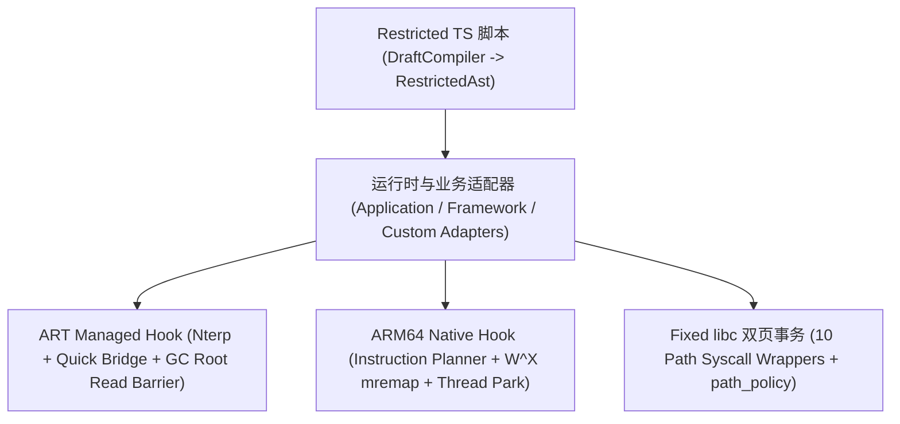

# Self-Hook 与脚本引擎设计规范 (Self-Hook Design)

本文档定义 `android/self-hook` 模块的底层架构与第一性原理实现，涵盖 ART Java 方法 Hook、ARM64 Native Inline/PLT Hook、固定 `libc` 双页导出包装器以及受限 TypeScript（Restricted AST）脚本编译与执行引擎。

---

## 1. 架构总览与分层

`self-hook` 完全自研，不依赖 Frida、Xposed 或 LSPlant 等外部框架，分为四个紧密协作的子系统：

---

## 2. ART Java 方法 Hook (`ManagedHook`)

### 2.1 ArtMethod 入口与发布策略

当前实现绑定仓库已验证的 ART 二进制合约。修改目标入口不能自动覆盖已经内联的调用者，`fullCallerCoverage` 和 `preexistingCompiledFramesCovered` 始终报告 false。

固定 helper、备份方法和回调先在正常 ART 状态下准备，再以一次暂停发布。初次发布及后续普通 Hook 的新目标发布，会反优化并使 JIT code cache 失效；只调用 `DeoptimizeEverything` 可能在 `ConfigureStubs` 时重新发布仍含旧内联代码的 JIT 调用者。缓存对象必须来自已绑定的 Runtime/Jit，并核对其身份与固定函数体。

固定发布完成后恢复原有运行标志和 JIT 选项，受控方法保留编译/内联屏障及稳定备份入口。Guest Service/Receiver 在注册给 Android 前安装实际回调入口，不为每个组件重复反优化全进程；若该入口升级为普通 Hook，仍补做调用者失效。所有普通客体使用同一批量发布与调用者失效规则。

原方法备份保持 GC root 和稳定桥，中央入口管理器继续维护已注册目标的入口所有权。实际冷启动、编译调用者及停用恢复的验证见 [THICK P0/P1 记录](thick-startup-p0-p1.md)。

### 2.2 GC Root 读屏障安全 (`DeclaringClass` Read Barrier)

- `ArtMethod::declaring_class_` 是一个 32 位压缩的 `GcRoot<mirror::Class>`。在并发拷贝 GC（Concurrent Copying / CMC GC）下，直接按裸指针读取 `declaring_class_` 会读到未转发的陈旧地址（From-Space）并引发段错误。
- `self-hook` 在读取 `ArtMethod` 所属类及维护备份方法时，严格执行 Baker 读屏障语义与 JNI 全局引用锚定，确保目标类与备份方法在 GC 周期中始终有效且不被回收。

### 2.3 调用栈归属与反射隐藏 (`Caller Coverage` & `Reflection View`)

- **Caller-Sensitive 方法兼容**：针对 `Field.get/set`、`Method.invoke`、`Class.forName`、`System.loadLibrary` 等依赖调用栈回溯调用方 `ClassLoader` 的系统方法，通过原生跳板栈帧修正与 caller 传递，确保被 Hook 后调用方身份依然被识别为真实的 Guest 类而非 `dev.tripoder` 桥接类。
- **反射视图隐身**：向 Guest 暴露的 `Method.getModifiers()` 与方法入口特征保持原始形态，避免安全 SDK 通过检查 `Modifier.NATIVE` 位或 `ArtMethod` 字段异常发现 Hook。

---

## 3. ARM64 Native Hook 引擎 (`NativeHook`)

### 3.1 指令规划器 (`Instruction Planner`)

在改写目标 ARM64 函数入口前，反汇编器对入口前 4–5 条指令（16–20 字节）进行静态分析与重定位规划：

- 识别并重定位 PC 相对寻址指令：`ADR`、`ADRP`、`B`、`BL`、`B.cond`、`CBZ`/`CBNZ`、`TBZ`/`TBNZ`、`LDR (literal)`。
- 识别并处理 `BTI`（Branch Target Identification）与 `PACIASP`/`PACIBSP`（Pointer Authentication）前导指令，确保构造的 Trampoline 符合 ARMv8.5+ 硬件安全约束。
- 若函数体过短或包含无法安全重定位的早退分支，规划器显式返回不可内联原因码，绝不破坏目标指令流。

### 3.2 信号停顿与 W^X 匿名页原子发布 (`Thread Park` & `Page Publication`)

为了在多线程高并发执行的目标进程中安全替换函数入口指令，且不触发 SELinux / 内核对代码页同时可写可执行（W^X）的审计告警：

1. **线程安全停顿 (`NativeThreadPark`)**：通过遍历 `/proc/self/task` 并向同进程其他工作线程发送专用信号，确保没有任何线程的 `PC` 正停留在待改写的 16 字节窗口内；若检测到线程 `PC` 落在窗口内，自动推进或等待其离开窗口。
2. **W^X 匿名页重映射发布 (`PagePublication`)**：
   - 将原代码页拷贝至新分配的 `RW` 匿名页，在匿名页上完成跳板指令写入、缓存刷新（`__builtin___clear_cache`）并切换为只读可执行（`RX`）。
   - 使用 `mremap(..., MREMAP_MAYMOVE | MREMAP_FIXED)` 将准备好的 `RX` 页原子覆盖到目标虚拟地址，全程目标地址不出现 `RWX` 状态。

### 3.3 模块代数与 `dlclose` 生命周期

- 监控链接器（Linker）的 `dlopen` / `dlclose` 事件，维护每个 `.so` 模块的加载代数（Module Generation）。
- 支持针对尚未加载的延迟 `.so` 注册待定（Pending）Hook，在 `dlopen` 构造函数（`.init_array`）执行前即完成拦截；当模块被卸载时自动清理关联跳板引用。

---

## 4. 固定 `libc` 双页导出包装器 (`fixed_libc`)

Guest 应用及第三方加固 SDK 常直接调用 `libc.so` 导出的底层文件操作函数。`self-hook` 通过双页事务机制接管 `libc.so` 的 **10 个核心路径入口函数**：

- `open`、`open64`、`__open_2`、`openat`、`openat64`、`__openat_2`
- `faccessat`、`fstatat64`、`statx`、`readlinkat`

### 双页原子替换与 `path_policy`

- 在一次停顿与页发布事务中，接管上述 10 个导出入口并转发至 `fixed_libc` C++ 包装器。
- 包装器使用线程局部重入保护（TLS Reentrancy Guard），查询当前进程激活的 `path_policy` 快照：
  - 命中沙箱路径规则时，将虚拟路径重写为宿主机上的隔离物理路径后再调用原始 `libc` 实现；
  - 命中 `/proc/self/*` 隐身规则时，转向伪造的文件描述符或过滤流；
  - 未命中任何重写规则时，零拷贝直通原始备份跳板。

---

## 5. 25 项启动引导契约与脚本引擎 (`RestrictedAst`)

### 5.1 25 项 / 2177 绑定引导契约 (`RuntimeBootstrap`)

当 Guest 进程启动时，`SelfHook` 按确定性顺序装载 25 个核心引导单元（涵盖 `ActivityThread`、`LoadedApk`、`Instrumentation`、`ContextImpl`、各大系统服务 Binder Proxy 以及 Native `fixed_libc` 10 个入口，共计 2177 个方法/符号绑定点），并在共享内存中维护启动健康快照。

### 5.2 受限 TypeScript 编译与解释器 (`DraftCompiler` & `RestrictedAst`)

为了支持工程师与 AI Agent 编写安全、高性能且不会导致宿主崩溃的动态 Hook 脚本：

- **编译期 (`DraftCompiler`)**：将用户或 Agent 编写的受限 TypeScript 脚本静态编译并校验为确定性的 `RestrictedAst`（支持 JSON 序列化下发至 `:slotN`）。
- **执行期 (`ScriptControl` & `ProcessInterpreter`)**：
  - 在目标 Java 或 Native 方法的 `onEnter`（Before）与 `onLeave`（After）阶段直接解释执行 `RestrictedAst`。
  - 支持读取/篡改基本类型参数、字符串、对象字段、`byte[]` 字节数组（用于加解密与网络 Buffer 分析）、提前短路返回自定义值（Short-Circuit Return）以及发射结构化观测事件至 `:authority` 与 MCP 网关。
