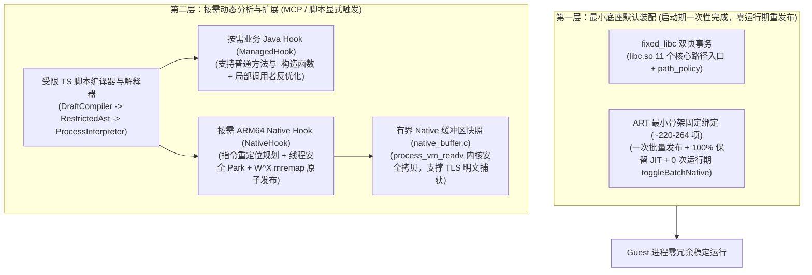

# Self-Hook 与脚本引擎设计规范 (Self-Hook Design)

本文档定义 `android/self-hook` 模块在**「统一最小承载底座（Level 1）+ 按需策略扩展（Opt-in）」**架构下的底层设计与实现，涵盖 ART Java 方法 Hook、ARM64 Native Inline/PLT Hook、固定 `libc` 双页导出包装器以及受限 TypeScript（`RestrictedAst`）脚本编译与执行引擎。

---

## 1. 架构总览与双层职责划分

`self-hook` 完全自研，零 Frida / 零 Xposed 依赖，在架构上严格区分为**默认底座能力**与**按需动态挂载能力**：

---

## 2. ART Java 方法 Hook (`ManagedHook`)

### 2.1 最小底座启动发布 vs. 按需业务 Hook 发布

- **最小底座启动期发布（Level 1 Baseline）**：
  - [`RuntimeFixedPreparation`](../android/runtime/src/dev/tripoder/runtime/RuntimeFixedPreparation.java) 先在正常 ART 状态下准备最小容器骨架所需的 ~220–264 个固定目标（仅限组件生命周期、`Application`/`LoadedApk`、Package/Storage/Job/PendingIntent 最小入口，不包含 12 个系统 Manager 家族与 Widget）。
  - 在客体代码执行前通过一次批量发布完成入口绑定，**保留正常 ART JIT 编译（`jitEnabled=true`）**，不在启动期执行全进程无差别调用者反优化，且运行期 UI 主线程 `toggleBatchNative` 保持为 **0 次**。
- **按需业务 Hook 发布（Opt-in Analysis Hook）**：
  - 当用户或 AI Agent 通过 `startupHook` 或 `hook_activate` 显式部署业务 Hook（支持普通方法与 `<init>` 构造函数）时，才针对新目标执行调用者反优化与已绑定 JIT code cache 失效，并为受控方法设置编译/内联屏障（`kAccCompileDontBother`）。
  - 修改目标入口不承诺热迁移早已存在活动栈帧或全部历史内联调用者（`fullCallerCoverage` 与 `preexistingCompiledFramesCovered` 诚实报告 `false`）。

### 2.2 GC Root 读屏障安全 (`DeclaringClass` Read Barrier)

- `ArtMethod::declaring_class_` 是 32 位压缩 `GcRoot<mirror::Class>`。在 ART 并发拷贝 GC 下，[`art_method_storage.c`](../android/self-hook/native/art_method_storage.c) 与 [`OriginalMethodStorage`](../android/self-hook/java/dev/tripoder/selfhook/OriginalMethodStorage.java) 在声明方法表之外维护备份槽与 `ClassExt` Native 根，严格执行读屏障语义与 JNI 全局引用锚定，杜绝陈旧地址段错误与持久化映像损坏。

### 2.3 调用栈归属与反射视图隐藏 (`Caller Coverage` & `Reflection View`)

- **Caller-Sensitive 方法兼容**：针对 `Field.get/set`、`Method.invoke`、`Class.forName`、`System.loadLibrary` 等回溯调用方 `ClassLoader` 的系统方法，通过原生跳板栈帧修正与 caller 传递，确保调用方身份仍被识别为真实 Guest 类（[`FixedFrameworkMembers`](../android/self-hook/java/dev/tripoder/selfhook/FixedFrameworkMembers.java) 支持未解析 ART native 槽位的反射回退）。
- **反射视图隐身（[`art_reflection_view.c`](../android/self-hook/native/art_reflection_view.c)）**：向 Guest 暴露的 `Method.getModifiers()` 与方法入口特征保持原始形态，隐藏 Hook 痕迹。

---

## 3. ARM64 Native Hook 引擎 (`NativeHook`)

### 3.1 指令规划器 ([`a64_relocate.c`](../android/self-hook/native/a64_relocate.c) / [`a64_entry.c`](../android/self-hook/native/a64_entry.c))

在改写目标 ARM64 函数入口前，对入口指令序列进行白名单静态分析与重定位规划：

- 识别并重定位 PC 相对寻址指令：`ADR`、`ADRP`、`B`、`BL`、`B.cond`、`CBZ`/`CBNZ`、`TBZ`/`TBNZ`、`LDR (literal)`。
- 识别并保留 `BTI c/jc`（Branch Target Identification）与 `PACIASP`/`PACIBSP` 前导指令。
- 若函数体过短或含不可重定位分支，规划器显式返回错误码，绝不盲目覆写破坏目标指令流。

### 3.2 有界信号停顿与 W^X 匿名页原子发布 ([`thread_park.c`](../android/self-hook/native/thread_park.c) / [`page_commit.c`](../android/self-hook/native/page_commit.c))

1. **有界线程安全停顿 (`tp_park_begin_bounded`)**：遍历 `/proc/self/task` 发送专用停顿信号（Signal 60），确保无任何线程 `PC` 落在待改写窗口内；对瞬时 `TIMEOUT`/`INVENTORY` 状态支持最多 3 次有界退避重试（间隔 1–2ms）。
2. **W^X 匿名页重映射发布**：将原代码页拷贝至新分配的 `RW` 匿名页，写入跳板、刷新指令缓存后切换为 `RX`，再通过 `mremap(..., MREMAP_MAYMOVE | MREMAP_FIXED)` 原子覆盖目标虚拟地址，全程绝不出现 `RWX` 页；停用时完整恢复原文件映射。

---

## 4. 固定 `libc` 双页导出包装器 ([`fixed_libc.c`](../android/self-hook/native/fixed_libc.c))

`self-hook` 在进程启动期通过一次双页事务接管 `libc.so` 的 **11 个核心路径入口函数**：

- `openat`、`fstatat`、`unlinkat`、`mkdirat`、`renameat2`、`faccessat`、`readlinkat`、`chdir`、`symlinkat`、`linkat`、`__fchmodat`（见 [`self_hook_storage.c`](../android/runtime/native/self_hook_storage.c#L78) 与 [`libc_fixed_contract.h`](../android/self-hook/native/libc_fixed_contract.h)）。
- 其中 `__fchmodat` 确保客体动态插件框架（如支付宝 Quinox）调用 `File.setReadOnly()` / `chmod(0444)` 时能正确重定向至真实沙箱路径，满足 Android 14+ ART W^X 动态 DEX 不可写校验。

包装器带线程局部重入保护（TLS Reentrancy Guard），查询当前进程的 [`path_policy.c`](../android/runtime/native/path_policy.c)：
- 命中客体私有数据目录或 `/proc/self/*` 规则时，执行路径重定向或视图过滤；
- 未命中规则时零拷贝直通原始备份跳板；
- 默认**不启用全进程 `seccomp`**，保持原生系统调用性能与 `debuggerd` 崩溃转储能力。

---

## 5. 受限 TypeScript 编译与解释器 (`DraftCompiler` & `RestrictedAst`)

- **编译期 ([`DraftCompiler.java`](../android/runtime/src/dev/tripoder/runtime/script/DraftCompiler.java) / [`src/plan.ts`](../src/plan.ts))**：将受限 TypeScript 脚本静态编译并校验为确定性的 `RestrictedAst`。
- **执行期 ([`SelfHookControl.java`](../android/runtime/src/dev/tripoder/runtime/script/SelfHookControl.java) / [`HookInvocationSession.java`](../android/runtime/src/dev/tripoder/runtime/script/HookInvocationSession.java))**：
  - 支持 Java 方法（含 `<init>` 构造函数）与 Native 函数的 `before` / `replace` / `after` 拦截。
  - 内置 `Hex`、`Base64`、`JSON` 标准编解码库与跨回调有界状态字典 `ctx.state`（64 键 × 4,096 字节）。
  - 支持非虚反射对象内省 `ctx.java.readField`、有界容器浅快照 `ctx.java.snapshotContainer`、线程/异常快照 `snapshotThread`/`snapshotThrowable`、DEX 内存快照 `ctx.code.snapshotDex`、Native 缓冲区安全采集 `ctx.native.captureBuffer` 以及原子持久化证据写入 `ctx.debug.captureEvidence`。
