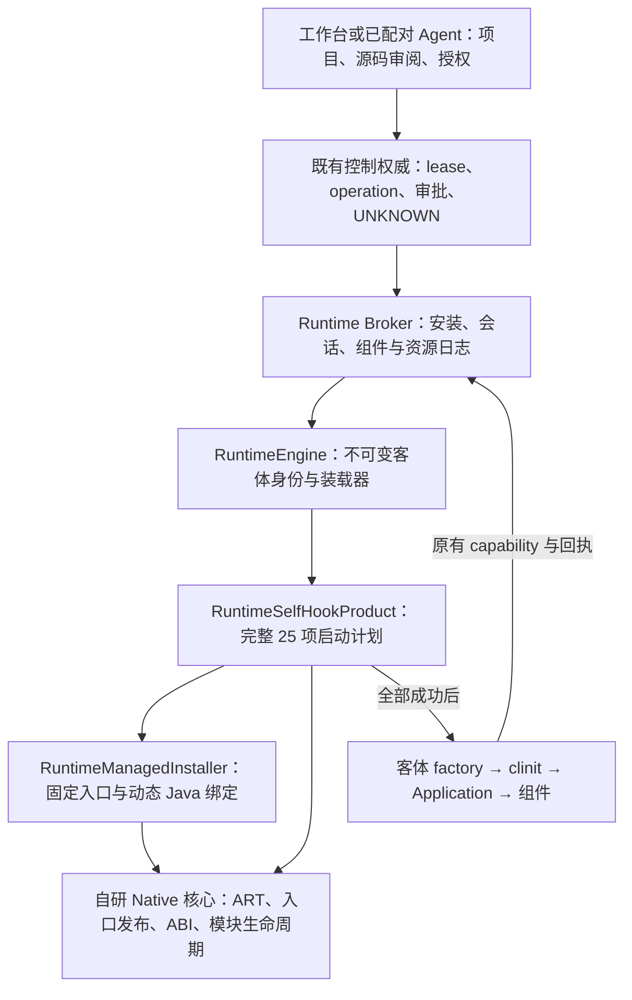

# Runtime 自研 Hook 启动与所有权

2026-10-16。Engine 已切换到自研 Java/Native 后端，产品包只加载一份 `libtripoderselfhook.so`。完整组件与工作台长流程仍在当前验收中；逐构建结果见 [交接与当前证据](self-hook-handoff-2026-10-15.md)。本文描述当前源码，不再把早期 Gadget 原型当成产品入口。

## 职责和启动边界

用户选择的边界是客体首次执行之前初始化。Engine 加载核心库后同步执行 `RuntimeSelfHookProduct.install(this)`；计划完成和同线程 ready 发布之前，不构造客体 factory、不初始化客体类、不调用客体构造器或组件。

`RuntimeSelfHookBootstrap` 只拥有进程内安装状态。Broker、Store、operation、控制 lease、审批和业务回执仍由原来的所有者管理，不增加第二套 Runtime。状态为 NEW → INSTALLING → COMPLETE → READY；缺项、重入、跨线程 ready、任一异常或发布失败都使本次尝试失败。部分安装后的进程不能继续客体代码，不切换后端。

## 完整计划

| 顺序 | 能力 | 真实动作 |
| --- | --- | --- |
| 1 | PROCESS_EXECUTION_POLICY | 显式建立解释执行策略和入口 writer 所有权 |
| 2 | FRAMEWORK_ACCESS | 同一固定注册表、成员/字段校验、组件与 manager 适配器准备 |
| 3 | APPLICATION_OWNERSHIP | 捕获真实物理宿主、LoadedApk 和 ActivityThread；预先捕获基础设施 resolver |
| 4 | REFLECTION_VIEW | 安装 pending 逻辑反射视图及 currentApplication/processName 两入口 |
| 5–7 | ACTIVITY_CREATION / DELIVERY / ROUTING | 构造 Permit、真实 Instrumentation、attach、主题、Intent/result/caller 路由 |
| 8–10 | SERVICES / PROVIDERS / RECEIVERS | 固定基类入口、真实生命周期、handle / PendingResult 与后续客体实现绑定 |
| 11 | PACKAGES | 514 固定入口和既有 RuntimePackages 全局逻辑端点 |
| 12 | STORAGE | 十个精确 libc wrapper 的唯一 IO 策略和两页发布 |
| 13–22 | ACTIVITY_MANAGER / CONNECTIVITY / WIFI_P2P / NETWORK_STATS / TELEPHONY / AUDIO / BATTERY / POWER / NOTIFICATIONS / SHORTCUTS | 十类 1523 个实例入口；owned 未授权操作明确拒绝；含 TrafficStats 和 Channel.close |
| 23–25 | UI_EFFECTS / FAILURE_DIAGNOSTICS / HOOK_CONTROL | 真实窗口效果、保留原语义的诊断、既有源码协议和 Java/Native 复合 Platform |

实际基础计划是 **2177 个 managed 绑定**：1523 个 manager、652 个其它固定入口、2 个 Application 入口。存储十个 Native wrapper 独立发布。managed 预算为 4096；停用不释放进程生命周期资源。后续 Instrumentation、Service、Receiver 和用户 Java 目标仍使用同一 ManagedHook owner。

## Application 的逻辑与物理对象

`prepareFramework` 准备固定成员；`prepareOwnership` 由 JNI 捕获物理归属；`prepareView` 才准备并发布 pending 反射投影及两入口 Hook。客体 factory/clinit/构造器阶段 currentApplication 明确为 null，processName 已是逻辑值；唯一客体实例创建后才提升为 guest，attach/onCreate 看到同一实例。

物理 `ActivityThread.mInitialApplication`、宿主 `Application.mLoadedApk`、物理 `LoadedApk.mApplication` 始终保留宿主。物理核验使用固定 JNI 字段读取；调用被拦截的 getter 或反射并不构成物理旁路。逻辑 LoadedApk、资源、loader、factory、Application 与 ContextImpl 由原有 ApplicationAdapter 一次创建并核验。

selected loader 和 defining loader 必须属于同一已验证 artifact 家系；Class 身份通过不初始化的真实解析核对。允许合法子 loader 委托，不接受同名 shadow 或外部类。QueuedWork finisher 保留平台生命周期，原 RuntimeException/Error 不改写。

## 存储发布

唯一产品 SO 包含一份 path_policy/io_adapter 状态，不再单独加载 tripoderio。固定 libc 版本、GNU Build ID、十个完整 leaf、两页原像和实际文件映射必须匹配。

十个 syscall wrapper 不调用旧 wrapper。保留 BTI c 后，以 `LDR x16; BR x16; literal` 直接尾跳到同一 IO 实现，消除近地址页依赖。静态 ELF 检查覆盖符号、重定位、直接跳转及 PC 相对读取，不接受覆盖窗口的内部入口；独立 NDK 汇编核对编码。

宽补丁必须检查真实在途 PC。全部线程暂停时，若任一线程仍位于会被覆盖的旧指令中间，保持两页原样并恢复线程，让旧调用自然完成后重新取完整快照。只在所有预像和 PC 条件成立时一次发布；不改写线程 PC、不重放调用。等待有明确预算，失败不开放客体。临界区只有核验过的直接调用、原子操作和 syscall，没有 JNI、日志、分配或应用回调。

## 用户 Hook 和模块准入

Java/Native 复合 Platform 复用实际 parser/compiler、HookInvocationSession 和现有 prepare/activate/disable/status 协议。原函数调用受线程和 invocation 作用域约束；参数版本在入场捕获，在途调用不被更新覆盖。Native 类型错误或失去活跃模块所有权必须终止进程，不能编造返回值。

制品中的库允许加载，与它是否有资格作为 Native Hook 目标是两个不同边界。catalog 只接收已验证制品的 canonical path；选择目标时必须是唯一活跃 generation，并完整核验文件摘要、GNU Build ID、符号、可执行映射和受支持前导指令。普通无 Build ID 的 JNI 库可以执行，但不能被赋予 Native Hook 权限；模块展示为 UNAVAILABLE，不合成替代 ID。卸载后准备状态失活；活跃绑定保持真实模块引用，违规卸载由核心 fail-stop。

控制权威继续在分发前持久化 operation，确认必须绑定实际 PID/UID/进程代次；结果不确定时保留 UNKNOWN，不自动重放。运行所需固定 Hook 不随用户脚本停用。工作台和 Agent 的真实审批/断连长流程与核心探针分别验收。

## 组件与物理资源

warm worker 使用其已有不可变 Broker capability，仍由 claim 验证真实 ticket/instance；cold worker 才通过 bootstrap provider 取得分配。ProcessSupervisor 统一观察死亡，先完成日志和资源收口，再发布 disconnected ACK；重复 Android/Binder 通知不能再次写已关闭 Store。

entry fence 与物理资源归属独立。任务列表缺失不等于未确认入口可以复用。新自研验收 APK 使用 SelfHookTaskP 名字；旧测试名永久拒绝。只有旧进程已 DEAD、ticket 均已退役、全部 leased 名字在当前 Manifest 缺失且 factory 永久拒绝，才释放旧物理租约；业务 operation/ticket/data 保留。正式工作台 Engine 的 TaskP 名字不因此改动。

## 已有证据与仍需验收

- H14 固定存储：24 发布/恢复检查、24 IO 规则、四线程约 40.9 万调用、40 精确修改字和两原文件页恢复，独立通过。
- H15 核心：4096 容量、8192 enabled/4096 disabled 调用、132 writer 事件、所有 owner 观测移动；JNI 31 项含普通/Fast/Critical、32 参数、GC 和并发；构造 26 项通过。
- 实际 Runtime P0 60 项、包管理/十门面 159 项、P4 Java/Native 105 项通过。P4 退出绑定真实 ApplicationExitInfo：脚本失败 SIGNALED/9，活跃卸载 EXIT_SELF/198。
- 当前完整 P2、其余独立组件、实际存储长流程和正式工作台授权/UNKNOWN仍在本次持续验收中；完成后更新最终逐制品证据。

所有设备证据只对应当前锁定固件、ABI 和自有未改写 APK。源码编译、主机合同、独立核心探针与正式产品验收分别记录；不能互相替代。这里不宣称通用第三方 APK、任意 Native ABI 或同 UID 恶意代码隔离已经成立。
