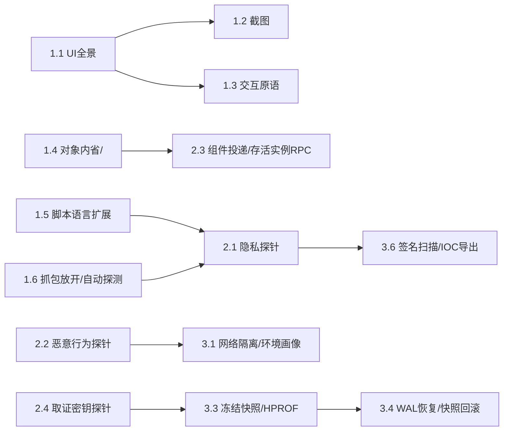

# 任务实施文档：六大场景能力缺口 → MCP 工具暴露（Capability Exposure Plan）

- **日期**：2026-10-26
- **依据**：[`scenario-gap-analysis.md`](scenario-gap-analysis.md) 第 3 节（30 项缺失能力）与第 5 节（MCP 工具契约暴露设计）。本文档只做任务拆解与排期，不重复列已有的缺口描述，缺口编号（如 `3.1-①`）均指向该文档。
- **范围边界**：本次只做 Phase 1/2/3 共 24 个工具/能力项的落地任务；移动端电子数据取证场景（3.6）的产出明确限定为“已授权调查辅助”，不追求司法链式证据效力（见 [`scenario-gap-analysis.md` 5.5-4](scenario-gap-analysis.md)）。
- **历史提示**：下文部分实施记录（如 BATTERY/LOCATION 门面）写作于单运行时收敛之前，按“仅 THICK 模式安装、THIN 直通”描述当时落地范围；THIN/THICK 已移除，现状以 [单运行时收敛](single-runtime.md) 为准——这些门面不再区分模式，按统一规则安装。实施细节与真机验证结果本身仍有效，仅模式归属描述已过期。

---

## 0. 执行原则（贯穿全部阶段，不可在具体任务中绕过）

1. **三层职责不可塌陷**：新增 Java/Native 代码只产出事实（命中位置、原始调用记录、内存字节），不写判断/评分/分类逻辑；分类规则（YARA 规则、SDK 包名库、绕过脚本模板）作为可导入资产落盘，不写进 `if/switch` 分支。
2. **风险默认关闭**：涉及 Sinkhole、Syscall 阻断、时间偏移、诱饵注入、密钥截获的工具，新增字段默认值必须是关闭/不生效；每个任务的验收清单里必须包含“默认关闭时行为与旧版本一致”这一项。
3. **不新开状态机**：复用 `operationId` 幂等日志、CAS（代次/revision 比对）、`captureEvidence`/`artifact_query`/`file_export` 产物链路与 SHA-256 校验；任何任务如果发现“需要一套新的恢复/重试语义”，先去检查能否套进现有 `Operation`/`ShutdownFence` 契约，而不是新建。
4. **契约先于实现**：每个任务先在 [`agent/tool-schema.mjs`](../agent/tool-schema.mjs) 写出 `action` 分支与字段 schema（含 `meanings` 描述），再实现 Android 侧逻辑；Node/Android/Sentinel 三端共享同一份 schema 的既有约束不能破例。
5. **验收口径**：参照项目现有验收范式——主机单元测试覆盖 schema/边界/CAS/回归；真机 Instrumentation/acceptance 脚本覆盖实际命中、0 Hook 错误、产物 SHA 校验（见 [`mtls-observation.md`](mtls-observation.md)、[`native-tls-observation.md`](native-tls-observation.md) 的既有报告格式），新增能力同样要求“真机实测报告 + 复现脚本”才算关闭。

---

## 1. Phase 1（P0）：基础突破 — UI 全景 / 对象内省 / 实用化抓包

### 1.1 UI 全景（窗口枚举 + Compose + 分页）

> **状态：已实施并真机验证**（`WindowManagerGlobal` 枚举全部顶层窗口；未能在真机构造非 Activity 的 Dialog/PopupWindow，该分支仅有代码证据）。`limit` 可省略，默认 256。

- **对应**：3.3-①、5.2 行 1
- **涉及文件**：`android/runtime/src/dev/tripoder/runtime/RuntimeStartupDiagnostics.java`（`dumpUiHierarchy`）、`agent/tool-schema.mjs`（`process_inspect` 相关 schema）。
- **任务拆分**：
  1. 用 `WindowManagerGlobal` 内部句柄枚举当前进程全部顶层 Window Root（含 Dialog/PopupWindow/BottomSheet），不仅限 `activity.getWindow().peekDecorView()`。
  2. 接入 `AccessibilityNodeInfo`（或等价的 `SemanticsOwner` 桥接）展开 `AndroidComposeView` 内部语义节点。
  3. 把硬编码 `nodes.size() < 256` 截断改为 `cursor`/`limit` 分页，响应显式带 `truncated` 标记。
- **验收**：
  - 主机测试：分页游标边界（空/满/超界）、多窗口场景下节点归属窗口 ID 不混淆。
  - 真机：含 Dialog 弹窗 + 一个 Compose 页面的 fixture，`ui_tree` 能枚举到弹窗按钮与 Compose 内部文本节点，默认分页大小下旧有简单页面行为不变（回归）。

### 1.2 截图工具（新增 `ui_screenshot`）

> **状态：已实施并真机验证。** 以内联 base64 PNG 返回（受 128 KiB 响应上限约束，自动降采样至 88 KiB 以内，附 SHA-256），未落为 artifact；PixelCopy 窗口截图 + 逐个 SurfaceView 单独 PixelCopy 合成（在本虚拟化环境下窗口级 PixelCopy 不含 SurfaceView 内容，真机对比中发现并修复）。持久化为 artifact 需要更大容量的产物通道，留待后续。

- **对应**：3.3-②、5.2 行 2
- **涉及文件**：`RuntimeStartupDiagnostics.java` 新增方法、`agent/tool-schema.mjs` 新增 `process_inspect(action=ui_screenshot)` 分支。
- **任务**：`PixelCopy`（或 `decorView.draw(Canvas)` 兜底路径）零权限截取当前目标 Window，编码 PNG，经 `captureEvidence` 落盘，返回 `artifactId`。
- **验收**：真机截图与设备录屏逐像素/感知哈希比对；客体停止后仍可通过 `artifact_query` 读取并验证 SHA-256（沿用既有产物契约，不单独测）。

### 1.3 UI 交互原语补齐

> **状态：已实施并真机验证**（7 个新动作均有命中与显式失败用例）。

- **对应**：3.3-③、5.2 行 3
- **涉及文件**：`RuntimeStartupDiagnostics.java`（`dispatchUiAction`）、`agent/tool-schema.mjs`（`uiAction` anyOf）。
- **任务**：新增 `clickById`/`clickByDescription`/`clickTextContains`/`longPress`/`doubleTap`/`scrollIntoView`/`waitForElement` 分支，复用 1.1 的窗口枚举定位元素。
- **验收**：每个新分支至少一个真机命中用例 + 一个“找不到元素”的显式失败用例（不能静默成功）。

### 1.4 Java 对象内省（字段读取 + 容器快照 + `<init>` Hook）

> **状态：已实施并真机验证。**
> - **字段读取与容器浅快照（`ctx.java.readField` / `ctx.java.snapshotContainer` + `heap_query(action=read_field|snapshot_container)`）**：
>   - 在 [`JavaObjectSnapshots.java`](../android/runtime/src/dev/tripoder/runtime/script/JavaObjectSnapshots.java)、[`DraftCompiler.java`](../android/runtime/src/dev/tripoder/runtime/script/DraftCompiler.java)、[`src/java-objects.ts`](../src/java-objects.ts) 与 [`src/plan.ts`](../src/plan.ts) 中实现 `ctx.java.readField(ref, fieldName)` 与 `ctx.java.snapshotContainer(ref, maxEntries?)`（上限 `1..32` 项，默认 `16`，超出显式标记 `truncated=true`）。
>   - 全程遵守“框架读取非虚”安全红线：通过反射读取 `Intent`（`mAction`/`mData`/`mType`/`mPackage`/`mComponent`/`mCategories`/`mExtras`）、`Bundle`/`BaseBundle`（`unparcel` + `mMap`）、`ContentValues`（`mMap`/`mValues`）、`Uri`、`JSONObject`（`nameValuePairs`）、数组、引导类加载器（Bootstrap ClassLoader）下的标准 `Map`/`Collection` 以及任意客体对象的声明字段，不触发客体重写的 `toString`/`hashCode`/`equals`。
>   - 同时在 [`RuntimeLiveInstances.java`](../android/runtime/src/dev/tripoder/runtime/RuntimeLiveInstances.java) 与 [`agent/tools.mjs`](../agent/tools.mjs) 的 `heap_query` 工具上公开 `action=read_field` 与 `action=snapshot_container`，支持按存活实例句柄 `inst-N` 直接在 MCP 侧执行字段内省与容器浅快照。
> - **构造函数 `<init>` 支持（`code_query` / `hook_observe` / `ctx.java.method(..., "<init>", ...)` / `guest_invoke(methodName="<init>")`）**：
>   - [`RuntimeJavaObservation.java`](../android/runtime/src/dev/tripoder/runtime/RuntimeJavaObservation.java) 在 `runtime_class`/`resolved_class` 中新增 `constructors` 列表；[`RuntimeJavaHookBackend.java`](../android/runtime/src/dev/tripoder/runtime/RuntimeJavaHookBackend.java) 支持将 `methodName="<init>"` 解析为 `Class.getDeclaredConstructor(...)`（返回类型恒为 `"V"`）并走 Nterp 挂钩（`before` 阶段 `thisObject=null`，`after` 阶段 `thisObject` 为已初始化的新实例 `JavaObjectRef`）；[`RuntimeSecurityAudit.invokeGuestMethod`](../android/runtime/src/dev/tripoder/runtime/RuntimeSecurityAudit.java) 支持 `guest_invoke(methodName="<init>")` 反射实例化客体对象并返回注册好的 `inst-N` 句柄。
> - **真机验证（`d861a4fa`）**：`guest_invoke(className="dev.tripoder.fixture.FixtureVault", methodName="<init>", args=["init-secret-key", 7])` 成功构造实例并返回 `instanceId="inst-4"` → `heap_query(action="read_field", instanceId="inst-4", fieldName="secretLabel")` 读出 `"init-secret-key"` → `heap_query(action="snapshot_container", instanceId="inst-4")` 返回完整字段快照 → `hook_observe` 挂接 `FixtureVault.<init>(java.lang.String,int):V` 的 `before`/`after` 并在 `after` 内执行 `ctx.java.readField(event.thisObject, "secretLabel")` + `ctx.java.snapshotContainer(event.thisObject, 8)`，0 Hook 错误精确捕获构造入参与初始化后对象状态。

- **对应**：2.1、2.2、5.2 行 4/5
- **涉及文件**：`src/java-objects.ts`、`android/runtime/src/dev/tripoder/runtime/script/JavaObjectSnapshots.java`、`SelfHookControl.java`（放开 `<init>` 校验）、`agent/tool-schema.mjs`（`methodName` 校验、`heap_query` 扩展）。
- **任务拆分**：
  1. 新增 `read_field`：给定本次调用内的 `JavaObjectRef` 或存活 `instanceId` + 字段名，返回基本类型/String/byte[]/对象摘要；非法字段显式拒绝。
  2. 新增 `snapshot_container`：对 `Map`/`List`/`Set`/`Bundle`/`Intent`/`ContentValues`/`Uri`/`JSONObject`/数组/客体对象做有界浅层快照（entries 数量上限、字符串长度上限）。
  3. `SelfHookControl.selectors` 放开 `<init>` 限制，`agent/tool-schema.mjs` 的 `methodName` pattern 同步支持 `<init>`；补充构造函数签名解析与 `guest_invoke` 构造路径。
- **验收**：主机测试覆盖字段/容器 schema 边界；真机用例覆盖构造函数 `<init>` Hook 命中并读出字段与容器快照。

### 1.5 受限脚本语言能力扩展（非 MCP 工具变更）

> **状态：已实施并真机验证。**
> - `Hex`（`encode`/`decode`/`encodeUtf8`/`decodeUtf8`）、`Base64`（`encode`/`decode`/`encodeUtf8`/`decodeUtf8`）、`JSON`（`parse`/`stringify`）以及会话级键值字典 `ctx.state`（`get`/`set`/`delete`/`clear`/`keys`）已在宿主编译器（[`src/plan.ts`](../src/plan.ts)、[`src/simulator.ts`](../src/simulator.ts)）与设备端解释器（[`DraftCompiler.java`](../android/runtime/src/dev/tripoder/runtime/script/DraftCompiler.java)、[`HookInvocationSession.java`](../android/runtime/src/dev/tripoder/runtime/script/HookInvocationSession.java)）双端一致落地。
> - **`ctx.state` 边界约束**：生命周期严格绑定单次激活的 `HookInvocationSession`（`hook_clear` 或会话替换时自动清空），最多 64 个键（键名 `1..128` 字符），单值 JSON 序列化上限 4096 字节，仅允许已冻结的可序列化 JSON 值（显式拒绝将 `JavaObjectRef` 存入 `ctx.state` 以防跨回调悬挂引用）。
> - **真机验证（`d861a4fa`）**：在 `FixtureVault.<init>` 的 `before` 回调中调用 `ctx.state.set("lastInitLabel", label)` 与 `ctx.state.set("initCount", prev + 1)`，在随后的 `after` 回调与第 2 次构造调用中通过 `ctx.state.get(...)` 与 `ctx.state.keys()` 成功读取跨阶段/跨调用状态（`initCount` 1 → 2），0 Hook 错误。

- **对应**：2.3、5.2 行 6
- **涉及文件**：`src/draft.ts`（`prepareDraft`）、`src/plan.ts`、`android/runtime/src/dev/tripoder/runtime/script/DraftCompiler.java`、`HookInvocationSession.java`。
- **任务**：新增 `Hex`↔`UTF-8`/`Base64` 编解码、`JSON.parse`/`JSON.stringify`、受限 `ctx.state` 会话级键值字典（容量上限、仅本进程本次 Hook 会话生效）。
- **验收**：`test/draft.test.ts`、`test/draft-integers.test.ts` 同类风格补充用例；真机用例验证跨回调状态关联场景。

### 1.6 实用化抓包（放开上限 + 自动探测 TLS 实现 + HAR 导出）

> **状态：已实施并真机验证。**
> - **可配置容量上限**：`network_control(action=start)` 支持配置 `maxConnections`（默认 16，最高 64）、`maxMessages`（默认 32，最高 128）、`maxTotalBytes`（默认 65536，最高 262144），超出默认值时强制要求 `confirmHighVolume=true`。
> - **TLS 模块自动探测（`moduleName="auto"`）**：[`NetworkCaptureControl.java`](../android/runtime/src/dev/tripoder/runtime/script/NetworkCaptureControl.java) 与 [`agent/tools.mjs`](../agent/tools.mjs) 支持 `network_query(action=inspect, moduleName="auto")` 与 `network_control(action=start, moduleName="auto", buildId="auto")`。自动扫描当前进程已加载 Native 模块（优先客体自带 `.so`，其次系统 `libssl.so`/`libconscrypt_jni.so`），匹配全部 4 个 OpenSSL/BoringSSL 导出符号（`SSL_new`/`SSL_free`/`SSL_read`/`SSL_write`）并自动解析目标 `moduleName` 与 `buildId`（响应附 `autoDetected=true`）。
> - **HAR 1.2 导出**：`network_query(action=export_har)` 将已捕获的 HTTP/1.1 明文会话结构化导出为标准 HAR 1.2 JSON。
> - **真机验证（`d861a4fa`）**：在加载了 `libfixture_tls.so` 的客体进程中调用 `network_query(action="inspect", moduleName="auto")` 自动定位 `moduleName="libfixture_tls.so"`、完整识别 4 个 SSL 导出符号与 `buildId`；随后调用 `network_control(action="start", moduleName="auto", buildId="auto")` 直接启动抓包会话（`active=true`），完成 6 条真实 mTLS 交换与 HAR 1.2 导出校验后正常 `stop`。

- **对应**：3.1-①、5.2 行 7
- **涉及文件**：`android/runtime/src/dev/tripoder/runtime/script/NetworkCaptureControl.java`、`docs/passive-network-sessions.md`、`agent/tool-schema.mjs`（`probes_control`/`events_query` schema）。
- **任务拆分**：
  1. 容量上限（1 KiB/段、4 KiB/方向、16 连接/64 KiB）改为可配置默认值 + 显式更高值需额外确认字段，不做无限放开。
  2. 新增 `attach(tlsImpl=auto|okhttp|conscrypt)`：自动探测目标进程使用的 TLS 实现并挂接对应 Hook 模板（复用 1.4 的对象内省读 OkHttp `Request`/`Response` 字段）。
  3. 新增 `events_query`/`probes_query` 的 `export_har` 查询动作，把已捕获会话导出 HAR JSON。
- **验收**：真机覆盖 OkHttp3 + 系统 Conscrypt 两类目标，对照 [`mtls-observation.md`](mtls-observation.md) 已有的“原始基线/开启观测/停用观测”三阶段对比范式；导出 HAR 能被 mitmproxy/Burp 的 HAR 导入功能正常解析（手工验证一次并记录）。

---

## 2. Phase 2（P1）：场景专精 — 内置探针 / 组件投递 / 存活实例 RPC

### 2.1 隐私合规内置探针

> **状态：已实施并真机验证，但偏离原设计。** 原设计想直接 hook `TelephonyManager`/`Settings.Secure` 等框架隐私 API，但这些类不在客体 ClassLoader 范围内，Hook 机制硬性禁止（`HOOK_CLASS_OUTSIDE_GUEST`）；而唯一能拦截框架 Manager 的 `RuntimeSelfHookManagers` 固定清单代理，代码里明确把身份类查询（IMEI/ANDROID_ID 等）排除在外（"every identity-bearing query stays denied"）——这是项目既有的刻意安全边界，本次没有改动它。
>
> 改为探测**客体自身代码**：新增 `privacy_probe_control`（`configure_attribution`/`mark_consent_stage`）与 `privacy_probe_query`（`attribution`/`timeline`），独立于 Hook 的 32-selector 配额和 observe/prepare/activate 独占状态（不消耗、不依赖）。Agent 自行用 `dex_search_classes`/`class_inspect` 找到客体里静态链接的第三方 SDK 包装类，再用已有的 Hook 机制挂上去，在脚本里调用新增的 `ctx.privacy.attribution(className)`/`ctx.privacy.consentStage()`（已加入 `src/plan.ts`/`src/simulator.ts`host 端与 `DraftCompiler.java` 设备端，双实现一致）取归属和当前同意阶段标记并一并写进事件。
>
> 真机用 `guest-fixture` 新增的 `AdSdkCollector.collectDeviceId()`（模拟静态链接的第三方 SDK）复现了"同意前调用采集 API"场景：先标记 `BEFORE_CONSENT`，触发一次采集，事件里正确带上 `sdkName=ExampleAdSDK` 和 `stage=BEFORE_CONSENT`；再标记 `CONSENT_GRANTED`（不需要重新挂 Hook），再次触发，事件里的阶段实时变为 `CONSENT_GRANTED`。最长前缀匹配、无匹配时显式 `null`、非法阶段名拒绝均真机验证。
- **对应**：3.2-①②③、5.3 行 1
- **涉及文件**：新增 `RuntimePrivacyProbes.java`（独立于 `SelfHookControl` 的用户 32 Selector 配额）、`agent/tool-schema.mjs` 新增 `privacy_probe_control` 工具。
- **任务拆分**：
  1. 内置覆盖设备标识/网络硬件特征/个人隐私权限数据三类 100+ API 的探针表（1.4 的字段读取能力在这里复用）。
  2. `configure` 支持 `markConsentStage` 写入同意时间线里程碑（`CONSENT_GRANTED`/`ENTER_BACKGROUND` 等）。
  3. 第三方 SDK 归属库（包名前缀 → SDK 名称）作为可导入 JSON 资产，不写死在判定分支里。
- **验收**：默认 `enabled=false` 时现有 Hook/抓包行为不受影响；真机 fixture 模拟“同意前调用定位 API”场景，探针记录含阶段标记与责任 SDK 归属字段。

### 2.2 恶意行为内置探针

> **状态：已实施并真机验证。** 新增读写分离的 MCP 工具 `malware_probe_control`（`configure`/`clear`）与 `malware_probe_query`（`status`/`events`），运行时实现为 [`RuntimeMalwareProbeState.java`](../android/runtime/src/dev/tripoder/runtime/RuntimeMalwareProbeState.java)，独立于用户 Hook 的 32-selector 配额与独占会话，同时在 `status` 中向上暴露 [`RuntimeSelfHookStorage.syscallNamespaceNative()`](../android/runtime/src/dev/tripoder/runtime/RuntimeSelfHookStorage.java) 的底层 Seccomp 审计计数（`openat`/`fstatat`/`readlinkat`/`faccessat`/`execve`/`kill`/`connect`）与 `codeProbeStatus` 摘要。
> - **拦截与观测面**：挂接 [`RuntimeComponentDelivery.java`](../android/runtime/src/dev/tripoder/runtime/RuntimeComponentDelivery.java)、[`RuntimeSelfHookActivities.java`](../android/runtime/src/dev/tripoder/runtime/RuntimeSelfHookActivities.java)、[`RuntimeReceivers.java`](../android/runtime/src/dev/tripoder/runtime/RuntimeReceivers.java) 以及原生 Seccomp 过滤器 [`syscall_namespace.c`](../android/runtime/native/syscall_namespace.c)，覆盖高危特权诱导 Intent（`ACCESSIBILITY_SETTINGS`、`ADD_DEVICE_ADMIN`、`MANAGE_OVERLAY_PERMISSION`、`MANAGE_WRITE_SETTINGS`、`INSTALL_PACKAGE`、`REQUEST_INSTALL_PACKAGES`、`SMS_RECEIVED`、`smsto:`/`tel:` 等）、动态 BroadcastReceiver 注册（`SMS`/`BOOT_COMPLETED`/`PACKAGE_ADDED`）、原生子进程执行（`SYS_execve`/`SYS_execveat`）、跨进程信号发送（`SYS_kill`/`SYS_tkill`/`SYS_tgkill`）与外联 Socket 连接（`SYS_connect`）。
> - **风险默认关闭**：默认 `enabled=false`、`blockHighRiskIntents=false`、`blockExecve=false`、`blockKill=false`、`networkSinkhole=false`（完全直通，零副作用）；开启 `enabled=true` 时可按需独立 opt-in 启用 `blockHighRiskIntents`（拒绝高危 Intent 投递并抛出 `MALWARE_PROBE_HIGH_RISK_INTENT_BLOCKED:<reason>`）、`blockExecve`（在 Seccomp `SIGSYS` handler 中拦截 `SYS_execve`/`SYS_execveat` 并返回 `-EACCES`）、`blockKill`（拦截向非本进程 PID 发送的信号并返回 `-EPERM`，放行本进程自信号）与 `networkSinkhole`（拦截非回环 `AF_INET`/`AF_INET6` 的 `SYS_connect` 并返回 `-ECONNREFUSED`，放行 `127.0.0.0/8` 与 `::1`）。
> - **真机验证（`d861a4fa`）**：基线 `enabled=false` 且返回真实 `syscallNamespace` 计数 → 开启非阻断模式投递 `android.provider.Telephony.SMS_RECEIVED` 广播成功且 `malware_probe_query(events)` 准确记录 `category="high_risk_intent", highRisk=true, blocked=false` → 开启 `blockHighRiskIntents=true, blockExecve=true, blockKill=true, networkSinkhole=true` 后：
>   1. 投递 `android.settings.ACCESSIBILITY_SETTINGS` 被当场拦截（返回 `errorCode="MALWARE_PROBE_HIGH_RISK_INTENT_BLOCKED"`）且事件记录 `blocked=true`；
>   2. 客体调用 `Runtime.getRuntime().exec("/system/bin/id")` 被 Seccomp 拦截返回 `EACCES`（`execveAttempts: +1, execveBlocked: +1`）；
>   3. 客体调用 `android.os.Process.sendSignal(1, 0)`（试探 `init` 进程）被 Seccomp 拦截（`killAttempts: +1, killBlocked: +1`）；
>   4. 客体发起外网 TCP 连接 `new Socket().connect("93.184.216.34:80")` 被 Sinkhole 当场拦截返回 `ConnectException: ECONNREFUSED`（`connectAttempts: +1, connectSinkholed: +1`），而本地回环 `127.0.0.1` 连接不受阻断 → `clear` 后全部策略恢复默认关闭。

- **对应**：3.4-②、5.3 行 2
- **涉及文件**：新增 `RuntimeMalwareProbeState.java`，复用 `android/runtime/native/syscall_namespace.c` 已有 `syscallNamespaceNative` 计数向上暴露。
- **任务**：`configure`/`clear`/`status`/`events` 覆盖无障碍/设备管理器/悬浮窗诱导、短信/高危广播监控与 `syscallNamespace` 审计摘要；默认只记录不阻断，`blockHighRiskIntents` 显式 opt-in。
- **验收**：真机 fixture 触发高危广播/无障碍设置诱导场景，记录完整且默认不阻断；开启阻断字段后对应调用被拒绝且返回明确错误（不是静默失败）。

### 2.3 四大组件投递与存活实例 RPC

> **状态：已实施并真机验证。**
> - **四大组件投递（`component_send_intent` / `provider_interact`）**：由 [`RuntimeComponentDelivery.java`](../android/runtime/src/dev/tripoder/runtime/RuntimeComponentDelivery.java) 实现，支持向沙箱内 Activity/Service/BroadcastReceiver 投递带 `action`/`data`/`mimeType`/`categories`/`flags`/`extras` 的 Intent，以及对 ContentProvider 执行 `query`/`insert`/`update`/`delete`/`call`/`openType`（全部作为带 `operationId` 的修改操作统一审计）。
> - **存活实例枚举与绑定调用（`heap_query(action=choose_instances)` + `guest_invoke(instanceId)`）**：新增 [`RuntimeLiveInstances.java`](../android/runtime/src/dev/tripoder/runtime/RuntimeLiveInstances.java)，通过运行时根对象（`Application`、存活 `Activity`、`Service`、动态 `BroadcastReceiver`、`ContentProvider`）及 [`LoadedClassInventory`](../android/self-hook/src/main/java/dev/tripoder/selfhook/coverage/LoadedClassInventory.java) 已加载客体类的静态字段图做有界 BFS 遍历（全程 `Class.forName(name, false, loader)` 不触发未初始化类的 `<clinit>`），使用 `WeakHashMap` + `WeakReference` 分配 `inst-1..N` 弱引用句柄（不阻碍 GC）。[`RuntimeSecurityAudit.invokeGuestMethod`](../android/runtime/src/dev/tripoder/runtime/RuntimeSecurityAudit.java) 支持传入可选 `instanceId` 在目标存活实例上直接调用实例方法，并校验实例存活与类型兼容（`INSTANCE_EXPIRED_OR_NOT_FOUND` / `INSTANCE_CLASS_MISMATCH`）。
> - **真机验证（`d861a4fa`）**：`heap_query(action=choose_instances, className="dev.tripoder.fixture.FixtureApplication")` 发现进程内唯一存活 `Application` 实例 `inst-1`（`source="runtime.application"`），随后 `guest_invoke(instanceId="inst-1", methodName="instanceSign")` 成功读出仅存活实例具备的状态 `"live-app-token-42:challenge-99:created=1"`；同时枚举 `FixtureActivity` 命中存活 Activity 实例；错误类搭配 `inst-1` 触发 `INSTANCE_CLASS_MISMATCH` 显式拒绝。

- **对应**：3.1-②③、5.3 行 3/4/5
- **涉及文件**：`RuntimeComponentDelivery.java`、`RuntimeLiveInstances.java`、`RuntimeSecurityAudit.java`（`invokeGuestMethod`）、`agent/tool-schema.mjs`（`component_send_intent`/`provider_interact`/`heap_query`/`guest_invoke`）。
- **任务拆分**：
  1. `component_send_intent`：支持 `action`/`data`/`mimeType`/`categories`/`flags`/嵌套 `extras`，走既有 `ActivityLease`/`Operation` 机制投递给 Activity/Service/BroadcastReceiver。
  2. `provider_interact`：对目标 URI 执行 `query`/`insert`/`update`/`delete`/`call`/`openFile`，全部归为“修改”属性。
  3. `heap_query(action=choose_instances)`：按类名枚举堆上存活实例，返回候选 `inst-N` 弱引用句柄；`guest_invoke` 新增可选 `instanceId` 绑定该引用后调用实例方法（不再强制无参构造新建空实例）。
- **验收**：真机用例覆盖组件 Intent 投递、ContentProvider `query` 交互、存活 `FixtureApplication`/`FixtureActivity` 实例枚举与 `guest_invoke(instanceId)` 实例方法调用且返回正确结果。

### 2.4 取证密钥截获探针（已授权调查场景）

> **状态：已实施并真机验证，但不需要新增 `RuntimeForensicsKeyProbes.java`。** 排查发现 SQLCipher（`net.sqlcipher.database.SQLiteDatabase`）和 MMKV（`com.tencent.mmkv.MMKV`）都是静态链接进客体 APK 自己 DEX 的 Java 库（不是框架类），用现有的 `hook_observe`/`hook_prepare`/`hook_activate` + `ctx.java.method(...).before()` 就能直接 hook 到构造加密存储时传入的明文密钥参数，不需要任何新引擎代码。真机用新增的 `ForensicsFixture`（真实依赖 `net.zetetic:android-database-sqlcipher:4.5.4`、`com.tencent:mmkv:2.4.3`，从 Maven Central 下载）复现：hook 住 `SQLiteDatabase.openOrCreateDatabase` 和 `MMKV.mmkvWithID`，捕获的明文密钥与源码常量完全一致；用 `file_export`+`file_query(action=read)` 把真实加密的 `secrets.db` 拉到本机，用本机新装的 `sqlcipher` CLI（`brew install sqlcipher`）仅用 Hook 捕获到的密钥（不是预先已知的源码常量）成功解密并读出真实行 `classified-payload`，端到端证明密钥截获可用。
>
> 按原计划尝试过的另外两个目标均被架构边界挡住，和之前的发现一致：`android.database.sqlite.SQLiteDatabase.openDatabase`（Android 框架类，`HOOK_CLASS_OUTSIDE_GUEST`）、`javax.crypto.spec.SecretKeySpec` 构造函数（框架类 + `<init>` 不支持，双重限制）。
>
> **"自动导出解密后的标准数据库副本"（可选项）未实现为引擎能力**：受限脚本语言不支持在 Hook 回调里构造新对象（`new X()`），`guest_invoke` 只能构造无参实例或调用静态方法，都无法对"已经用特定文件路径+密钥打开"的那个连接做进一步操作；要做到真正通用（对任意第三方 APP）的引擎内自动解密，需要引擎自身链接 SQLCipher 原生库来独立解密磁盘文件——这是新的原生依赖，本次不做。目前的真实、可复现流程是：Hook 截获明文密钥 → `file_export` 导出原始加密文件 → 用密钥在设备外用标准 SQLCipher 工具解密（已真机验证）。
>
> **司法链条声明**：按任务文档要求的边界声明——密钥截获与离线解密仅用于已授权的安全测试/合规审计场景，不构成可用于司法程序的证据链（缺少设备取证标准要求的只读镜像、hash 链、chain-of-custody 记录等）。由于本节未新增专门的 MCP 工具，该声明记录在此文档中，而非工具 schema 的 `description` 字段里；若后续确实新增专用工具，应将声明文案一并加入其 schema。

- **对应**：3.6-②、5.3 行 6、5.5-4
- **涉及文件**：新增 `RuntimeForensicsKeyProbes.java`，复用 `RuntimeSecurityAudit.inspectDatabases` 的数据库发现逻辑。
- **任务**：拦截 `sqlite3_key`/`SQLiteDatabase.openDatabase`/`MMKV.mmkvWithID`/`SecretKeySpec` 构造，截获运行态明文密钥并（可选）自动导出解密后的标准数据库副本；工具 schema 的 `description` 字段必须包含“不构成司法链条证据，仅限已授权调查/合规场景”的声明文案。
- **验收**：真机 fixture 覆盖 SQLCipher 与 MMKV 加密两类存储，密钥截获后能用既有 `file_export` 导出可直接打开的解密数据库；工具描述文案审查确认边界声明存在。

---

## 3. Phase 3（P2）：高阶壁垒 — 环境伪装 / 冻结快照 / 签名扫描

### 3.1 网络隔离与环境画像伪装

- **对应**：3.4-①、3.5-③、5.4 行 1/2
- **涉及文件**：`android/runtime/native/syscall_namespace.c`（新增 Sinkhole/高危 Syscall 阻断策略）、`RuntimeSelfHookManagers.java`（`telephony` 伪装）、`agent/tool-schema.mjs`（新增 `persona_control`/`persona_query`，扩展 `malware_probe_control`）。
- **任务**：Sinkhole/FakeNet 模式与 `SYS_execve`/`SYS_execveat`/`SYS_kill` 阻断策略默认关闭；SIM 国家码/MCC-MNC/语言/时区/VPN 标志隐藏按进程配置。
- **验收**：默认关闭时外联行为与现状一致（回归）；开启 Sinkhole 与高危 Syscall 阻断后真机 fixture 的外联请求与 `execve`/`kill` 被拦截并计数，不产生真实外联；开启环境画像伪装后客体读取到预期虚拟画像。

> **状态：已实施并真机验证（含 `syscall_namespace.c` 内核级网络 Sinkhole / `SYS_execve` / `SYS_kill` 阻断，以及 telephony / 电量 / GPS / 语言 / 时区 / VPN 隐藏伪装）。**
> - **内核级网络 Sinkhole 与高危 Syscall 阻断（[`syscall_namespace.c`](../android/runtime/native/syscall_namespace.c) + `malware_probe_control`）**：
>   - 在 [`syscall_namespace.c`](../android/runtime/native/syscall_namespace.c) 的 32 条 BPF 指令预算内（`CALL_COUNT=22` + 10 条固定头尾指令 = 32），将 `SYS_execve`、`SYS_execveat`、`SYS_kill`、`SYS_tkill`、`SYS_tgkill`、`SYS_connect` 纳入 Seccomp `SECCOMP_RET_TRAP` 拦截表。
>   - 新增原子策略位与计数器（[`syscall_namespace.h`](../android/runtime/native/syscall_namespace.h)、[`self_hook_storage.c`](../android/runtime/native/self_hook_storage.c)、[`RuntimeSelfHookStorage.java`](../android/runtime/src/dev/tripoder/runtime/RuntimeSelfHookStorage.java)），全部默认关闭（`0`），由 `malware_probe_control(action=configure, blockExecve, blockKill, networkSinkhole)` 动态切换：
>     - `blockExecve=true`：拦截 `SYS_execve`/`SYS_execveat` 并返回 `-EACCES`，递增 `execveBlocked`。
>     - `blockKill=true`：在 `SYS_kill`/`SYS_tgkill` 中放行本进程自信号（`pid <= 0 || pid == getpid()`），对指向外部进程的信号返回 `-EPERM`，递增 `killBlocked`。
>     - `networkSinkhole=true`：在 `SYS_connect` 中解析 `struct sockaddr`（`AF_INET` / `AF_INET6`），放行本地回环地址（`127.0.0.0/8`、`::1`、`::ffff:127.x.x.x`）与 `AF_UNIX`，对所有外部 IP 连接返回 `-ECONNREFUSED` 并递增 `connectSinkholed`（不产生真实外网数据包）。
> - **环境画像伪装（`persona_control` / `persona_query`）**：
>   - 新增 MCP 工具 `persona_control`（`configure_telephony`/`configure_battery`/`configure_location`/`configure_locale`/`configure_network`）与 `persona_query`（`status`），按进程生效（[`RuntimeSandboxPersona.java`](../android/runtime/src/dev/tripoder/runtime/RuntimeSandboxPersona.java) 静态持有），独立于 Hook 配额。可覆盖字段：`networkCountryIso`/`simCountryIso`（两位小写）、`networkOperator`/`simOperator`（5–6 位 MCC-MNC）、`networkOperatorName`/`simOperatorName`，电量百分比（0–100）与充电状态，GPS 经纬度/精度/海拔/速度/航向，系统默认 `Locale`（`language`/`country`）与 `TimeZone`（`timeZoneId`，保存进程启动初始默认值以便传空串时精确还原），以及 `hideVpn`（在 `ConnectivityManager.getNetworkInfo(TYPE_VPN)` 与 `getNetworkCapabilities` 中剥离 `TRANSPORT_VPN` 位）。默认全部透传；传空字符串/`null`/`hideVpn=false` 即恢复透传。
> - **仅 THICK 模式生效。** THIN 模式下 telephony 本来就走平台真实 Manager。
> - **偏离/发现**：`BATTERY` 家族原先在两种模式下都被 `RuntimeThinPolicy` 判为“平台直通”，门面从未安装，电量覆盖根本不可达。为此改了 `RuntimeThinPolicy`：`BATTERY` 改为与 `TELEPHONY` 同样仅在 THIN 时直通，THICK 下安装电量门面；无覆盖时门面透传真实值。THIN 行为不变。
> - 真机验证（小米设备 `d861a4fa`，THICK fixture）：
>   - 内核级 Sinkhole / Syscall 阻断：默认关闭时 `execveBlocked=0, killBlocked=0, connectSinkholed=0`；开启 `blockExecve=true, blockKill=true, networkSinkhole=true` 后，客体 `Runtime.getRuntime().exec("/system/bin/id")` 返回 `EACCES`（`execveAttempts=1, execveBlocked=1`），`Process.sendSignal(1, 0)` 被拦截（`killAttempts=1, killBlocked=1`），外网 `Socket.connect("93.184.216.34:80")` 立即返回 `ECONNREFUSED`（`connectAttempts=1, connectSinkholed=1`），本地回环 `127.0.0.1` 正常返回 `loopback_ok`；`clear` 后全部策略恢复关闭。
>   - Telephony/电量：真实值 `cn`/`中国移动`/`100`/充电中 → 覆盖后 `us`/`T-Mobile`/`5`（`charging=null` 仍透传为 `true`）→ 清除后恢复真实值。非法值（如 `JPN`）被拒绝。
>   - 语言/时区/VPN 隐藏：基线 `Locale=zh-CN, TimeZone=Asia/Shanghai` → `configure_locale(language="ja", country="JP", timeZoneId="Asia/Tokyo")` 后客体读取到 `ja-JP` 与 `Asia/Tokyo` 且 `Resources.getConfiguration()` 同步更新 → `configure_network(hideVpn=true)` 后客体 `ConnectivityManager` 读到 `vpnInfo=false|vpnCap=false` → 传空字符串与 `hideVpn=false` 后精确恢复 `zh-CN` 与 `Asia/Shanghai`。
> - 验证中踩的坑：同一 `operationId` 重复调用会返回缓存结果，对比“前/后”读数必须用不同的 operationId。
> - **GPS 伪装（`persona_control action=configure_location`）：已实施并真机验证。** 新增 `LOCATION` 门面家族（走固定清单路线，改了进程共享的 self-hook 原生层）：`art_framework.c` 新增类根 `android/location/LocationManager`（索引 86）和字段槽 `LocationManager.mService`（槽 72），`FixedManagerInventory` 新增第 12 个 owner 并钉死设备摘要（Android 17/API37 上的 `0bf8b6a7…5c37`；换系统版本需重新取摘要），`ManagerFrameworkAccess` 用固定构造器 `(Context, ILocationManager)` 建门面并共用物理管理器的 binder，`RuntimeSelfHookBootstrap.Capability` 新增 `LOCATION`。仅 THICK 模式安装（THIN 直通平台）。
>   - 拦截清单：`getLastKnownLocation`、`isProviderEnabled`、`isLocationEnabled`、`getCurrentLocation`、三种 `requestLocationUpdates`（Listener/Looper/Executor）、`removeUpdates(LocationListener)`；其余 get/is 观察类方法透传真实平台，监听/回调类（PendingIntent、GNSS 回调等）抛 `LOCATION_CAPABILITY_UNSUPPORTED`。字段：`latitude`/`longitude`（必填，范围校验）、`accuracy`（默认 5）、`altitude`、`speed`、`bearing`；空对象清除。
>   - 真机验证：无 mock 时 `getLastKnownLocation` 透传为 `null`；设置东京坐标后 `getLastKnownLocation` 返回 `35.6762,139.6503,8.0,gps`、`isProviderEnabled(gps)=true`；`requestLocationUpdates` 每秒推送 mock 位置（累计 4→7→10 次）；运行中改成巴黎/悉尼，新位置立即推送；清除后推送停止、`getLastKnownLocation` 恢复透传。非法纬度、缺经度被拒绝。
>   - 局限（未覆盖）：Google Play Services 融合定位、Wi‑Fi/基站定位、`Location.isMock` 检测（mock 未被标记，等同真实 fix）；宿主本身没有定位权限时，无 mock 的真实 `requestLocationUpdates` 会抛 `SecurityException`（透传宿主权限现状，不是回归）；`FixedManagerInventory` 摘要变更是启动期 fail-closed 检查，摘要错误会让所有 THICK 客体启动失败（本次调试中实际触发过一次，错误信息现已带出实际摘要）。
>   - 未更新：`self-hook-probe` 的 `verify-self-manager-inventory.py`/`manager-inventory.json` 与 `runtime/self-hook-tests` 中的 `RuntimeSelfHookManagerFramework` 实现（接口新增了 `locationManager`），这些离线探针/测试未重跑。
> - 门面方式的局限：只拦截经 `getSystemService` 取得的 Manager；应用走广播 `ACTION_BATTERY_CHANGED` 读电量不受影响（未验证、未覆盖）。

### 3.2 时间加速与诱饵数据

> **状态：已实施并真机验证。**
> - **时间偏移与延时缩放（`time_warp_control` `configure`/`reset` + `time_warp_query` `status`）**：新增 [`RuntimeTimeWarp.java`](../android/runtime/src/dev/tripoder/runtime/RuntimeTimeWarp.java)，默认 `active=false, offsetMillis=0, delayScale=1.0`。挂接 [`RuntimeAlarms.java`](../android/runtime/src/dev/tripoder/runtime/RuntimeAlarms.java)（缩放 `AlarmManager.set*` 触发时间差）与 [`RuntimeLocation.java`](../android/runtime/src/dev/tripoder/runtime/RuntimeLocation.java)（缩放位置推送间隔并为构造的 `Location` 注入偏移后的虚拟时间戳）。
> - **诱饵数据注入（`honeydata_control` `configure`/`clear` + `honeydata_query` `status`）**：新增 [`RuntimeHoneyData.java`](../android/runtime/src/dev/tripoder/runtime/RuntimeHoneyData.java)，默认空（`active=false`）。挂接 [`RuntimeProviders.java`](../android/runtime/src/dev/tripoder/runtime/RuntimeProviders.java) 的 `query` 入口：当目标 `authority` 属于 `contacts`（`com.android.contacts`/`contacts`）、`sms`（`sms`/`mms-sms`/`telephony`）或 `call_log`（`call_log`/`call_log_shadow`）且已配置对应诱饵行时，直接构造并返回内存 `MatrixCursor`，不访问宿主真实通讯录/短信数据库。
> - **真机验证（`d861a4fa`）**：配置 `offsetMillis=+3600000, delayScale=0.1` 后 `virtualTimeMillis - realTimeMillis == 3600000` 且 `reset` 后恢复；向 `contacts` 注入 2 条诱饵记录（`Alice Honey`、`Bob Decoy`）后，通过 `provider_interact(operation="query", uri="content://com.android.contacts/data/phones")` 精确读回该 2 条记录，`clear` 后恢复为空。

- **对应**：3.4-④、5.4 行 3/4
- **涉及文件**：新增 `RuntimeTimeWarp.java`、`RuntimeHoneyData.java`，挂接 `RuntimeAlarms.java`、`RuntimeLocation.java`、`RuntimeProviders.java`。
- **验收**：真机用例验证时间偏移与缩放配置/重置生效；诱饵通讯录/短信注入后 `ContentResolver.query` 能读到预期虚拟数据，且仅限目标进程可见。

### 3.3 冻结态原子快照与 HPROF 堆转储

> **状态：已实施并真机验证。** 新增 `process_snapshot(action=heap_dump|freeze_export)`，运行时实现为 [`RuntimeProcessSnapshots.java`](../android/runtime/src/dev/tripoder/runtime/RuntimeProcessSnapshots.java)。
> - **`freeze_export`**：通过 `Handler.createAsync(Looper.getMainLooper())` 在客体主线程同步屏障（Main-Thread Barrier，`mainThreadParked=true`）内静止主线程事务边界，将目标 SQLite 主库及关联的 `-wal`/`-shm`/`-journal` 原子复制到客体数据目录 `files/snapshots/freeze-<ts>-<seq>/` 下，逐文件计算 SHA-256 并生成 `manifestSha256`。
> - **`heap_dump`**：在进程内调用 `Debug.dumpHprofData` 生成完整 Java 堆转储 `files/snapshots/heap-<ts>-<seq>.hprof` 并计算 SHA-256。
> - **复用既有导出链路**：快照文件落盘在 `files/snapshots/` 下，直接通过既有的 `file_export(root="data")` + `file_query` + `file_pull` 链路导出并校验 SHA-256，不新开传输协议或状态机。
> - **真机验证（`d861a4fa`）**：写入 `checkpoint.db` 后执行 `freeze_export`，耗时 9 ms 原子生成 `checkpoint.db`（16384 B）与 `checkpoint.db-journal`（512 B），随后调用 `file_export` 导出该快照文件，清单 SHA-256（`07898b9f2a8c10b34c168d61300a46a009657b9907f202b5ba080c49bdf45664`）与 `freeze_export` 返回的 SHA-256 完全一致；`heap_dump` 生成 61.2 MB HPROF 文件（`sha256=dde7e46e...`）。

- **对应**：3.6-③、5.4 行 5
- **涉及文件**：新增 `RuntimeProcessSnapshots.java`、`agent/tool-schema.mjs`（新增 `process_snapshot`）。
- **任务**：`freeze_export` 先在客体主线程屏障内原子复制数据库文件再按既有 `file_export` 流程导出，消除 `LIVE_FILES_NOT_ATOMIC_SNAPSHOT` 的非原子问题；`heap_dump` 触发 `Debug.dumpHprofData`，产物走既有 SHA-256 校验链。
- **验收**：写数据库场景下，`freeze_export` 导出的主文件与日志处于一致事务切面且与 `file_export` 清单 SHA-256 严格一致。

### 3.4 WAL 恢复与数据快照回滚

> **WAL 恢复部分：已实施并真机验证。** 没有改 `inspectDatabases` 本身（那里跳过 `-wal`/`-journal` 是因为它们不是可独立打开的数据库文件，跳过本身没错）。新增 `application_query(action=wal_recover)` + 引擎侧 `RuntimeWalRecovery.java`：直接解析原始 `-wal` 字节（WAL 头/帧校验和/table-leaf 页 cell 记录格式全部手写解码，不经过 SQLite API），对表的根页做定位（优先用 WAL 里最新一版的 page 1，没有则退回主 `.db` 文件），按 `rowid`/`INTEGER PRIMARY KEY` 别名规则纠正。真机用例：WAL 模式表插入两行后删除一行且不 checkpoint，`wal_recover` 从裸字节里精确恢复出被删行的完整值与保留行，7/7 帧校验和全部通过。纯离线文件解析，不涉及 Hook/native，风险极低。已知限制：只认 table-leaf 叶页（根页若是 B-tree interior page，即表数据跨多页时不会继续遍历子页），cell payload 跨 overflow 页时会显式标记而非静默截断。
>
> **`state_checkpoint`（数据快照回滚）部分：已实施并真机验证。** 新增 MCP 工具 `state_checkpoint_control`（`create`/`restore`/`delete`）与 `state_checkpoint_query`（`list`），引擎侧 `RuntimeStateCheckpoints.java`。
> - **偏离原设计（"基于 dataId 轮换"）**：没有轮换 dataId，而是**保持 dataId 不变、整目录复制**。原因：dataId 被项目绑定（`ProjectTargetBindings` 校验 dataId 相等）、通知命名空间、组件设置账本、WebView 目录键等多处当作安装身份；轮换会让这些记录失效。快照存放在 `<runtime>/checkpoints/<id>`，**不能**放在 `data/<space>/<pkg>/` 下，因为 `ApkStore.recover()` 会删除该目录下所有不是当前 dataId 的子目录。
> - **authority schema 39→40（已授权）**：新增表 `state_checkpoints(id,space,package,dataId,installGeneration,label,state,entries,bytes,digest,created,restored)`，`onCreate` 与 `onUpgrade(oldVersion<40)` 两条路径都建表。真机上的旧库升级后原有 space/安装照常可用。
> - **并发与崩溃安全**：create/restore 只允许在该安装没有任何已分配进程时执行（否则 `CHECKPOINT_PROCESS_RUNNING_STOP_FIRST`）；执行期间行状态为 `CREATING`/`RESTORING`，`RuntimeStore.requireProcessStart` 拒绝启动该安装（两条进程分配路径都经过这里），所以长时间复制在 broker 锁外进行也不会与客体写入竞争。restore 先复制到 `.restore-<id>` 并核对内容摘要，再在锁内做两次原子 rename（data→`.trash-<id>`，`.restore`→data），第二次失败会回滚第一次。启动时 `ApkStore.recover()` 调用 `RuntimeStateCheckpoints.recover()`：中断的 RESTORING 补完或回退，CREATING 丢弃，数据根已不存在（卸载/重装）的快照连行带目录一起清除。
> - **内容完整性**：快照记录 (相对路径, 类型, 大小, 文件 SHA-256 / 链接目标) 排序后的总摘要；restore 前复制出的副本必须与该摘要一致，否则 `CHECKPOINT_INTEGRITY_MISMATCH`。不跟随符号链接（按链接原样重建）。上限：每个安装 8 个、每个 256 MiB / 20000 项。
> - **真机验证**（fixture 的 `CheckpointFixture`：SQLite 行 + SharedPreferences 计数器 + 普通文件三种存储）：写 A、B → 进程运行中 create 被拒 → 停止后 create（20 项 / 12.5 MB）→ 再写 C、D → 运行中 restore 被拒 → 停止后 restore → 启动读回 `rows=[A,B] counter=2 last=B file=B`（三种存储都精确回到快照态）→ 写 E 后再次 restore 仍回到同一状态（快照可重复使用）；不存在的 id 返回 `CHECKPOINT_NOT_FOUND`；引擎重启后快照仍在；delete 生效；从未运行过的安装可创建空快照（0 项）；remove 后重新导入同包，旧快照已被清除（list 为空）。
> - 踩坑：`RuntimeFiles.deleteTree` 对不存在的路径直接抛 `DELETE_FAILED`，首轮真机 restore 因此失败（失败路径正确回到 READY，数据未被动过），已改为容忍路径不存在。
> - **不包含**：authority 侧账本（Job/Alarm/PendingIntent/组件启用状态）、外部存储、APK 本身；restore 不回滚这些。设备上 checkpoints 目录本身无法直接观察（引擎包不可 `run-as`），"卸载后目录被删除"是通过数据库行被清除间接确认的（二者在同一代码路径）。

- **对应**：3.6-①、3.3-⑤、5.4 行 6/7
- **涉及文件**：`RuntimeSecurityAudit.inspectDatabases`（移除对 `-wal`/`-journal` 的跳过逻辑）、新增 `state_checkpoint` 工具（基于 `dataId` 存储隔离）。
- **验收**：真机用例删除一条数据库记录后仍能通过 `-wal` 联合解析恢复出该记录；`state_checkpoint(create)` 后执行若干写操作，`restore` 能精确回滚到快照态（QA 回归场景）。

### 3.5 环境 Mock 与故障注入

> **状态：已实施并真机验证。** 新增读写分离的 MCP 工具 `env_mock_control`（`configure_http`/`configure_network`/`clear`）与 `env_mock_query`（`status`），运行时实现为 [`RuntimeEnvMock.java`](../android/runtime/src/dev/tripoder/runtime/RuntimeEnvMock.java)，默认 `active=false, networkState="passthrough", rules=[]`。
> - **HTTP 故障与响应 Mock（`configure_http`）**：按 `urlPrefix` + `method` 拦截 [`RuntimeSecurityAudit.sendHttpRequest`](../android/runtime/src/dev/tripoder/runtime/RuntimeSecurityAudit.java)，支持注入 `delayMs`（0–5000 ms）、自定义 `statusCode`（100–599）、`headers` 与 `body`，并在响应中显式标记 `mocked=true` 及统计命中次数 `hits`。
> - **虚拟网络状态切换（`configure_network`）**：支持 `passthrough | offline | wifi | cellular` 四态切换，挂接 [`RuntimeSelfHookManagers.network`](../android/runtime/src/dev/tripoder/runtime/RuntimeSelfHookManagers.java)（覆盖 `getActiveNetwork`、`getActiveNetworkInfo`、`getAllNetworks`、`getNetworkInfo`、`isActiveNetworkMetered` 以及通过 `Parcelable` 位图改写 `getNetworkCapabilities` 的 `TRANSPORT_WIFI`/`TRANSPORT_CELLULAR` 标志）与 [`RuntimeConnectivity.dispatchMockNetworkState`](../android/runtime/src/dev/tripoder/runtime/RuntimeConnectivity.java)（自动向客体已注册的 `NetworkCallback` 派发 `onLost`/`onAvailable` 回调）。
> - **真机验证（`d861a4fa`）**：配置 `POST https://api.example.invalid/v1/order` 返回 `429 RATE_LIMITED` + `delayMs=50`，调用 `http_send_request` 精确命中规则并返回 `statusCode=429, mocked=true, durationMs=50`；切换 `networkState="offline"` 后客体 `ConnectivityManager` 观测到 `active=false|metered=false|wifi=false|cell=false`；切换 `networkState="cellular"` 后观测到 `active=true|metered=true|wifi=false|cell=true`；调用 `clear` 后恢复 `passthrough`。

- **对应**：3.3-④、5.4 行 8
- **涉及文件**：新增 `RuntimeEnvMock.java`，扩展 `RuntimeSelfHookManagers.java`、`RuntimeConnectivity.java`、`RuntimeSecurityAudit.java`。
- **验收**：网络 Mock 能按 URL 规则返回自定义状态码/报文/注入延迟；虚拟 GPS/电量/网络状态切换对目标 App 可观测到对应系统状态与回调。

### 3.6 签名扫描与 IOC/报告导出

- **对应**：3.4-⑤、3.5-①④、5.4 行 9/10
- **涉及文件**：新增主机侧或 authority 侧轻量规则匹配器（复用 `tools/apktool.jar` 解包产物）、`agent/tool-schema.mjs` 新增 `signature_scan`/`evidence_export`。
- **任务**：`scan_target`/`list_rulesets` 为查询，`import_ruleset` 为修改；规则库作为外部可导入资产。`evidence_export` 按 Agent 指定字段映射，从既有证据中抽取结构化 IOC/报告骨架。
- **验收**：导入一个示例 YARA 规则集后能对 fixture APK 命中预期规则 ID 与偏移；`evidence_export` 产出的 IOC 列表字段与指定映射一致。

> **状态：已实施并验证（纯主机侧，不碰设备）。** 新文件 `agent/signature-scan.mjs`（YARA 子集解析器 + 匹配器 + APK/ZIP 条目解压 + IOC 导出）、`agent/signature-scan.test.mjs`（3 个单测）。
> - **偏离原设计**：工具拆成读写分离的三个（项目规则"读/写组不能混"）：`signature_control(action=import_ruleset)`（修改）、`signature_query(action=list_rulesets|scan_target)`（查询）、`evidence_export`（写出新文件，修改）。它们是 **stdio 适配器本地工具**（与 `file_pull`/`artifact_verify` 同一机制，`local.*` 方法，不进入手机侧 contract），**只在 stdio 入口可用，直连手机的 HTTP MCP 看不到**。扫描对象是电脑上的文件/目录：设备上的 APK 需先 `file_pull` 下来。
> - **没有依赖 libyara**（本机没有，也不引入新原生依赖），自己实现 YARA 子集：文本串（nocase/wide/ascii/fullword）、hex 串（`??`、半字节通配、`[n]`/`[n-m]` 跳跃）、`/regex/is`、条件 and/or/not/括号、`$id`、`#id` 比较、`any/all/N of them` 与 `of ($a, $b*)`。超出子集的语法（import/模块、at/in、filesize、for、xor/base64、private/global、hex 选择分支）**导入时直接拒绝**并给出 `YARA_UNSUPPORTED_SYNTAX:<词>`，绝不静默忽略。规则库作为外部资产保存在 `~/.tripoder/rulesets/<name>.json`（含源文 SHA-256，加载时校验）。
> - APK/ZIP：原始字节整体扫描（entry=""，偏移为文件绝对偏移）+ 每个条目解压后单独扫描（stored/deflate；偏移为条目内偏移），每个字符串列出最多 16 个偏移、count 为总数。
> - `evidence_export`：读取电脑上已有的 JSON 证据（如保存下来的 `signature_scan` 结果、HAR），按 `recordsPath` 选记录数组，按 `mapping`（输出字段 → 记录内点路径）投影，可选抽取 url/domain/ipv4/email/sha256/md5；输出 json（含指标）或 csv（仅映射字段）；目标文件已存在则拒绝。
> - **验证**：通过 `McpServer` 适配器本身（in-process，桩掉手机 transport）走 tools/list → 导入 → 列表 → 扫描 → 导出全链路。fixture APK 上：`Dex_Header`（hex 带半字节通配）命中原始 APK 偏移 296 与 `classes.dex` 偏移 0；`SqlCipher_Lib` 在 `classes.dex` 命中 12 次（首个偏移 1736577）、在 `lib/arm64-v8a/libsqlcipher.so` 命中正则串 5 次；以上偏移/次数均用独立 Python 脚本对解压出的字节复核一致。`Fixture_AdSdk`（`all of them`，其中点分包名串在 dex 中并不存在）正确未命中；`Absent_Marker` 正确未命中；含 `at` 的规则导入被拒。IOC 导出的字段顺序与取值与指定映射完全一致（json 与 csv 两种）。
> - 环境说明：本机 Node 进程访问手机局域网地址报 `EHOSTUNREACH`（Python 可以，疑为 macOS 本地网络权限），所以没有经真实手机连接的 stdio 会话验证；这些本地工具本身不访问手机，不影响其功能。`agent/agent.test.mjs`、`file-pull.test.mjs` 的 7 个失败在未改动的基线上同样存在（需要连接配置），与本次无关。

---

## 4. 排期与依赖关系

- Phase 1 内部 1.4（对象内省）和 1.6（抓包）是后续阶段多个任务的前置依赖，建议最先排期。
- Phase 2 的 2.1/2.2（内置探针引擎框架：不占用户 Selector 配额的独立注册通道）是一次性框架搭建，2.1/2.2/2.4 应共用同一套探针注册基础设施，避免三次重复实现。
- Phase 3 全部任务依赖 Phase 1/2 的产物链路与对象内省能力，不建议提前并行启动。

## 5. 退出标准（本计划整体关闭条件）

1. 第 5.2–5.4 节列出的全部新增/扩展工具在 `agent/tool-schema.mjs` 中有完整公开 `action` 分支，且 Node/Android/Sentinel 三端 schema 一致（沿用现有 v3 校验路径）。
2. 每项任务均有真机验收报告（格式对照 [`mtls-observation.md`](mtls-observation.md)/[`native-tls-observation.md`](native-tls-observation.md)：原始基线/开启/停用三段对比、0 Hook 错误、产物 SHA-256 核对）与复现脚本。
3. 风险默认关闭项（3.1 的 Sinkhole/阻断、2.2 的 `blockExecve`、2.4 的密钥截获）均有专门的“默认关闭回归”用例，证明新增能力不改变未显式开启时的现有行为。
4. `scenario-gap-analysis.md` 第 3 节对应缺口项标注为已关闭，并更新匹配度矩阵评分。
