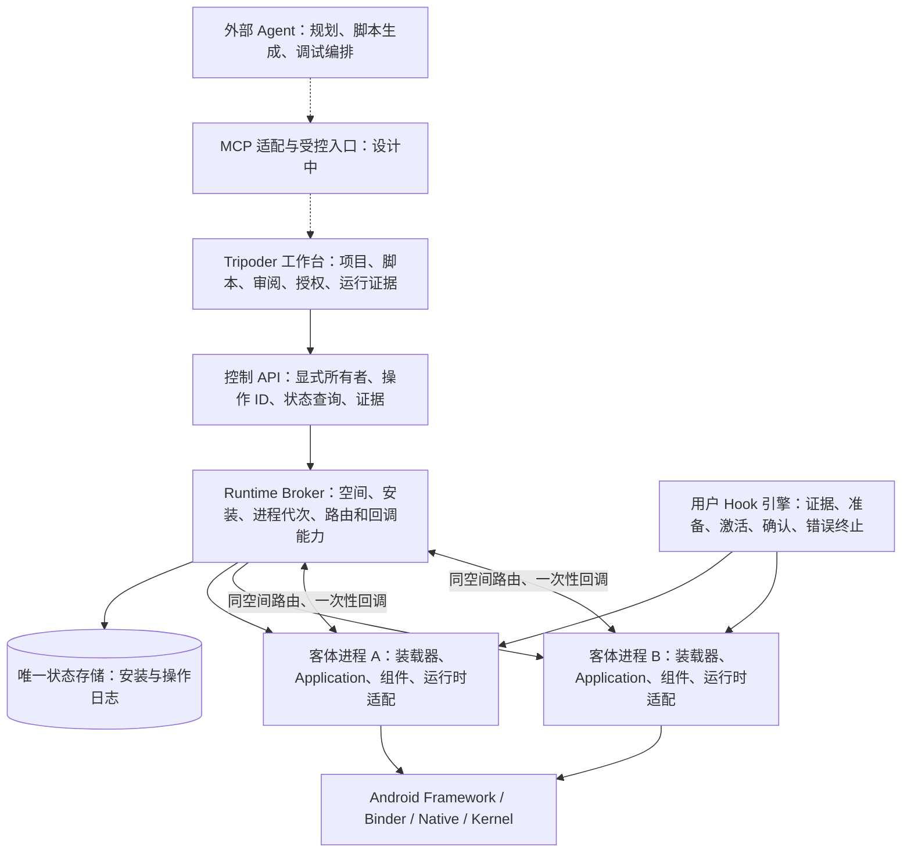

# Tripoder 独立研发架构

> 2026-10-18：本文讲设计动机与边界。**现在的进程、包和控制链路以 [current-architecture.md](current-architecture.md) 为准**。下文提到的"工作台独立 UID"已于 2026-10-17 取消。

2026-10-16 当前更新：RuntimeEngine 已以自研 Java/Native 核心同步完成 25 项启动计划后才开放客体；固定路由与用户脚本共用核心，Broker/审批/UNKNOWN仍由原权威管理。产品包不加载 Gadget。P0/包管理/P4 自有流程已通过，其余组件和正式控制验收仍在进行；当前机制见 [启动链](self-hook-runtime-bootstrap.md)，下方阶段基线按历史日期理解。

状态：2026-10-13 审查后的实施基线。当前工作台仍是实验产品；本轮先建立可复用 runtime 和独立验收入口，不迁移用户数据。本文取代旧文档中“完整 Android 虚拟机是唯一产品后端”的路线假设；QEMU 研究和历史证据保留。

2026-10-14 更新：独立 UID 工作台与引擎已经接通，项目人工 Hook 部署的自研应用闭环已通过，阶段范围见 [路线与证据](tripoder-roadmap.md)。用户提出由外部 Agent 提供 AI，内置模型接入暂缓；新增 [外部 Agent 控制候选设计](external-agent-control-design.md)，其传输/工具尚未实现。

## 目标与不可越过的边界

第一性原理：让未修改的 APK 在 Tripoder 管理的应用空间内执行，需要重新建立安装、进程、组件、文件和授权的运行语义。Hook 是实现机制和用户功能之一，不是架构中心，也不能替代身份、生命周期或事务。

目标是应用虚拟化，不重新实现 Android 内核。宿主零 Root、零 ADB 激活。ADB 仅用于研发时安装测试包、启动测试和收集证据，运行过程不能调用 shell 服务、授权隐藏权限或依赖调试器。

**同 UID 边界是硬限制。** 独立进程、虚拟 UID、Context 包装、路径重定向、Binder nonce 都不是针对任意恶意 Native 代码的内核隔离。运行器与客体同 UID 时，不能承诺引擎内的密钥保密；可信工作台已分离 UID，配对凭据和项目源码留在工作台，模型凭据按外部 Agent 方向留在外部助手。不能以 Keystore 加密、独立目录或非导出 Service 替代 UID 分离。工作台与引擎 UID 分离不证明引擎中客体之间的恶意代码隔离。

2026-10-17 起，工作台与引擎合并为同一 APK、同一 UID。工作台私有数据（配对凭据、项目源码）对客体不再受保护，这是用户为体验做出的明确取舍。上一段关于工作台 UID 分离的表述只适用于合并之前；关于同 UID 不是安全边界的判断不变。

独立研发：不读取、复制、改名移植 VirtualApp 实现；已有自研模块只有在来源清楚时复用。依据 Android 公共 API、系统行为与自有测试 APK 建立规范。依赖保留固定版本、来源、许可证和构建摘要；独立编码本身不是专利或商标清权结论。

## 架构

控制 Broker 是虚拟身份与状态的唯一权威；客体进程持有不可变身份及版本化策略快照。热路径不能每次经数据库/Binder。运行器必要拦截和用户 Hook 分开管理，关闭用户脚本不能关闭组件路由。

源码边界：`android/runtime` 保存生产可复用的契约、存储、装载和路由实现；`android/runtime-probe` 仅装配同一库和输出断言；自有 A/B APK 不引用 Tripoder SDK。主工作台以后调用同一 runtime，不能另写一套运行器。P0 只允许显式列出的 Android/ABI/组件能力；缺少能力立即拒绝，没有旧 GuestRuntime/GameRuntime、宿主同包应用、虚拟机或原函数 fallback。

## 对象与所有权

| 对象 | 稳定身份和职责 |
|---|---|
| Space | 安装命名空间、跨应用交互策略、数据生命周期；与项目分离 |
| AppInstall | `(spaceId, packageName, installGeneration)`；不可变 base/split 集合、签名、版本、ABI、组件与摘要 |
| ProcessSession | 安装代次 + 声明进程名 + 随机进程代次；PID/真实 UID/Binder 是连接证据，不是长期身份 |
| Project | 引用 Space/安装，保存脚本、配置、测试和证据；导航不拥有客体进程生命周期 |
| ControlLease | 当前控制者及 ownerGeneration；冲突拒绝，旧部署状态未知时禁止新部署 |
| Operation | 操作 ID + 完整请求摘要 + 调用者身份；终态可查询、不可因超时重放 |
| CallbackCapability | 绑定空间、双方安装/进程代次、操作、期限、次数的一次性能力 |

安装制品与运行数据分离；升级创建新代次，不原地覆盖正在使用的 APK/native 库。安装发布不能假装文件系统与 SQLite 是同一事务：先 staging 校验与同步，再发布不可变文件，最后提交记录；恢复清理孤儿，缺失/摘要不符的已登记安装进入损坏状态并拒绝运行。P1 安装层已实现完整集合验签与校验；执行层仍拒绝 split。文件与事务协议见 [P1 设计](runtime-p1-design.md)。

## 方案审查后补充的强制规则

1. Binder 入口先捕获真实调用 PID/UID；服务端注册记录决定身份，请求字段不能切换空间。绑定进程代次、连接死亡和 bootstrap 能力；同 UID 恶意代码仍不在安全保证内。
2. “已接收、已启动、Activity 已恢复、脚本已生效、场景通过”分别记录。超时/断连进入结果未知，查询后才能决定下一步，不自动重试副作用。
3. 回调只能消费一次；重放、过期、进程死亡、安装升级、错误空间及错误目标全部拒绝。
4. Activity 必须验证真实 Application、资源、Context、extras classloader、JNI、结果返回和重建；创建 Activity 对象不等于完整组件虚拟化。Provider 提前初始化、任务栈及 PendingIntent 是后续独立门槛。
5. Java Hook 失败抛出明确异常；Native ABI 不能可靠承载脚本异常，当前受控后端应终止客体进程，不能返回任意默认值或重放原函数。after 失败不撤销已经发生的原函数副作用。
6. 明确系统服务允许范围。缺少路由目标不能进入宿主同包应用；未支持的服务不因为“通常可用”而自动透传。
7. 自有 fixture 成功只能证明覆盖路径。对方 SDK、签名检查、反篡改、硬件服务、通知、权限、图形和游戏性能必须逐场景验收。

## 复用和重构

| 当前部分 | 决策 |
|---|---|
| `src/plan/evidence/parameters/draft` | 复用类型、证据匹配、AST 限制；改为失败即失败；扩展安装集合和进程代次在 P4 |
| 工作台项目/脚本/日志 UI | 复用用户功能；P5 统一控制路径，显式绑定 Space；AI 编排拟交给外部 Agent，内置模型接入暂缓 |
| GuestStore 的只读制品/摘要思想 | 复用规则；固定包名、单 so、项目当数据空间的实现重构 |
| GuestRuntime / GameRuntime | 冻结为旧实验入口；正式迁移后退出产品执行路由，不作为新 runtime 的恢复路径 |
| 旧 Gadget 实验代理 | 退出正式 Runtime 构建/加载；当前固定适配和用户 Java/Native Hook 使用同一自研核心，旧实验不作为恢复路径 |
| ComponentController、输入和文件工具 | 复用工作台能力；路由/文件授权由 runtime 提供，不由 UI 猜测 |
| QEMU/隔离探针及未提交研究 | 保留研究和证据，本应用虚拟化路线不调用它们 |

## P0 已实施边界（2026-10-14）

共享 runtime 已由独立薄验收应用验证：一台锁定固件的 Android 17 设备，两个自有签名 APK、真实 Application/Activity/资源/JNI、同空间 A→B→A、数据空间、重建/重启、失败关闭和未知结果协调。最终 **57 项真机断言通过**，详见 [审查和验收报告](evidence/runtime-p0-2026-10-13/README.md)。主工作台尚未接入。

P0 的 UI/OEM 服务及只读 Settings 是明确开放的宿主能力；Java 路径按空间组织，JNI 使用显式传入路径。它没有完整系统状态虚拟化、任意 Native 路径拦截或强隔离。P0 authority 重建测试本身不证明控制进程死亡恢复；P1 增加真实进程终止与数据库重开，仍未验证整机断电。实现与来源说明见 [runtime README](../android/runtime/README.md)。

阶段及验收见 [分阶段改造](tripoder-roadmap.md)，具体状态机见 [执行契约](execution-contract.md)。

## P1 实施边界

安装权威、不可变制品、持久会话、原子安装/升级/卸载回执、显式项目迁移和故障恢复已实现；具体门槛与结果见 [P1 设计](runtime-p1-design.md) 和 [验收证据](evidence/runtime-p1-2026-10-14/README.md)。旧工作台仅修正来源与 legacy 状态语义，完整接入属于 P5。通用组件、任意系统语义和四款产品场景仍未完成。
