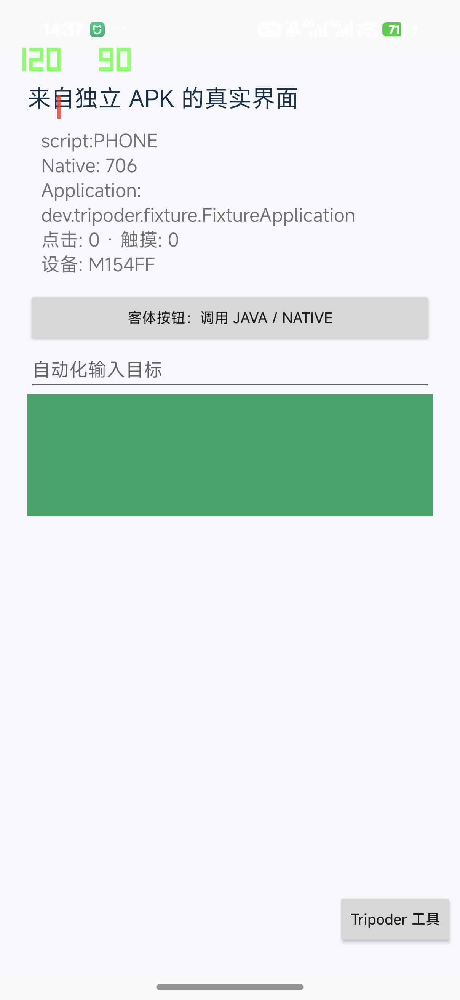

# Tripoder 0.3.0 真机验收

日期：2026-10-13。范围是独立构建的自有客体 APK，不是微信、钉钉、王者荣耀或原神。运行器仍限制客体摘要，不能安装任意 APK；四款应用的完整运行目标尚未完成。

## 实现范围

| 能力 | 本次实现 | 边界 |
|---|---|---|
| 手机编辑 Hook | 标准 TypeScript AST 解释、检查、热部署、上一版代码与参数回滚、草稿保存 | 支持受限语法子集；不是完整 TS 类型检查 |
| 真实 Hook | 固定 Java 方法、Native 导出函数；before／replace／after；错误回退与记录 | 未提供任意类／对象／指针／地址 Hook；并发卸载未验收 |
| AI | 可配置 Chat Completions、真实 DeepSeek 请求、检查后手动部署 | 当前仅能为已观察的两个自有函数生成方案 |
| 客体组件 | 独立 APK 的 Application、Activity、XML 资源、生命周期、OpenGL 绘制与回读 | 一个受控 Activity 槽位；系统身份仍是宿主 |
| 文件 | 客体数据目录 64 KiB 文本读写、穿越与符号链接拒绝 | 不是任意文件系统重定向或恶意同 UID 代码隔离 |
| 设备字段 | 客体进程 Java Build.MODEL／BRAND／MANUFACTURER，支持恢复 | 不修改 Native、内核或系统设备身份 |
| 自动化 | 当前客体窗口内资源名定位、点击、EditText 文本写入 | 无系统输入注入；暂停界面取消任务 |
| 手柄 | Android SOURCE_GAMEPAD 按钮 → 客体视图触摸映射 | 已测合成按键；实体手柄、摇杆、多点触控未测 |

## 设备与运行方式

Xiaomi M154FF，Android 17／API 37，ARM64。release 非 debuggable、普通应用 UID；客体进程与宿主 PID 不同但共享 UID。独立客体 APK 没有安装到系统，嵌入 APK 的字节与单独发布的 fixture 完全一致。0.3.0 仅申请 INTERNET 权限，用于 AI 请求；Gadget 通过离线脚本启动，没有外部监听服务。

ADB 用于开发安装、启动、截图和读取本应用的报告。离线验收在安排延迟自检后停止电脑 ADB 服务 40 秒，并持续检查本机 5037 端口无监听；核对手机自检的起止时间完全位于该区间。没有撤销手机保存的 USB 调试授权，也没有声称测试了物理拔线或另一台从未授权过的设备。

## 最终制品与结果

- [主 APK 0.3.0](../artifacts/tripoder-hook-lab-0.3.0-arm64.apk)：13,901,101 字节，SHA-256 `6634a6a75088ba85ec288b5736f457343fafba4a2f00a8d8f9d63de40c14011f`。
- [客体 fixture 1.1](../artifacts/tripoder-guest-fixture-1.1-arm64.apk)：2,423,120 字节，SHA-256 `f9718932fdbead5ce0158f4302b799a0e7869411d7a001a6ccbaac14618e5ed1`。
- [制品／签名证据](evidence/android-workbench-2026-10-13/v0.3-packaging.json)：仅 INTERNET 权限、APK v2 签名通过、内嵌客体字节完全一致。

| 检查 | 最终 APK 结果 | 证据 |
|---|---|---|
| SDK 与草稿解释器 | 35/35 | [测试输出](evidence/android-workbench-2026-10-13/sdk-v0.3.0-tests.txt) |
| 宿主 Hook 回归 | 25/25 | [JSON](evidence/android-workbench-2026-10-13/host-v0.3.0-connected-result.json) |
| 独立客体 Hook 与重启 | 两次各 31/31，PID／会话变更，数据保留 | [重启报告](evidence/android-workbench-2026-10-13/guest-v0.3.0-connected-restart-result.json) |
| 手机 TypeScript 与本地 HTTP 契约 | 24/24，全部在电脑 ADB 服务停止期间完成 | [报告](evidence/android-workbench-2026-10-13/workbench-v0.3.0-offline-result.json) · [时间核对](evidence/android-workbench-2026-10-13/workbench-v0.3.0-offline-host-verification.json) |
| 组件、图形、文件、环境、自动化与按键 | 18/18，全部在电脑 ADB 服务停止期间完成 | [报告](evidence/android-workbench-2026-10-13/component-v0.3.0-offline-result.json) · [时间核对](evidence/android-workbench-2026-10-13/component-v0.3.0-offline-host-verification.json) |

真实 DeepSeek `deepseek-flash` 已在最终 APK 上完成生成 → 检查 → 人工点击部署 → 真实调用 → 客体 Activity 显示。模型本次保留 `script:` 前缀并把入参转成大写，实际 Java 返回 `script:PHONE`，Native 返回 `706`；两类 Hook 均记录真实命中，Native 入口字节发生变化，错误列表为空。这次输出与示例模板相近，不能推断任意自然语言需求都会正确生成。

[真实 AI 报告](evidence/android-workbench-2026-10-13/live-ai-result.json) · [原始生成代码](evidence/android-workbench-2026-10-13/generated.hook.ts) · [界面与导航验收](evidence/android-workbench-2026-10-13/live-ai-ui-verification.json)。返回首页后正常进入客体页、再次打开真实界面，方案和客体 PID 均保留。取证结束后终止本应用进程以清除密钥页面内存，再打开工作台；保存的草稿可以重新部署，重启不会自动启用 Hook。源码、报告和 APK 均不含密钥。

## 修复的实际问题

- Android 17 优化路径导致 Java 原函数调用再次进入 Hook。对目标方法选择性 deopt 后，before／original／after 真机路径通过；没有全进程 deopt。
- 客体 getApplication 重定向后，后续生命周期事件转发到客体 Application；同步注册控制器，并在 post-created 添加工具，避免被 setContentView 覆盖。
- 资源名查找不能依赖合并资源表的 getIdentifier，输入工具改为匹配真实 View 树的资源名。
- ACTION_UP 会异步投递 performClick，输入自检等待下一轮主线程回调，再验证点击和 Hook 结果。
- 普通打开客体页面保留当前方案。只有显式自检才重置测试方案；工作台可直接打开应用了方案的客体界面。
- AI 输入区增加键盘 Insets 处理。手机中文九键输入法曾改写开发工具输入；英文输入并核对完整长度后，真实请求成功。这不是服务密钥无效。

## 四款应用的验收现状

| 应用 | 本机观察版本 | 在 Tripoder 中运行 | 开启 Hook 后完整功能验收 |
|---|---|---|---|
| 微信 | 8.0.79（3200） | 未实现 | 未验收 |
| 钉钉 | 未发现 com.alibaba.android.rimet | 未实现 | 未验收 |
| 王者荣耀 | 12.1.1.1（1201010103） | 未实现 | 未验收 |
| 原神 | 未发现 com.miHoYo.Yuanshen／com.miHoYo.GenshinImpact | 未实现 | 未验收 |

这里只读取了安装元数据，没有测试这些应用的账号、聊天、登录、支付或游戏流程。自有 fixture 的 OpenGL 与 Hook 成功不能证明商业游戏兼容、帧率、耗电或账号安全。

## 仍需完成

普通应用 UID 无法直接改写系统中其他 UID 的进程。要实现目标，必须让 APK 在自管容器内执行，并提供它所依赖的 Android 组件、资源和系统服务语义。当前缺失通用 PackageManager／Activity／Service／Provider 路由、权限与通知、Split APK、多进程、完整 Context／文件路径与 Native 加载兼容；不是再增加几个 Hook 就能补齐。

接下来的关键验收是通用引擎和四应用真实功能流程。还需补齐通用目标发现／ABI、脚本并发与失控恢复、实体手柄和长期性能测试。所有缺口均未按“完成”统计。

构建和复现命令见 [Android README](../android/README.md)，AI 的字段、请求与执行边界见 [AI 工作流](ai-workflow.md)。
